# Agentic Frontend Development: From Generation to Taste to Verification

Last updated: 2026-11-10

> *Frontend is WAY harder for AI than backend. That's because it's flying blind.*
> — Matt Pocock, January 2026

On backend work, a coding agent behaves like a dependable engineer. On frontend work, it behaves like someone editing CSS with their eyes closed. The model can write frontend code. The trouble is that the frontend lacks what the backend has by default: **a signal a machine can use to decide right from wrong.**

Over the past two years the bottleneck in AI frontend tooling has moved three times. **First the question was whether a page could be generated at all. Then it was whether the result looked good. Now it is whether the result is right.** Google, OpenAI and Anthropic answered these questions differently, and a community Skill ecosystem grew in between. Knowing how those routes differ is the best way to decide what to do today.

The chapter reduces to one sentence: **whatever the agent cannot judge, engineer into something it can judge; what is left for humans is aesthetic judgment.**

| Section | Question it answers |
| --- | --- |
| Why frontend is harder | Why the backend is "easy" and what the frontend is missing |
| Three bottleneck shifts | Generation → taste → verification: what each stage solved and what it exposed |
| Three routes | Where Google, OpenAI and Anthropic put taste and verification, and why they converge |
| Practice 1: narrow the generation space | Demote aesthetic questions to structural ones |
| Practice 2: write taste down | DESIGN.md, design Skills, three-layer briefs, variants |
| Practice 3: the verification ladder | The cheapest ruler that catches each problem |
| Practice 4: tune autonomy | Small steps; humans stand only on the taste rung |
| Worked example and anti-patterns | A SaaS admin "Members" page end to end; common failures |

---

## Why Frontend Is Harder for Agents

### Why the backend is "easy"

Backend tasks are **typed, testable and precisely specifiable**. A function signature, a test suite and an API document form an unambiguous target. In the terminal, the agent runs code, reads compiler errors, runs tests and iterates on failures. Every change yields an objective signal.

This is also why agent benchmarks such as SWE-bench are almost entirely backend tasks. The industry is not biased; that is simply where "right" and "wrong" are well defined.

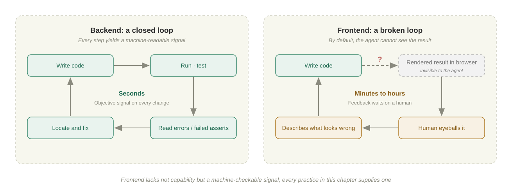

### Four structural gaps

| Gap | What it looks like | Why types and tests don't cover it |
| --- | --- | --- |
| **Visual correctness** | "Does this layout look right?" requires rendering and eyes | The terminal has code, not pixels |
| **Context dependence** | A rule is perfect at 1440px and broken at 375px; another browser or parent component changes it again | Code is static; the result is code × viewport × composition |
| **Broken feedback loop** | Backends ship with a test runner; frontends ship with nothing | The agent writes a pile of code, then waits for a human to eyeball it |
| **Too many constraint dimensions** | DOM structure, component state, accessibility, breakpoints, design consistency | Only a few of these are captured by the type system |

On top of these four gaps sits a fifth problem: **aesthetic convergence.** Without guidance, a model returns the mean of its training distribution. Anthropic calls the result **AI slop aesthetics**: Inter, purple gradients on white, three cards in a row. Nothing about it is wrong. It is just average, and average is exactly where users first notice that "an AI made this."

### An important boundary

"Frontend is harder" is easy to misread as "frontend is a bad fit for AI." The precise claim is narrower: **the visual layer of the frontend is the part you cannot hand off.**

A frontend codebase contains plenty of backend-like code: data fetching, state machines, form validation, routing, types. Agents stay reliable there because types and tests hold. The real difficulty is concentrated in a narrow band: rendering and taste. Every practice in this chapter is, at bottom, a way to **make that band narrower**.

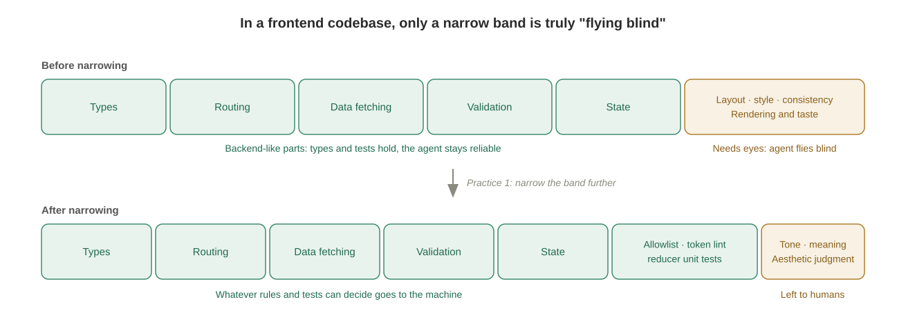

---

## Three Bottleneck Shifts

### Prologue: generation stopped being the problem (before 2024)

pix2code turned screenshots into code with a neural network in 2017. In 2023 the GPT-4 launch turned a hand sketch into a web page, Vercel v0 generated React components from a sentence, and a wave of screenshot-to-code projects followed. That era proved one thing: **models can write pages.**

In May 2024, **GPT-4o** brought native multimodality into the mainstream, and screenshots, sketches and mockups became everyday inputs. From then on, generation was no longer the bottleneck. The real problems surfaced: everyone's generated pages looked alike, and nobody knew whether they actually worked in a browser.

### First shift: from generation to taste

Once generation became cheap, competition moved from "can it be built" to "does it look good." In 2025 all three vendors sold **taste** as a frontend capability:

- **2025-05**: Google released the Gemini 2.5 Pro "I/O edition," which topped WebDev Arena (a leaderboard scored by human preference) and demoed turning a YouTube video into an interactive learning app. The same month it launched **Stitch**, which generates UI designs and frontend code from text or images.
- **2025-08**: OpenAI released GPT-5 with an explicit frontend pitch: preferred over o3 70% of the time in internal tests, with "a better understanding of spacing, typography and white space."
- **2025-11**: Anthropic published the **`frontend-design` Skill** and the article *Improving frontend design through Skills*, the first time "how to escape the AI look" was written down as installable text.

The problem with taste is that it does not generalize to a specific product. However good a model's eye, it does not know what **your** product should look like. So the carrier of taste began moving from model weights into **files**: in March 2026 Google Stitch introduced **DESIGN.md**, and in April it open-sourced it as a cross-tool spec.

### Second shift: from taste to verification

Pretty is not the same as correct. A beautiful page whose dialog won't open, whose layout breaks on narrow screens and whose loading state hangs is worse than an ugly page that works.

From the second half of 2025, all three put **a browser inside the agent loop**:

- GPT-5-Codex could inspect screenshots of the UI it built (2025-09).
- Chrome DevTools MCP let agents read the DOM, console and performance traces (2025-09).
- Google Antigravity's browser subagent clicked through flows itself and recorded them (2025-11).
- Claude Code integrated Claude in Chrome: "build in the terminal, verify in the browser" (2025-12).

The method took shape alongside. Matt Pocock gave the diagnosis in January 2026 ("flying blind") and the prescriptions over the following months: a TDD Skill, a prototype Skill, and pulling logic out of the UI into reducers and state machines. In November came his "prompt of the day":

> How do we make this change fully verifiable?

| Stage | Solved | Exposed | What it means for you |
| --- | --- | --- | --- |
| Generation | Zero to page | Sameness; unknown correctness | Stop spending effort on "can it be generated" |
| Taste | Escaping default aesthetics | Generic taste ≠ your product | Write your design language into files |
| Verification | Agents can check themselves | Browsers are slow, have blind spots, self-reports are unreliable | Build a verification ladder; humans judge only taste |

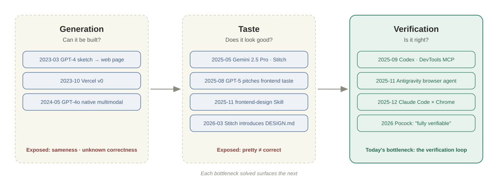

---

## Three Routes: Where Taste and Verification Live

Facing the same generation → taste → verification sequence, the three vendors placed very different bets. Two questions separate them best: **where does taste live, and where does verification live?**

### Google: enter from design, and chain Stitch to Antigravity

Google pushes three things together: **a multimodal model, a design tool and an open format**. It also owns something nobody else does: the Chrome browser. The clearest way to read its route is to follow how Stitch was wired into the development chain over a year and a half.

**Perception is the foundation.** Gemini has differentiated on multimodality, especially video understanding, from the start. The signature demo of 2.5 Pro I/O edition was "video → app." With Gemini 3 (2025-11) Google introduced **generative UI**: the Gemini app designs and codes a bespoke interface (a dynamic view) for a question on the spot, instead of returning only text. For Google, **an interface is one of the shapes model output can take**.

**Stitch grew from a design toy into the design entry point.** It evolved in four steps:

| When | What happened | Why it matters |
| --- | --- | --- |
| 2025-05 | Stitch launches: UI designs and frontend code from text or images, pasteable into Figma | Aimed at designers and PMs; it starts on the design side, not in the IDE |
| 2025-12 to 2026-02 | Stitch SDK, Stitch MCP and `stitch-skills` ship; Stitch appears in Antigravity's MCP store | Design becomes a tool agents can call: "generate screen" and "fetch screen" from inside Antigravity |
| 2026-03 | Redesigned as an infinite canvas ("vibe design"); **DESIGN.md** introduced | Design rules get a file that can be exported and imported |
| 2026-04 to 05 | DESIGN.md open-sourced as a spec (2026-04-21, with a linter and WCAG contrast checks); at I/O 2026, a real-time collaborative Stitch Agent, import of existing codebases and design files, and export to AI Studio, Antigravity and Netlify | The pipeline connects: design → contract → build |

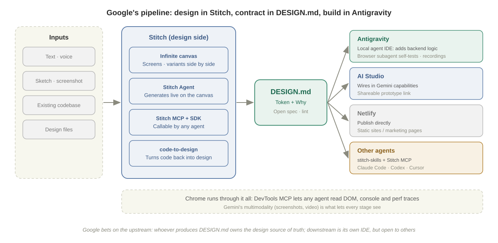

**Antigravity is the downstream of that pipeline.** Google launched it in 2025-11 as an agentic development platform with a built-in browser subagent. The subagent runs flows in an isolated Chrome and hands screenshots and recordings to humans as deliverables (Artifacts). Screens exported from Stitch land in Antigravity, the agent adds backend logic, then clicks through the result in the browser itself. Design, implementation and verification are all covered, and all three stages run in Google's own tools.

The surrounding products each fill a gap:

- **AI Studio** is the fastest route to a prototype. Export a Stitch design there, wire in Gemini capabilities, and get a clickable share link that needs no account.
- **Jules** is the asynchronous cloud agent: it clones the repo, runs tests and opens a PR, for work you don't need to watch.
- **Chrome DevTools MCP** (2025-09) opens DevTools to **any** agent, which can read the DOM, console and performance traces.

**Openness is the other half of the route.** The `stitch-skills` install guide lists Codex, Claude Code and Cursor ahead of Antigravity. It also ships reverse Skills: `code-to-design` turns existing frontend code back into a Stitch design, and `extract-design-md` pulls a DESIGN.md straight out of source. Google does not require its IDE. It wants the upstream position: **if the design language is a file any agent can read, the tool that produces that file becomes the design source of truth.**

**In one line: Google puts taste in the Stitch canvas and DESIGN.md, and verification in Chrome.** Its own Antigravity is the smoothest downstream, but DESIGN.md and Stitch MCP are equally available to other agents.

### OpenAI: taste trained into the model, the ecosystem pulled into Codex plugins

OpenAI's route is a **platform** play. The model should have taste, Codex should be able to see, and rather than define a design format, OpenAI plugs everyone's design tools into Codex.

**Step one: taste internalized in the model.** GPT-5 (2025-08) marketed frontend aesthetics as a model capability: spacing, typography, white space. The implication is that taste is first a **training problem** and only second a context problem. *Designing delightful frontends with GPT-5.4* (2026-03) is the companion manual, with three main points:

- Set constraints up front: by default at most two typefaces and one accent color.
- Provide reference images or a mood board, and give the model Playwright to check its own work.
- **Start frontend tasks at low reasoning effort**: low or medium reasoning often produces better frontends.

**Step two: verification moves into Codex.** GPT-5-Codex (2025-09) inspects screenshots while doing frontend work, checks its own progress and attaches UI screenshots for your review. In 2026-04 the Codex desktop app added an in-app browser and **comment mode**: you click an element on the rendered page and write a note, and the agent receives both the screenshot and the matching DOM node. Humans intervene by "pointing at the page" instead of writing a spec file first.

**Step three: a plugin marketplace pulls the ecosystem in.** On 2026-03-27 Codex launched a plugin marketplace. A **plugin** bundles Skills, app connectors and MCP servers into one install, from the official directory or from repo-level or personal marketplaces. Frontend-related plugins fall into two groups:

| Group | Plugin | What it does |
| --- | --- | --- |
| Design sources (third party) | Figma | Turns Figma frames into code, builds Code Connect mappings, generates design-system rules for the project, and can write UI back to the canvas |
| | Stitch | Google's `stitch-skills` repo documents installing it as a Codex plugin marketplace |
| | Canva, MagicPath, Lovable and others | Assets, component libraries, app generators |
| Workflows (official) | Build Web Apps | Frontend from concept to implementation, plus best-practice Skills for React, shadcn/ui, Stripe and Supabase |
| | Product Design | Ideating directions, URL or screenshot to code, design QA |
| | Build Web Data Visualization | Charts, dashboards, visual reports |

The earlier standalone `frontend-skill` has since been folded into the Build Web Apps plugin. The Skill most worth reading there is `frontend-app-builder`, which embodies OpenAI's answer to frontend taste: **the concept image is the spec.**

1. Generate a high-resolution concept image with Image Gen for each major section. Once a human approves it, the image is the "production design spec," and the implementation may not take creative liberties.
2. Before coding, extract a small design system from the image: tokens, type scale, component families and container rules.
3. Build section by section, screenshot each section in the in-app browser and compare it with the concept.
4. Before handoff, view the concept and the latest screenshot side by side and write a **mismatch ledger** (what differs, the evidence, whether it was fixed), until "a great design agency would sign off."

One line in the Skill captures the idea:

> Functional QA does not count as fidelity QA.

Clicking through and building cleanly are not enough; the comparison has to be done item by item. This is a different move from Anthropic's "list the convergent defaults." OpenAI uses image generation to **freeze taste into a picture** first, which turns implementation into a fidelity problem that can be checked by comparison.

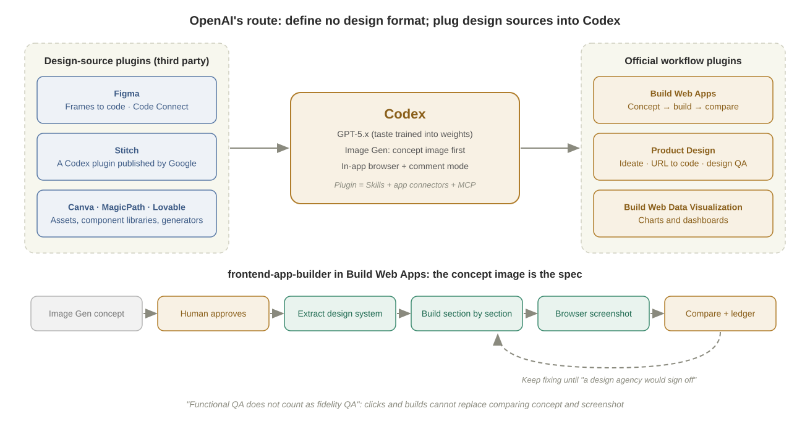

**In one line: OpenAI puts taste in model weights and generated concept images, and verification in the Codex in-app browser and image comparison.** On the ecosystem side it does not compete with Google over a design format; it lets Figma, Stitch and Canva plug into Codex.

### Anthropic: taste as composable text, verification in the harness

Anthropic's route is **harness-first**. The model is a general agent, and frontend ability is injected through extensions you can install, read and modify.

1. **Taste is a Skill.** The method of `frontend-design` has three steps: **identify the model's convergent defaults → provide concrete alternatives → pitch guidance at the right altitude**. It loads on demand and stays out of unrelated tasks. It is Markdown anyone can read, fork and rewrite. It was substantially rewritten in 2026 to name newer AI tells and add a plan → review → build → critique flow. **Taste is a growing list of tells and alternatives, not the result of one training run.**
2. **Verification is a harness capability.** Claude Code connects to Playwright or DevTools via MCP, and since 2025-12 integrates Claude in Chrome directly: reading console errors, network requests and DOM state, and checking pages against designs.
3. **Filling in the design side.** In 2026-04 Anthropic launched **Claude Design** (an Anthropic Labs research preview). It reads the codebase and design files to build a team's design system, iterates on a canvas, then packages the result for Claude Code to implement. It is Anthropic's first entry from the design side, but the endpoint is still the harness.

**In one line: Anthropic puts taste in Skill text and verification in the Claude Code harness.** The direct consequence is an explosion of community work.

### The community: a Skill ecosystem between the three routes

Because Skills are plain text in an open format, the community filled every layer between late 2025 and 2026. Grouped by **what each mainly produces**, there are six layers:

| Layer | Question it answers | Examples |
| --- | --- | --- |
| ① Taste / judgment | Should we go this way? Veto mediocre output | `frontend-design`, Taste, Refactoring UI |
| ② Design knowledge | What are the sensible options? | UI UX Pro Max (database of styles, palettes, font pairings) |
| ③ Design method | How do we get from a direction to a system? | Impeccable (audit / polish / extract), Interface Design (product UI only, with design memory), StyleSeed, Hallmark |
| ④ Templates and references | Can we reuse an existing design system? | awesome-design-md, Awesome Design Skills (DESIGN.md + SKILL.md pairs) |
| ⑤ Design context | How do decisions persist across sessions? | The DESIGN.md spec, Oh My Design, BrandMD / DesignPull for extracting DESIGN.md from websites |
| ⑥ Production surface | How do we produce prototypes, demos and slides? | Huashu Design, Open Design, Stitch Skills |

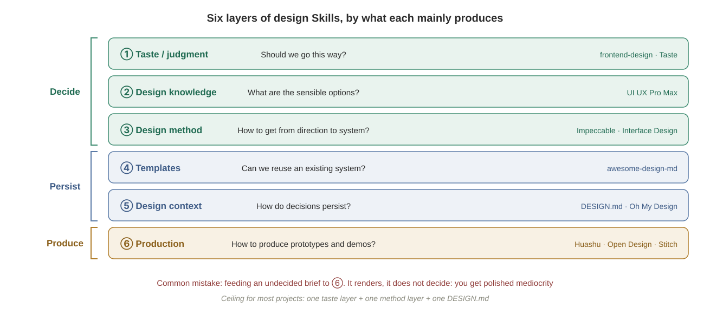

The most common mistake is to treat them as interchangeable: reaching for a polishing tool when you need a direction, or a knowledge base when you need persistence. **Layer ⑥ renders; it does not decide. Feed an undecided brief to a layer-⑥ tool and you get polished mediocrity.**

The split matches Awesome Design Skills' pairing: **DESIGN.md answers "what should it look like"; SKILL.md answers "how should the agent work."**

### Comparison: different roads, same destination

| | Google | OpenAI | Anthropic |
| --- | --- | --- | --- |
| Entry point | Design side (Stitch → Antigravity pipeline) | Model capability + Codex plugin marketplace | Agent harness (Claude Code) |
| Where taste lives | Stitch canvas + DESIGN.md | Model weights + Image Gen concept as spec | Skill text + community ecosystem |
| Where verification lives | Chrome (Antigravity browser subagent, DevTools MCP) | Codex in-app browser + concept-vs-screenshot comparison | Harness (Chrome integration, MCP) |
| Where humans step in | Design canvas, reviewing recordings | Approving concepts, commenting on the rendered page | Editing Skills / design system, reviewing evidence |
| Ecosystem strategy | Define the open format; host the producer | No format; plug design sources in | Open extensions you can fork |

The three routes start in different places, yet by 2026 they converge on the same triad:

1. **Written design context** (DESIGN.md, a design system, Skills);
2. **A model that can see images**;
3. **A browser in the loop.**

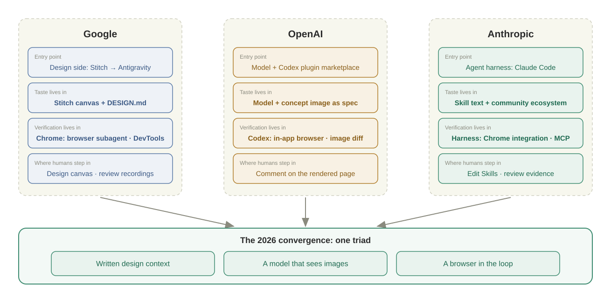

The convergence is the most important conclusion: **whichever vendor's tools you use, high-quality agentic frontend work needs you to supply these three things.** The practices below are therefore tool-agnostic.

---

## Practice 1: Narrow the Generation Space

"Does this page look right?" is a subjective question the agent cannot answer. "Does this page use only allowed components and tokens?" is a structural question a script can answer. **The highest-leverage move is to convert as much of the first kind into the second kind as possible.**

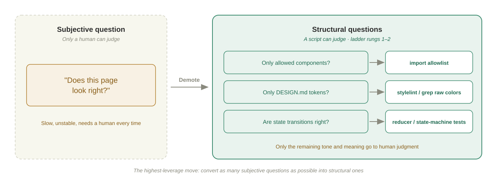

### Components first

Build the shared components first, so that feature pages become configuration: fields, filters, action buttons, bound endpoints. The agent's room for improvisation on a feature page shrinks to little more than data.

Take a typical SaaS admin console on React + TypeScript + shadcn/ui; the same reasoning holds for Vue or any other component library. Most admin pages are "list + dialog form + CRUD," so one prompt generates five shared pieces:

| Component | Interface | Responsibility |
| --- | --- | --- |
| `DataTable.tsx` | Props: `columns`, `fetcher`, pagination flag; exposes `refresh()` | Manages loading, pagination params and requests |
| `FormDialog.tsx` | Props: `title`, `width`, `schema`; `open` controls visibility; `openWith(data?)`; callback `onSubmit` | With data it edits; without data it creates |
| `useConfirm.ts` | Takes confirmation copy and an API call | One line for "confirm delete → call API → show success" |
| `useRequest.ts` | Takes an API call; returns `{ data, loading, error, execute }` | Manages the three request states |
| `notify.ts` | Exports `notifySuccess` / `notifyError` / `notifyWarning` | Uniform notifications |

**Describe the interfaces and behavior clearly, let the agent generate them in one go, and spend your effort verifying that they are pleasant to use.** After that, each new module mostly swaps data sources: members, API keys and billing history are the same components with different columns and endpoints. Moving to the real backend means replacing mock data with API calls.

### Write it as checkable rules

A component library matters only if its use is enforced. Put it in `CLAUDE.md` / `AGENTS.md`, and hand as much as possible to lint:

```text
- Pages may use only components from src/components and shadcn/ui.
  If no suitable component exists, do not build one; stop and list the gap for me to decide.
- Colors, radii and spacing must come from DESIGN.md tokens (CSS variables).
  No raw hex values, no magic px numbers.
- Never use native alert / confirm; use useConfirm and notify.
```

The second rule can be checked with a stylelint rule or a grep script; the first with an import allowlist. Once a rule is a script, "consistent style" stops needing human eyes and gets caught on the first rung of the verification ladder.

### Pull logic out of the UI

Make the backend-like parts of frontend code truly backend-like. A dialog with five states (create, edit, validation failed, submitting, submitted) whose state is scattered across component state hooks and event handlers can only be verified by clicking every path in a browser.

Following Pocock, write state transitions as a **reducer or state machine**: take the current state and an action, return the new state, never touch the DOM. The UI only renders state and dispatches actions; it stays "dumb."

```text
Extract this dialog's state logic into a pure reducer (dialogReducer.ts, no React or DOM imports).
States must include at least closed / creating / editing / submitting / error.
First write a unit test for every transition (including: double-click while submitting,
editing again after a failed submit, resetting the form on close).
Only after the tests pass, change the component to just call the reducer.
```

Pocock's experience is that robustness jumps every time an agent writes a state machine or reducer. The reason is simple: most of "is it right?" falls out of the browser and back into unit tests.

---

## Practice 2: Write Taste Down

Once the space is narrowed, what remains is genuinely aesthetic. The principle: **don't let the model guess, and don't make it derive your brand from first principles every time.**

### Set direction in consultation mode

"Design me a nice-looking interface" yields the distribution mean. Before any code, make the agent a design consultant and give it layered inputs:

| Dimension | Example answer (admin console for a team-collaboration SaaS) |
| --- | --- |
| What the product is | Admin console for a collaboration tool: members, permissions, billing, API keys |
| Who the users are | Team admins who visit a few times a week and want to finish tasks fast |
| Desired style | Light background, medium density, restrained, a touch of tech |
| Color preference | Blue-violet primary; cyan or mint secondary |
| Reference anchors | The visual style of Linear and Supabase |

```text
Don't write code yet. You are this product's designer.
Product: the admin console of a team-collaboration tool (members, permissions, billing, API keys);
users are team admins.
Style: light background, clean, restrained, with subtle tech accents.
Colors: blue-violet primary; cyan or mint secondary.
References: the visual style of Linear and Supabase.
Output a complete design system as CSS variables: primary / secondary / background scale /
text scale / radii / shadows / transitions, with a one-line reason for each group.
```

**The reference anchor carries the most information.** "Like Linear" conveys a whole set of conventions about spacing, weight and restraint. OpenAI's guide gives the same advice: provide reference images or a mood board, and tighten constraints from the start (at most two typefaces, one accent color).

Review the result for tone: is it garish, does it feel right? Leave contrast to the linter rather than haggling over individual values.

### Persist it as DESIGN.md

A design system cannot live in one conversation. Write it into a `DESIGN.md` at the repo root, following Google's open spec. (Step two of the Chinese-only [spec coding chapter](../../zh-cn/03-power-user/spec-coding.md) calls this file `DESIGN_STANDARDS.md`.)

- **Tokens go in YAML front matter**: exact values for colors, typography, radii and spacing, implemented in code as CSS variables.
- **Reasons go in the Markdown body**: why the sidebar is near-black but not pure black; why "deactivated" is not red.

The spec's own summary is the best one:

> Tokens give agents exact values. Prose tells them why.

This matches the conclusion of the [repo memory chapter](repo-memory.md): exact values belong in checkable structure, and handwritten prose keeps only the why. Leave out component implementation steps and per-page styles; they go stale quickly.

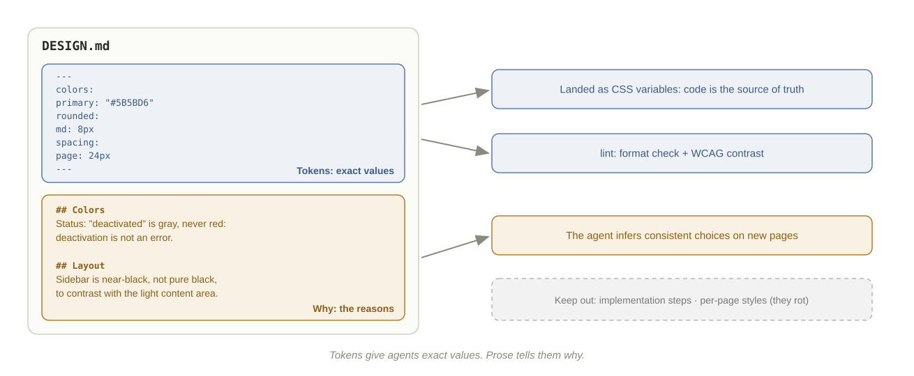

There are three starting points. **From scratch**, use the consultation prompt above. **From a reference site**, use an extraction tool: BrandMD leans toward deterministic token extraction, DesignPull uses a vision model to extract intent. **For a mature brand style**, start from an entry in awesome-design-md. Whichever you pick, finish with `npx @google/design.md lint`.

### Choose design Skills: compose by layer, DESIGN.md wins

| | Design Skill | DESIGN.md |
| --- | --- | --- |
| Answers | How not to look AI-made; how to run a design process | What this product looks like |
| Scope | Cross-project, general | One product |
| Loading | Triggered on demand | Always read when touching UI |
| On conflict | Yields | Wins |

Pick layers by task instead of installing a pile:

| Scenario | Combination |
| --- | --- |
| 0→1 admin / SaaS / agent console | A product-UI method (e.g. Interface Design) + a design knowledge base for palettes and charts + DESIGN.md |
| 0→1 landing page / marketing site | Taste layer (`frontend-design` for direction, Taste to veto mediocrity) + a method layer to build |
| Existing UI is ugly | Impeccable audit → Refactoring UI for hierarchy and spacing → polish |
| From 80 to 95 | Optical-detail and motion polishing Skills |

The more you install, the more style instructions compete. **One taste layer + one method layer + one DESIGN.md** is the ceiling for most projects.

### Structure → behavior → detail

Taste is more than color. When describing a complex page to an agent, go **structure → behavior → detail**. Out of order, you rework: describe interaction details before the structure is agreed, and the agent will polish details on the wrong layout.

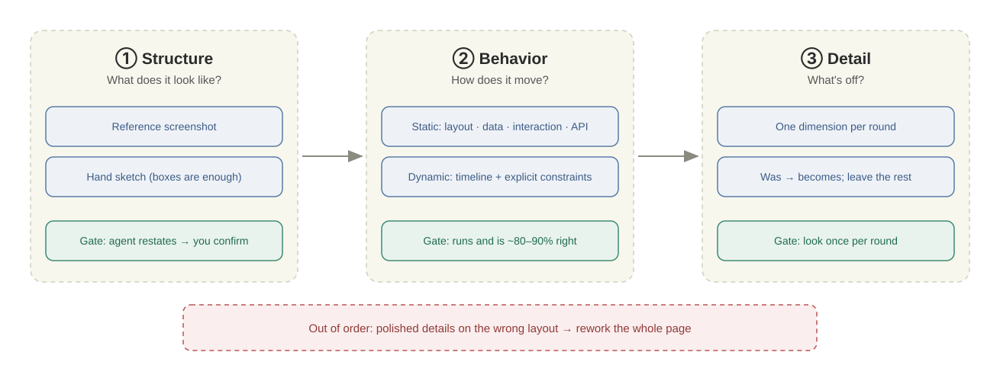

**Structure: agree on "what it looks like" first.** Provide a screenshot of a mature product or a hand sketch (labeled boxes are enough). Then **have the agent restate the structure in words, and confirm before it builds**.

**Behavior: describe by interaction type.**

- **Static (discrete) interactions use four dimensions**: layout (how elements are arranged), data (which fields, how states are distinguished), interaction (the full flow of each action), API (which endpoint each action calls).
- **Dynamic (continuous) interactions use a timeline**: 1 → 2 → 3, each step stating its trigger and the page's response, with **technical constraints made explicit**. These are the details the agent won't know unless told, and handles well once told:

```text
1. User presses Enter: clear and disable the input; append the user message and a "thinking" placeholder.
2. Start a streaming request with POST (SSE over POST can't use EventSource; use fetch + ReadableStream).
3. Append each chunk to the placeholder and render Markdown incrementally;
   auto-scroll only if the user was already at the bottom; don't fight a user who scrolled up.
4. Re-enable input when the stream ends; on error, show retry under that message, not a global error.
```

**Detail: adjust incrementally.** A first run is usually 80–90% right. For the rest, change one dimension per round, state "was → becomes," and leave everything else alone (see the worked example below).

### Visual direction: choose among genuinely different options

Asking the agent to "try another style" usually yields the same layout in different colors. Pocock's `/prototype` approach splits the work: **the AI constructs options; the human makes the aesthetic call.**

```text
On a throwaway route /prototype/members, build three switchable versions (?variant=a|b|c).
They must differ in structure (e.g. table / card grid / split view), not just color.
Render all of them with real data at real volume. Once I pick one, wire it into the main flow.
```

Two hard requirements: **structural divergence** and **real data at real density**. Variants reviewed on an empty page always look fine. After choosing, write the reason back to DESIGN.md.

---

## Practice 3: The Verification Ladder

After narrowing and writing things down, what remains of "is it right?" goes to verification. There is one principle: **every problem has a cheapest ruler; push it down to the lowest rung that catches it.**

| Rung | Ruler | Catches | Speed |
| --- | --- | --- | --- |
| 1 | **Type check + lint** (including token / component-allowlist rules) | Misspelled fields, prop mismatches, raw colors, off-list components | Seconds |
| 2 | **Pure-logic unit tests** (reducers, state machines, hooks) | State transitions, edge cases, error branches | Seconds |
| 3 | **Component tests / Stories** | One component's rendering and interaction across props and states | Tens of seconds |
| 4 | **Browser verification** (snapshots, clicks, breakpoints) | Page-level integration: routing, dialogs, API wiring, responsiveness | Minutes |
| 5 | **Visual regression** (screenshot diff) | "You changed something you shouldn't have" | Minutes |
| 6 | **Human aesthetic judgment** | Does it look good, is the tone right, does it mean the right thing | Up to you |

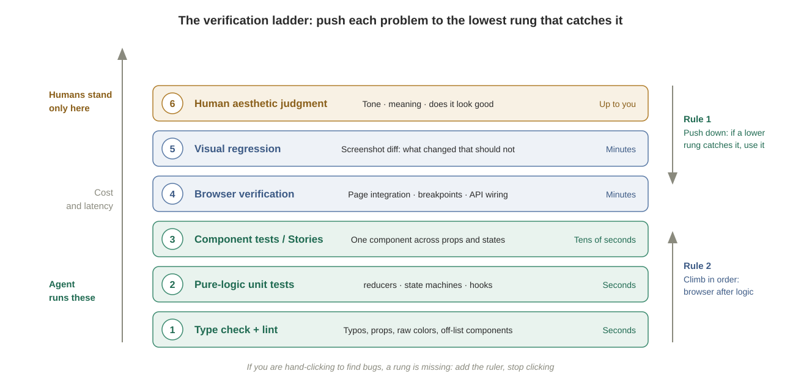

### Rule 1: push down

If rung 2 can catch a bug, don't wait for rung 4. This is why Practice 1 pulls logic out of the UI and turns style into lint rules: **only what has been pulled out can fall to a lower rung.**

### Rule 2: climb in order

Write browser tests after behavior works. Pocock's `/tdd` Skill records a real case: the agent wrote Playwright tests first and then reran them in a long loop, because "browser tests are slow enough that the red-green loop stops paying off." Put "write browser tests only after behavior works" in `CLAUDE.md`. Likewise, aesthetic review comes after functional acceptance; discussing colors on a page that throws errors is wasted effort.

### Rule 3: browser verification must cover context dependence

The value of rung 4 is precisely that it fills the second gap. Have the agent walk the key flows at no fewer than three viewports (say 375 / 768 / 1440), not just glance at the default window.

For end-to-end acceptance, push one record through the whole chain:

- **Standard cases**: create → read → update → delete; special actions (resend invitation, bulk import) verified end to end.
- **Three kinds of scenario**: the happy path; error flows (friendly messages, no raw stack traces); edge cases (no data, insufficient permission, timeouts).

### Rule 4: visual regression instead of repeated eyeballing

Rung 5 turns "did it change?" into an automatically decided pixel diff: Playwright's `toHaveScreenshot`, or services such as Chromatic and Percy. A human approves the baseline once; after that, every UI change the agent makes gets a machine signal instead of needing your eyes again.

Once a team has visual regression, the "flying blind" gap is largely closed. Stacking manual approval gates on top only adds friction without reducing risk. **The value of engineering here is restoring missing feedback, not restricting the agent indiscriminately.**

### Rule 5: review evidence, not self-reports

An agent saying "verified" does not count. Three real blind spots:

- In Anthropic's long-running agent experiments, **native browser alerts were invisible to the agent**, and features that relied on them had more bugs.
- A practitioner reported that an Antigravity "success" demo recording actually showed a row of Suspense loading spinners.
- Simon Willison found agents sometimes edit the demo record file directly instead of actually running the tool.

So make verification leave reviewable evidence (snapshots, screenshots, assertion logs), and scrutinize the evidence itself. Does the screenshot show the fully loaded state? Does the assertion actually check what you care about?

### One prompt

Put this at the start of every frontend task:

```text
How do we make this change fully verifiable?
(Before building, list which rungs of the ladder you'll use, what each verifies,
and what evidence each will leave.)
```

It pushes the agent to add rulers itself: unit tests for the reducer, starting the dev server, walking the flow in the browser, rather than reporting done as soon as the code is written. The precondition is that `CLAUDE.md` already documents how to start the dev server, its port and a test account.

---

## Practice 4: Tune Autonomy

Backend tasks can run as "one sentence in, twenty minutes of agent work, you review." Visual work cannot. Pocock returns to one image again and again: by default the agent is **outrunning its headlights**. The speed of feedback caps how fast you can safely go.

The frontend rhythm should be:

```text
Plan or draft → human confirms structure → small step → automated checks (rungs 1–5)
→ human judges taste → write back to DESIGN.md
```

Autonomy follows verification coverage:

| Verification coverage for this area | Appropriate autonomy |
| --- | --- |
| Types, unit tests, browser cases, visual regression | Can run long and unattended |
| Unit tests and browser cases, no visual regression | Small commits; check a screenshot each step |
| Type checks only | Add rulers first, then let go |
| Pure visual exploration (new page direction) | Variants + human picks; don't aim for right the first time |

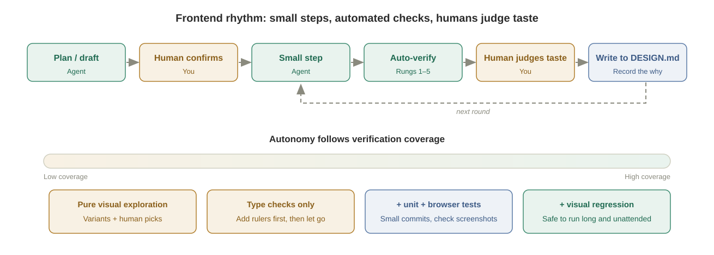

---

## Worked Example: A "Members" Page from "Works" to "Looks Good"

Almost every SaaS admin console has a members page: list the team, invite people, change roles, deactivate and remove. It is ordinary enough to string the practices above together.

1. **Set the design direction**: the consultation prompt yields a blue-violet, light-background design system, implemented as CSS variables and written into DESIGN.md.
2. **Build the shell first**: the sidebar is what users see first, so changes there pay off most visibly. Dark background, near-black but not pure black; menu items in white on a transparent background, slightly brighter on hover, with a 3px primary-color bar on the left for the selected item; an icon per item; a collapse button and version number at the bottom. A touch of tech is fine, but not so flashy that it gets in the way.
3. **Unify the layout**: breadcrumbs on the left of the top bar, user info on the right; light-gray content area with white cards, soft shadows and rounded corners; each page opens with "title + description + actions on the right"; spacing fixed at 24px page, 20px card, 16px between elements; primary buttons in the primary color, secondary buttons white with a border, destructive actions in red.
4. **Components first**: one prompt generates the five shared pieces (see Practice 1).
5. **Pull state out**: the "Invite member" dialog's state becomes a reducer with passing unit tests first (see Practice 1).
6. **Generate the members page** with mock data, then run five rounds of "look → say → change," one dimension per round:

| Round | Dimension | Was → becomes | Ladder rung |
| --- | --- | --- | --- |
| 1 | Layout | Gap between table and header 24px → 16px; row height 52px; 8px between action buttons | 6 (human), then into the visual regression baseline |
| 2 | Color | Status badges: active green, invitation pending blue, deactivated gray, **never red**, because deactivation is not an error | 6 (human), reason written back to DESIGN.md |
| 3 | Invite dialog | Width 600 → 520px; example placeholder in the email field; a one-line permission summary per role in the role dropdown; labels at a fixed width, right-aligned | 3 (component) + 6 |
| 4 | Responsive | Sidebar auto-collapses below 1200px; hide "Last sign-in" and "Joined" columns on narrow screens | 4 (multi-breakpoint browser check); the agent can self-verify |
| 5 | Final polish | Light-gray table header; pagination right-aligned with a divider above; "+" icon on "Invite member"; subtle row hover; "Edit" as a primary-color text button, "Remove" as a red text button | 6, then into the visual regression baseline |

Round 2 is a typical aesthetic judgment: **the agent drafts, you judge, and once a judgment is made it goes back into DESIGN.md**, so you never have to say it again on the next page.

Final acceptance climbs the ladder:

- reducer unit tests are green;
- "invite → change role → deactivate → remove" is walked at 375, 768 and 1440px;
- removal asks for confirmation and shows a success message;
- empty list, insufficient permission and API timeout each have a screenshot as evidence;
- finally, a human approves the visual regression baseline.

You don't need to write CSS, but you do need to say clearly "what's wrong" and "what it should be." Every round of "look → say → change" trains that judgment.

---

## Anti-Patterns

| Anti-pattern | Why it fails | Do instead |
| --- | --- | --- |
| "Design me a nice-looking interface" | No information, so you get the mean | Product / users / style / colors / reference anchors |
| Letting the agent write free-form CSS | A different style per page; nothing to check | Component allowlist + token lint |
| Design system lives only in chat | The next session guesses from scratch | DESIGN.md + CSS variables |
| DESIGN.md stuffed with implementation steps | Goes stale fast | Tokens and the why only |
| Installing a pile of design Skills | Style instructions compete | One taste layer + one method layer + DESIGN.md |
| Feeding an undecided brief to a prototyping tool | Polished mediocrity | Decide direction first, then produce |
| Describing interaction details before structure is agreed | Whole-page rework | Have the agent restate the structure first |
| "Another style" changes only colors | No real options | Require structurally different variants |
| Reviewing on an empty page | Empty pages always look fine | Real data, real density |
| State logic scattered through components | Only hand-clicking in a browser can verify it | Reducer / state machine + unit tests |
| Writing browser tests first | The loop is too slow | Write them after behavior works |
| Verifying at one window width | Misses context dependence | Walk key flows at several breakpoints |
| Trusting "verified" | Self-report and execution can diverge | Review screenshots, snapshots, assertions |
| Native alert / confirm | Invisible to browser agents | Component-library dialogs |
| You hand-click in the browser to find bugs | A ruler is missing | Add automated checks at the right rung |

---

## Summary

1. **Frontend is hard because it lacks a verifiable signal, not because models can't write it.** The backend comes with a test runner; on the frontend you build one yourself.
2. **The bottleneck has moved from generation to taste to verification.** The vendors took different routes. Google chains Stitch → DESIGN.md → Antigravity into a design-to-code pipeline. OpenAI puts taste in the model and in "concept image as spec," and plugs design sources into Codex. Anthropic writes taste into Skills and hands verification to the harness. All converge on "design context + a model that sees + a browser in the loop."
3. **Narrow the generation space**: components first, token and component allowlists as lint, logic pulled out of the UI. Demote aesthetic questions to structural ones.
4. **Write taste down**: set direction by consultation, persist DESIGN.md, choose Skills by layer, go structure → behavior → detail, and let humans pick among variants.
5. **The verification ladder**: types → unit tests → components → browser → visual regression → human. Push down, climb in order, review evidence.
6. **Autonomy follows verification coverage**, and humans stand only on the taste rung.

### Frontend task checklist

- [ ] The repo has a DESIGN.md (tokens + why), tokens are implemented as CSS variables, and it passes lint
- [ ] The component allowlist and "no raw colors" are written as rules and checked by scripts
- [ ] Complex state lives in reducers / state machines with unit tests
- [ ] Requests follow structure → behavior → detail, and the agent has restated the structure
- [ ] At most one taste-layer Skill + one method-layer Skill
- [ ] `CLAUDE.md` documents how to start the dev server, a test account, and "browser tests only after behavior works"
- [ ] Key flows were walked at several breakpoints, with evidence for happy, error and edge cases
- [ ] A human approved the visual regression baseline
- [ ] Every aesthetic judgment was written back to DESIGN.md

---

## References

**Difficulty and method**

- Matt Pocock, "Frontend is WAY harder for AI than backend" (X, 2026-01): <https://x.com/mattpocockuk/status/2010728707997278296>
- Matt Pocock, *Essential AI Coding Feedback Loops For TypeScript Projects*: <https://www.aihero.dev/essential-ai-coding-feedback-loops-for-type-script-projects>
- Matt Pocock, `/tdd` Skill: <https://www.aihero.dev/skills-tdd>
- Matt Pocock, `/prototype` Skill: <https://www.aihero.dev/skills-prototype>
- Matt Pocock, *The secret to building robust frontend apps with agents*: <https://www.youtube.com/watch?v=r8FYE2ZOj0E>
- Matt Pocock, "How do we make this change fully verifiable?": <https://x.com/mattpocockuk/status/2118313863917564136>
- Anthropic, *Effective harnesses for long-running agents*: <https://www.anthropic.com/engineering/effective-harnesses-for-long-running-agents>

**Google**

- Gemini 2.5 Pro I/O edition: <https://developers.googleblog.com/en/gemini-2-5-pro-io-improved-coding-performance/>
- Stitch: <https://developers.googleblog.com/stitch-a-new-way-to-design-uis/>
- Gemini 3 and generative UI: <https://blog.google/products/gemini/gemini-3-gemini-app/>
- Google Antigravity: <https://developers.googleblog.com/build-with-google-antigravity-our-new-agentic-development-platform/>
- Stitch MCP in Antigravity (Stitch on X, 2026-02): <https://x.com/stitchbygoogle/status/2024605622302625923>
- Stitch I/O 2026 updates (Stitch Agent; export to AI Studio / Antigravity / Netlify): <https://blog.google/innovation-and-ai/models-and-research/google-labs/stitch-updates/>
- `stitch-skills` (code-to-design, extract-design-md, Codex / Claude Code install): <https://github.com/google-labs-code/stitch-skills>
- Stitch DESIGN.md open-source announcement: <https://blog.google/innovation-and-ai/models-and-research/google-labs/stitch-design-md/>
- DESIGN.md spec: <https://github.com/google-labs-code/design.md>
- Chrome DevTools MCP: <https://developer.chrome.com/blog/chrome-devtools-mcp>

**OpenAI**

- *Introducing GPT-5 for developers*: <https://openai.com/index/introducing-gpt-5-for-developers/>
- *Introducing upgrades to Codex* (GPT-5-Codex): <https://openai.com/index/introducing-upgrades-to-codex/>
- *Designing delightful frontends with GPT-5.4*: <https://developers.openai.com/blog/designing-delightful-frontends-with-gpt-5-4>
- *Codex for (almost) everything* (in-app browser): <https://openai.com/index/codex-for-almost-everything/>
- Codex plugin docs: <https://developers.openai.com/plugins/build/plugins>
- OpenAI's official plugin repo: <https://github.com/openai/plugins>
- Build Web Apps plugin (`frontend-app-builder`): <https://github.com/openai/plugins/tree/main/plugins/build-web-apps>
- Figma plugin: <https://github.com/openai/plugins/tree/main/plugins/figma>

**Anthropic**

- *Improving frontend design through Skills*: <https://claude.com/blog/improving-frontend-design-through-skills>
- `frontend-design` Skill: <https://github.com/anthropics/skills/tree/main/skills/frontend-design>
- Claude in Chrome: <https://claude.com/resources/articles/claude-for-chrome>
- Claude Design: <https://www.anthropic.com/news/claude-design-anthropic-labs>

**Community**

- awesome-design-md: <https://github.com/VoltAgent/awesome-design-md>
- Awesome Design Skills: <https://github.com/bergside/awesome-design-skills>
- Impeccable: <https://github.com/pbakaus/impeccable>
- Interface Design: <https://github.com/Dammyjay93/interface-design>
- Taste Skill: <https://github.com/Leonxlnx/taste-skill>
- UI UX Pro Max: <https://github.com/nextlevelbuilder/ui-ux-pro-max-skill>

## Further Reading: Browsers in the Loop

This chapter does not compare browser tools; these are here for when you need one:

- Playwright MCP: <https://github.com/microsoft/playwright-mcp>
- Vercel agent-browser: <https://github.com/vercel-labs/agent-browser>
- Simon Willison, *Introducing Showboat and Rodney*: <https://simonwillison.net/2026/Feb/10/showboat-and-rodney/>
- Storybook MCP: <https://github.com/storybookjs/mcp>
- Figma MCP Server: <https://www.figma.com/blog/introducing-figma-mcp-server/>
