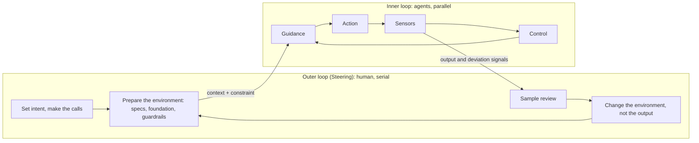

# Product, Business, and Engineering Foundation: The Three Layers of Agentic Development

Last updated: 2026-11-10

> *An agent never leaves a blank. Whatever layer you didn't decide, it will decide for you — and the decision will look perfectly reasonable.*

The Chinese-only [spec coding chapter](../../zh-cn/03-power-user/spec-coding.md) lays out a six-step path from idea to product: write the spec, set design standards, design the architecture, build memory, then start coding. The steps are easy to remember. What's hard is knowing what each step is actually deciding. A PRD mixes user needs, business rules, and technology choices; a single "add a feature" task changes a page, a business judgment, and the HTTP client's timeout configuration all at once.

This chapter answers one question: **why does a seriously engineered project need to think about, build, and verify the product layer, the business layer, and the engineering foundation layer separately — and how should that separation show up in an agentic coding workflow?** Answering it requires a change of perspective first: the three-layer split is not merely software-engineering best practice. It is how you supply an agent with context and constraint — and the place where that supply lives is the codebase itself.

Chapter 4's [product and business definition](../../zh-cn/04-team/product-business-definition.md) and [architecture and deployment design](../../zh-cn/04-team/architecture-and-deployment-design.md) (both Chinese-only) already cover what the two documents should contain and what the templates look like. This chapter does not repeat the templates. It explains why the three layers must be separated, how each enters the agent's workflow, and gives two concrete designs: **engineering component initialization at project start**, and **refactoring and component extraction while the project runs**.

| Section | Theory | Companion practice |
| --- | --- | --- |
| Why three layers | The double loop; the codebase is the harness; three layers = the supply of context and constraint | Loop diagram, three-layer comparison table |
| Mining implicit knowledge | Unmined blanks get filled with defaults, and defaults become exemplars | Per-layer implicit-item checklist, destination table for mining products |
| Product layer | Four kinds of requirements; the gap between requirement and testable | Grilling session, acceptance-example prompts |
| Business layer | Domain concepts → rules → invariants | The four domain questions, glossary |
| Engineering foundation layer | The constraint-strength ladder; why soft constraints decay | Nine steps of architecture decisions |
| Separating business from foundation | Dependency direction, component catalog, executable constraints | Separation checklist |
| Design A: component initialization | The outer loop builds the environment: foundation first, then the reference slice, then business | Six-phase protocol and prompts |
| Design B: refactoring and extraction | The improvement loop: evidence-driven extraction; the order of correction | Six-step loop and two worked examples |
| Mapping the layers onto the workflow | Which loop each stage runs in, which layer it touches, who decides | Panorama table |

---

## Why Three Layers

### The Big Picture First: The Double Loop of Agentic Coding

Before talking about layers, let's establish a model that runs through this chapter and [Repo Memory](repo-memory.md): agentic development consists of two nested loops.

The **inner loop** is the agent executing one bounded task: guidance (task instructions, Skills, memory files) → action (writing code, calling tools) → sensors (tests, lint, type checks) → control (continue, correct, retry). There is almost no human in this loop: the sensors emit machine-decidable signals, and the agent corrects itself against them. Precisely because it does not depend on a human, **the inner loop can run in parallel** — ten agents advancing ten tasks at once, none waiting on the others.

The **outer loop (the Steering loop)** is the human loop: set intent, make the trade-off calls, sample-review the output, and when you find a deviation, change the environment. No machine can make these judgments for you — whether to build multi-tenancy, whether an abstraction is worth introducing, whether this output can merge. The outer loop is inherently serial; its bandwidth is your attention.



Where the two loops meet is the **environment**: the agent reads context (what it needs to know) and constraint (what it must not do) from the environment, and hands its output and deviation signals back to whoever maintains that environment. And this environment is nothing other than **the codebase itself** — the spec, the glossary, the foundation components, the reference slice, the tests, the lint rules, down to every line of existing business code. All of it is part of the harness. The quality ceiling of any single agent task is set by this environment before the agent starts working.

Cursor engineer Lauren Tan (poteto) describes the relationship as a trust curve: how many agents you can run in parallel depends on how much you trust them, and trust is not grown by feel — it is earned, piece by piece, through engineering. She also gives a blunt validity criterion for the inner loop: **a loop only exists when the agent can check its own results** — otherwise what you have is a "you change it, I'll take a look" round trip, which can never parallelize.

Outside these two loops there is a slower **improvement loop**: the moment you turn a correction into a retained change for the future — a new lint rule, a new Skill, a foundation refactor — you have left the current task. Note the distinction: re-planning within a task still belongs to the inner loop; only a retained change to future prompts, tools, memory, or code structure counts as improvement. Design A and Design B later in this chapter are, respectively, the operating protocols for the outer loop's "build the environment" move and for the improvement loop.

### What Each Layer Answers

A software system that can evolve over the long run rests on three kinds of decisions with completely different natures:

- The **product layer** answers "for whom, solving what problem, and what counts as done." Its input is users and the market; its output is scope, non-goals, and acceptance criteria.
- The **business layer** answers "what concepts exist in this domain and what rules they obey." An order cannot be cancelled after it ships; an Agent must be bound to one available model — rules like these have nothing to do with language or framework.
- The **engineering foundation layer** answers "how the code is organized, where it runs, and what happens when things fail." Module boundaries, a unified error model, timeouts and retries on external calls, logging, and deployment all live here.

The three layers differ not just in content but in **rate of change, mode of verification, and who decides**:

| Dimension | Product layer | Business layer | Engineering foundation layer |
| --- | --- | --- | --- |
| Question answered | What to build, what not to build | What the domain rules are | How to organize, deploy, tolerate failure |
| Rate of change | Fast (adjusts with feedback) | Medium (deepens with business understanding) | Slow (one change affects everything) |
| Where it lives in the repo | Spec, acceptance examples, non-goals list | Domain modules, glossary, rule tests | Foundation modules, architecture rules, CI and lint |
| How it's verified | End-to-end acceptance from the user's view | Rule-level unit tests | Build, startup, architecture tests, performance baselines |
| Who decides | Product owner / you | Domain expert / you | Architecture owner / you |
| The agent's role | Interrogator, researcher | Translator (concepts → structure) | Executor (generates against the rules) |
| Context it gives the agent | Scope, non-goals, acceptance examples | Glossary, domain model, reasons behind rules | Component catalog, reference slice, architecture rules |
| Constraint it gives the agent | Non-goals list (soft) | Invariants + rule-level tests (hard) | Lint, architecture tests, dependency rules (hard) |
| Which loop mostly decides it | Outer loop | Outer loop sets rules, inner loop executes | Outer loop designs up front, improvement loop evolves |

When you work alone, all three hats sit on your head. But one person wearing all the hats does not mean the decisions can be made in one tangle.

The last three rows of the table deserve a second look. Seen through the double loop, the essence of the three-layer split is this: **it divides the context and constraint that the outer loop must supply to the inner loop into three streams by their nature**, each with its own carrier, strength, and rate of evolution. "It's software-engineering best practice" turns out to be a by-product — even if you work alone and care nothing for process, the moment you want agents doing work for you in parallel, none of the three streams can be missing.

### Why Agents Raise the Stakes

Before agents, the cost of mixing the three layers surfaced slowly: writing was slow, so problems were discovered in the act of writing. Agents change two things.

**First, an agent fills in every layer's blanks.** You say "build me Agent management," and it may helpfully add a permission system, versioning, and audit logs — a product decision. It puts the "Agent must be bound to an available model" validation inside a controller — a business rule in the wrong place. It writes a fresh HTTP client for this one feature, with the default timeout of waiting forever — the foundation got bypassed. Each decision looks reasonable in isolation; together they are loss of control.

**Second, an agent amplifies existing patterns.** When it writes new code, its most reliable reference is the code already in the repo. However the first feature was written is how the next ten will be written. If the first feature put a business rule in the UI, that mistake gets copied ten times.

So a mixed-up codebase fails in three recognizable ways:

| Failure | What got mixed | Typical symptom |
| --- | --- | --- |
| **Scope drift** | The agent made product decisions | Features keep multiplying; nobody remembers who decided to build them |
| **Rule leakage** | Business rules landed in the interface layer or the page | The same rule written three times in three places; change one, miss two |
| **Foundation reinvention** | Each feature rebuilt a foundation capability | Five pagination styles, three error formats, a different timeout everywhere |

The point of the layering is to let each kind of decision be made **at the right time, by the right person, into the right place** — and then let the agent execute inside that structure. In double-loop language: what the three failures share is that decisions that belonged to the outer loop were left to the inner loop.

---

## Mining Implicit Knowledge: The Work That Decides Future Performance

A substantial part of the context and constraint the three layers must supply has never been said out loud. It lives in users' expectations, in the domain expert's intuition, in your own knowledge of what your team can operate. When an agent hits one of these blanks it does not stop to ask — it fills the blank with its own default; and once a default enters the code, it becomes an exemplar in the repo that every subsequent task will copy. **So mining implicit knowledge is not up-front paperwork. It is the engineering investment that sets the ceiling of every inner loop that follows.**

### Every Layer Has Its Own Implicit Items

| Layer | The explicit part | The implicit part | Cost of not mining |
| --- | --- | --- | --- |
| Product | Features the user explicitly asked for | Implicit requirements, non-goals, business constraints, quality attributes | The agent decides your product scope for you |
| Business | Feature names like "must be able to create Agents" | Unstated rules, exceptions, state constraints | Validation is missing, or written in the wrong place |
| Engineering foundation | The technology stack choice | Team size, operational capacity, performance expectations, how external dependencies actually behave | The foundation gets built to "textbook defaults," detached from your reality |

### The Method: Make the Agent Grill You

> [Matt Pocock: Skills for Real Engineers](https://github.com/mattpocock/skills)

The most popular skill in Matt Pocock's skills repository is `/grill-me`: have the agent interrogate you until the two of you reach consensus. Its popularity tells you one thing — **execution is no longer the bottleneck; the bottleneck has moved to making implicit knowledge explicit.** Pocock lists "the agent didn't build what I wanted" as failure mode number one, and quotes *The Pragmatic Programmer*: nobody knows exactly what they want. When development was slow, ambiguity got worn away over many rounds of communication; now an agent delivers a complete implementation in minutes, and ambiguity hardens straight into code.

Grilling is only the format. The method behind it applies to all three layers:

- **Reverse the direction**: instead of you briefing the agent, the agent helps you surface the implicit items by asking. It is good at enumerating branches; you are good at judging.
- **Separate facts from decisions**: facts that can be looked up in the repo or docs, the agent looks up itself; only decisions go to a human.
- **Ask in dependency order**: don't ask how many permission tiers you need before you've decided who the users are.
- **Mine backward from "I don't understand"**: the judgments and exceptions in existing code that the agent cannot parse are the shadows left by lost implicit knowledge — have it produce a question list and let a human answer (see [Working with Brownfield Codebases](legacy-codebases.md) for the practice).
- **Mine the correction history**: the moments where you repeatedly corrected the agent are exactly where an unwritten implicit constraint lives.
- **No guessing**: whatever can't be answered gets marked "unconfirmed." An answer the agent invents is more dangerous than a blank.

### Where Mining Products Go

What you dig up must not stay in the session transcript. Every kind of finding has a definite home, each received by one layer:

| Mining product | Destination | Receiving layer |
| --- | --- | --- |
| Implicit requirements, edge scenarios | Acceptance examples → end-to-end tests | Product layer |
| Unstated rules and exceptions | Invariants + rule-level tests | Business layer |
| Decidable engineering constraints | Lint, architecture tests, directory structure | Engineering foundation layer |
| Reasons behind trade-offs, external constraints, historical baggage | Written down as Why, into repo memory | [Repo Memory](repo-memory.md) |

The next three sections cover how each layer completes the trip from implicit to verifiable.

---

## The Product Layer: From What Users Say to What Can Be Tested

### Four Kinds of Requirements

What users explicitly say is only part of the requirement. A complete requirement contains at least four kinds:

| Kind | Meaning | Example (internal AI platform for a team) |
| --- | --- | --- |
| **Explicit requirements** | What the user states | "I want to configure multiple model providers" |
| **Implicit requirements** | What the user assumes and never says | API keys must not display in plaintext; a downed provider must be visible |
| **Business constraints** | From the organization and setting, not the individual user | 50 internal users, no multi-tenancy needed; data stays inside the intranet |
| **Non-functional expectations** | Quality attributes | Streaming replies with a typewriter effect; one machine must handle the load |

Agents handle explicit requirements best and miss the other three most easily. Worse, a missed implicit requirement doesn't throw an error — the default is sometimes right by luck and sometimes wrong by luck, and you can't tell at a glance. When you run the grilling method from the previous section, the last three kinds are what to push on.

### From Requirement to Testable: Several Steps Remain

Even with the requirement clarified, there is still a gap between "requirement" and "verifiable." "Support multi-model management" is not something you can test. In between there are at least four steps:

| Step | Output | Example | The agent's role |
| --- | --- | --- | --- |
| Idea | One-sentence problem statement | The team wants to use several LLMs on the intranet | Research comparable products, map the feature landscape |
| Requirement | Scope and non-goals | Provider CRUD + connectivity testing; no billing | Proposes trade-offs; you decide |
| Scenarios | Happy path and edge scenarios | Add provider → test connectivity → list shows status | Enumerates missed branches |
| Acceptance examples | Given / When / Then | Given a wrong key, when Test is clicked, then status is "unavailable" with a reason shown | Drafts examples; you confirm each one |
| Executable tests | End-to-end or API tests | `test_connectivity_with_invalid_key` | Translates examples into test code |

The more steps you skip, the more room the agent has to improvise. **Acceptance examples are the smallest executable contract the product layer hands downstream**: concrete enough that the agent can write tests from them, and close enough to user language that you can judge correctness at a glance.

Scope trade-offs can be run through three quick questions: does the product still stand without it? How good is good enough? Can you state it in one sentence? The full five-step definition process and template are in Chapter 4's Chinese-only [product and business definition](../../zh-cn/04-team/product-business-definition.md).

### Companion Prompts

A grilling session (the equivalent when grill-me isn't installed):

```text
I want to build <one-sentence idea>. Before writing any code, grill me
until we reach consensus on the requirements.

Rules:
- Break the requirements into a decision tree. Each round, only ask questions
  whose prerequisites are already settled, and give your recommended answer.
- Push hardest on four kinds of requirements: explicit requirements, implicit
  requirements the user wouldn't volunteer, business constraints from the
  organization and setting, and quality attributes.
- Facts you can look up in the repo or docs, look up yourself. Don't ask me.
- End every round with two columns: "settled" / "still open".
- Do not start implementing until I confirm we have consensus.
```

Acceptance example generation:

```text
Based on the confirmed requirements, write acceptance examples for <feature>.

- Use Given / When / Then, one scenario per example.
- Cover the happy path and at least three edge scenarios (bad input, external
  dependency failure, permission or state not allowing the action).
- Describe only user-observable behavior. No implementation details.
- List any assumptions the examples need that I haven't decided, marked
  separately.
```

---

## The Business Layer: Turning Domain Concepts into Rules

### Why the Business Layer Exists on Its Own

The product layer says "must be able to create Agents"; the engineering foundation provides the database and the HTTP framework. A layer is still missing in between: **what exactly is an Agent? What is it made of? In which states can it not be deleted?** These questions are neither user requirements nor technology choices. They are domain knowledge.

The value of the business layer is that **it is the most stable, most valuable, and most easily buried of the three layers**. Pages can be rebuilt and frameworks swapped, but "an Agent must be bound to one available model" stays true. If that rule is scattered across controller `if` statements, frontend form validation, and some cron job, nobody truly owns it.

### The Four Domain Questions

Facing an unfamiliar business concept, let the agent help you build understanding first — four questions to ask a concept through:

1. **What is it?** — in this business context, what does the word concretely mean.
2. **How does it differ from near neighbors?** — what separates an Agent from a plain conversation; are "conversation memory" and "knowledge retrieval" the same thing or not.
3. **What must be configured to build or use it?** — enumerate the constituent parts, layer by layer.
4. **Where are its boundaries?** — how far this project goes, and what is not its job.

After the four questions, map the concept onto data structures: how many tables, what relationships, which fields are configuration and which are state. The agent is good at producing multiple options here; your job is to **ask "what does this buy us?" of every option**, then decide.

### Write Rules as Invariants, Inside Business Modules

The best form for a business rule is an **invariant**: a condition that must hold no matter which entrance the request came through.

```text
Example invariants (Agent module):
- An Agent is bound to exactly one model; that model's provider must be enabled.
- An Agent referenced by any conversation cannot be physically deleted, only disabled.
- When a tool-binding list updates, apply only the diff — insert additions and
  delete removals; never replace wholesale (call statistics must survive).
```

Invariants live inside the business module, are enforced by business-layer code, and come with **rule-level tests** — tests that run without starting a web server or touching a real database. Two direct payoffs: the agent cannot bypass the rule when it changes the interface layer; and when the rule itself changes, there is exactly one place to change.

In the language of the mining section: writing an invariant moves an implicit rule out of a human head and into the code. Once moved, it becomes a constraint embedded in the code — the agent cannot route around it and does not need to "remember" it. But not every rule can be moved. "A referenced Agent cannot be physically deleted" can become a test; "why the join table uses diff updates" can only be written down as a reason. The former is executable control, the latter is Why; that boundary line is the subject of [Repo Memory](repo-memory.md).

### Practices in the Agent Workflow

- **Maintain a glossary.** Put the domain vocabulary in `GLOSSARY.md` (or its equivalent). Pocock calls this "shared language" in his repo README: what the agent can say in one word, it shouldn't need twenty for. Names, filenames, and test names all follow the glossary, which also makes the codebase easier for the agent to navigate.
- **Ask about boundaries before saying "build an X."** Spell out in the task which business rules the feature depends on and what it is not responsible for. Say only "create Agent" and the agent will very likely skip the precondition checks.
- **Business code does not depend on frameworks.** Business modules depend only on abstractions the foundation provides (repository interfaces, a clock, an ID generator) — never directly on HTTP-framework or ORM types. Business rules can then be tested without the runtime environment, and foundation changes can't accidentally wound the business layer.
- **Write the reason next to the decision.** Why the join table uses diff updates, why there is no multi-tenancy — reasons like these go into ADRs; see "store only the Why" in [Repo Memory](repo-memory.md).

---

## The Engineering Foundation Layer: Why Engineering Design Is Separate and Up-Front

### Business Requirements Don't Derive the Engineering Structure

Many people believe engineering structure can "grow as you write." But business requirements will never tell you: how many modules the code splits into, how modules call each other, what happens when an external service times out, whether you deploy one machine or a cluster, which fields the logs must carry. The answers depend on **team size, operational capacity, performance expectations, and the direction of evolution** — none of which appears in a requirements document.

More importantly, the engineering foundation is the **hardest layer to change**. Change one business rule, you touch one module; change the error response format once, you touch every endpoint and every frontend caller. Every foundation decision is inherited by every line of code that comes after it.

In an agent workflow, add one more reason: **the foundation determines what the agent will copy.** If the repo has no unified client for external calls, the agent writes a fresh one every time. If the repo already has a client with timeouts, retries, and error mapping baked in — and the rules say it must be used — the agent uses it. Up-front engineering design is, at bottom, **deciding in advance which patterns the agent will amplify.**

### The Constraint-Strength Ladder

> Lauren Tan (poteto, Cursor): talk on agent engineering (reposted by the UninformedInvestors channel, 2026-08)

The constraint mechanisms available to the foundation are not equally strong. Lauren Tan ranks them in five tiers, strongest first:

| Tier | Form | Enforced by | How it fails |
| --- | --- | --- | --- |
| Codebase structure | Feature-per-directory, registry auto-discovery, reference slice | Nobody — the wrong way to write it is awkward or doesn't even exist | Bad design adds friction instead |
| Static analysis | Lint, type checks, import boundaries, architecture tests | Machine; hard failure | Bypassed via explicit exemptions |
| AI review | Automated PR review | A model as reviewer | Judgment has gaps; things slip through |
| Rules | AGENTS.md, style guides | The model's voluntary compliance | Decays as context grows |
| Skills | Per-task injected instructions | The model's voluntary compliance | Same, and harder to verify |

The first two turn CI red — hard constraints. The last three depend on the model "remembering and choosing to comply" — soft constraints. Her warning is blunt: if your constraint system consists only of rules, style guides, and AI review, your codebase will rot — a matter of time, not probability. Soft constraints necessarily decay, through three mechanisms:

1. **Instructions are just part of probabilistic sampling.** When the context is stuffed with a hundred thousand tokens of code and task pressure pushes the agent to "just make it run," the "don't write it this way" on line 40 of a memory file loses attention weight. And it doesn't error — it just gets quietly violated.
2. **Demonstration outweighs declaration.** Agents love to copy existing patterns. One bad example is not one incident — it is a template that will be copied N times. A rule is a declaration; code is a demonstration; demonstration always wins.
3. **No feedback loop.** When a soft rule is violated, no machine turns red. It can't be corrected, so it just keeps being repeated.

Which lets us state the foundation's design goal more aggressively: **keep narrowing the space of possible code until the correct way to write it is the path of least resistance.** The agent will take shortcuts — it only sees the code in its context, edits the files already open, and calls it done when the build passes. You cannot make it see everything, so pave the shortcut into the right road: when "the proper way" is creating one new file and "working around it" means touching five, it picks the proper way on its own. The reference slice in Design A is a demonstration you deliberately planted in the repo; a component catalog plus a lint rule banning the low-level library is a tier-4 rule promoted into the top two tiers.

### Nine Steps of Engineering Design

Engineering design splits into a code-level stage and a system-level stage. The agent can participate in every step; the judgment in every step stays with you:

| Stage | Step | The judgment you make |
| --- | --- | --- |
| Code level | 1. List the architecture questions this round must answer | Scope: code dimension (modules, organization, call rules) + system dimension (deployment, bottlenecks, external dependencies) |
| | 2. Demand at least three options with trade-offs | Force every option to state what it gives up and what it gains |
| | 3. Filter options against your constraint list | Team size, stack complexity, operational capacity, future growth — technically best ≠ best for you |
| | 4. Interrogate the chosen option point by point | "Can one person really operate microservices?" "Will a 60-second timeout cut off normal conversations?" |
| | 5. Verify the cost of change | "If we split this later, how big is the change?" A small answer means slack was left in the right places |
| | 6. Freeze it into executable rules | Written for the executor: concrete enough to follow directly, boundaries stated |
| System level | 7. Deployment picture + a "now / not yet" table | Every "not yet" item gets a written reason |
| | 8. Bottleneck map + staged scaling route | Every stage has an explicit trigger condition; don't move before it fires |
| | 9. Data and performance rules | Primary keys, time fields, indexes, pagination, big-table forecasts — the boundaries for all the SQL the agent will write later |

Every product of the nine steps flows into the execution system: architecture rules into `CLAUDE.md` or module READMEs, decidable rules into lint and architecture tests. The full decision checklist and template are in Chapter 4's Chinese-only [architecture and deployment design](../../zh-cn/04-team/architecture-and-deployment-design.md).

---

## Separating Business from Foundation: The Agentic Coding Playbook

Knowing the layers isn't enough; the separation must **hold automatically in the agent's daily work**. Five practices do the separating.

### 1. Dependencies Point One Way

Business modules depend on abstractions the foundation provides; the foundation knows nothing about any business.

```text
modules/<domain>  ──depends on──▶  foundation (error model, external-call client, data-access base…)
foundation        ──✗──▶   modules/<domain>
modules/a         ──✗──▶   the internals of modules/b (only through b's exposed service interface)
```

The payoff: the foundation can be reused by every business module and upgraded on its own; business modules can be developed in parallel and extracted later.

### 2. The Foundation Exposes Few Components, Cataloged

The foundation should not be a pile of loose utility functions but **a small number of stable components with clear contracts**. So the agent knows what exists, the foundation keeps a component catalog:

```markdown
# foundation component catalog

| Component | Purpose | Entry point | Don't |
| --- | --- | --- | --- |
| AppError / error codes | All business errors | foundation/errors | Don't concatenate error strings in business code |
| HttpClient | All external HTTP calls (timeout, retry, error mapping) | foundation/http | Don't import the low-level HTTP library directly |
| Paged<T> | Pagination for list endpoints | foundation/paging | Don't hand-roll offset math |
```

This catalog is a compressed view of What: keep it close to the code, regenerable from the code, with its provenance stated — exactly what [Repo Memory](repo-memory.md) means by "derived artifacts are caches, not facts."

### 3. Rules Land in Executable Controls

"Business modules must not import the low-level HTTP library," written only in `CLAUDE.md`, will eventually be violated. Whatever can be machine-decided goes to a tool:

| Rule | Executable control |
| --- | --- |
| Dependency direction | import-linter (Python) / dependency-cruiser (JS/TS) / ArchUnit (Java) |
| Ban the low-level client | Lint rule: importing the raw HTTP library outside `foundation/` is forbidden |
| Unified error responses | Architecture test: every endpoint's return type must be the unified response |
| Modules stay inside their borders | Architecture test: modules may only reference each other's `api` package |

Now a violation gets instant feedback in CI or a hook, instead of waiting for you to spot it in review.

### 4. One Task Touches One Layer

Scope each agent task to a single layer: either a business feature (using the foundation) or a foundation change (carrying no business logic). **Foundation changes need human approval**, because their blast radius is global. If a business task discovers the foundation lacks a capability, the right move is to stop and split out an independent foundation task.

### 5. Allocate Review Attention by Blast Radius

When reviewing agent output, sort by blast radius:

```text
structural issues (whole project) > foundation components (all business) > configuration (one instance) > placeholders and local code (one file)
```

When the agent deviates from the rules, do two things: have it fix the current output, and then fold that rule into the docs or a lint rule so the deviation can't recur.

---

## Design A: Engineering Component Initialization at Project Start

This section gives a stack-agnostic initialization protocol. The core idea: **before writing any business logic, get the whole system's skeleton to start up, and decide first which template the agent is going to copy.** In double-loop terms: Design A is the outer loop's opening move — before the first inner loop spins up, put the context it will read and the constraints it will hit into the environment.

It differs from the common five-step "scaffold → shared layer → empty shells → integration → launch scripts" recipe in two ways: a "decisions on paper" phase is added at the front, and a "reference slice" phase in the middle. The first gives the agent constraint anchors from the very first line of code; the second ensures the first pattern the agent copies is one you designed, not one that congealed by accident.

### Target Structure

A stack-agnostic directory sketch; adjust names to your language's conventions:

```text
project/
├── CLAUDE.md                    # navigation + architecture rules + why
├── GLOSSARY.md                  # domain vocabulary
├── docs/
│   ├── spec/                    # product layer: scope, non-goals, acceptance examples
│   └── adr/                     # decision records
├── foundation/                  # engineering foundation: zero business content
│   ├── errors/  http/  data/  logging/  config/  testing/
│   └── CATALOG.md               # component catalog
├── modules/
│   ├── _reference/              # reference slice: a complete example module through all layers
│   └── <domain>/
│       ├── domain/              # business rules and invariants, framework-free
│       ├── application/         # use-case orchestration
│       └── adapters/            # interface layer, persistence implementations
├── web/                         # frontend (same split: foundation vs business pages)
└── Makefile                     # dev / test / check one-command entry points
```

### Six Phases

| Phase | What happens | Acceptance command | What the human reviews |
| --- | --- | --- | --- |
| P0 Decisions on paper | One-sentence product definition, non-goals, architecture decisions into `CLAUDE.md` and ADRs | None (a human reads) | Is every rule concrete enough to execute |
| P1 Project container | Build system, module declarations, dependency versions, directory structure; zero business code | The build system resolves all modules | Do module boundaries and dependency direction match P0 |
| P2 Foundation components | Error model, external-call client, data-access base, logging, config, test fixtures | Minimal call-chain tests pass | Are contracts uniform; has business leaked in |
| P3 Reference slice | One example module walks through every layer, fully tested | The slice's rule tests + API tests pass | This is the template the agent will copy — read every line |
| P4 Business shells + walking skeleton | Placeholders for all business modules and pages; one end-to-end health-check path | Every entry point reachable; health check returns success end to end | No route conflicts, no broken links in the chain |
| P5 One-command start + guardrails | `make dev / test / check`; architecture lint; CI | One command runs it after clone; violating code fails `check` | Do the guardrails actually catch violations |

Human involvement is not spread evenly across the six phases: P0 and P3 are the two human checkpoints — P0 decides the constraints, P3 decides the demonstration. P1, P2, and P4 can be handed to the agent boldly, with the acceptance commands as the net.

#### The P2 Foundation Component Checklist

The foundation's job is not "wrap everything that might ever be used" but to unify, in advance, **the capabilities every business module will certainly use and must use identically**:

| Component | Responsibility | Why it must be unified up front |
| --- | --- | --- |
| Error model + unified response | Error codes, context-carrying exceptions, global handler, one response shape | Frontend and backend both depend on it; changing it later touches every endpoint |
| External-call client | Timeout, retry, error mapping, logging | Left ununified, every call site has a different timeout and incidents amplify |
| Data-access base | Common fields, pagination, soft delete, transactions | Left ununified, every module invents its own pagination |
| Logging and tracing | One format, request-ID propagation | So one request can be stitched together when things break |
| Configuration | Per-environment loading, secrets never in the repo | Prevents hardcoding and leaks |
| Test fixtures | Test database, fake external services, a clock | Keeps business-rule tests fast and stable |
| Frontend request layer and shared components | Request wrapper (loading / error / data states), tables, form dialogs, confirmations | Business pages only decide "which endpoint, which fields" |

Acceptance for each component: write one minimal call that proves the whole chain works, then confirm it actually removes duplication from the modules that follow.

#### P3 The Reference Slice: The Step That Matters Most

The reference slice is a **deliberately complete example module**: an entity, one business rule with its rule test, use-case orchestration, a persistence implementation, an API, a frontend list page and form — all built on foundation components. Its business can be trivial (a `DemoItem` will do), but the way each layer is written must be exactly the way you want the agent to copy from now on.

Why this is the critical step: when the agent is unsure inside a new module, it searches the repo for the most similar code. The reference slice is the "most similar code" you planted on purpose. Every subsequent business-module task can then open with:

```text
Following the structure and style of modules/_reference, implement <business module>.
Business rules are in the acceptance examples in docs/spec/<feature>.md;
use only components listed in foundation/CATALOG.md.
```

#### Scope Every Phase's Prompt

The most common initialization failure is the agent "helpfully" doing extra. Every phase's prompt declares its boundary explicitly:

```text
Current phase: P1, project container.
Create only build configuration, module declarations, and directory structure.
No business code, no logic, no tests.
When done, run <build resolution command>, paste the output, and stop.
```

```text
Current phase: P2, foundation components — the external-call client.
Implement per the "external calls" section of CLAUDE.md: default timeout,
retry decided by exception type, unified error mapping, request logging.
Touch only foundation/http and its tests; do not modify anything under modules/.
Write one minimal test against a fake service covering success, timeout, and 5xx;
run it and paste the results.
When done, update the corresponding row in foundation/CATALOG.md.
```

### Three Principles That Run Through Initialization

- **Split tasks in dependency-topological order**: container first, then foundation, then the reference slice, business last. If one generation exceeds what you can review in one sitting, split again.
- **Accept every step with an executable command**: build passes, tests pass, health check returns success. Agent-generated code usually looks fine to the eye; the problems surface at runtime.
- **Stop the foundation at "enough"**: unify only what will certainly be used and must be identical. Everything else waits for Design B, when there is evidence.

---

## Design B: Refactoring and Component Extraction While the Project Runs

The foundation built at initialization will not be perfect. As business modules accumulate, new duplication appears and old boundaries start to pinch. The agent is a double-edged sword here:

> [Matt Pocock: Skills for Real Engineers — #4 We Built A Ball Of Mud](https://github.com/mattpocock/skills)

Pocock's verdict: agents accelerate coding dramatically, and therefore accelerate software entropy just as much — codebases grow complex faster than ever. His remedy is "start caring about code design again," with an `/improve-codebase-architecture` sweep every few days looking for modules that can be "deepened."

This section turns that into a repeatable cycle. It is the improvement loop described earlier: the signals come from the inner loop (repeated mistakes, repeated review comments), the handling happens in the outer loop (a human decides the layer, picks the interface), and the product is retained for every future task.

### Principle: Make It Work First; Extract on Evidence

While building features, **make it work in the most direct way first**. Different providers have different connectivity-test endpoints? Write the if-else; don't reach for a design pattern yet. The payoff: you validate the whole chain quickly, you accumulate evidence of where the duplication actually is, and when you do refactor, real scenarios back the abstraction instead of guesswork.

But "make it work first" is not "never clean up." The timing of extraction is decided by **evidence**, not by itch.

### Trigger Signals

Any one of these signals makes the extraction loop worth entering:

| Signal | Meaning | How it's found |
| --- | --- | --- |
| **Third repetition** | The same pattern appears a third time (Rule of Three) | Have the agent scan for similar code |
| **The agent keeps making the same mistake** | The foundation is missing a capability it should own | Reread review records and correction history |
| **Change amplification** | A small requirement touches many files | Look at recent diff sizes |
| **Shallow modules** | Interfaces nearly as complex as implementations; understanding one concept means hopping through many small files | Architecture scan |
| **Repeated review comments** | The same comment written three times | Review records |
| **Repeated test setup** | Every test file builds the same data and fakes | Test-code scan |

Note the second row: in an agent workflow, "the agent keeps getting this wrong" is itself an architecture signal. Instead of shouting the rule in `CLAUDE.md` a third time, extract the capability into a foundation component and make the correct way the cheapest way.

### The Order of Correction: Architecture > Checks > Tests > Prose

When a signal fires, don't rush to add a line to the memory file. Lauren Tan's pstack makes correction an explicit ordered procedure (`/correct`): when the agent repeats a mistake, first ask whether architecture or a data structure can make the mistake **unwritable**; failing that, whether a lint or CI check can make it **unpassable**; failing that, find a test that catches it; only when none of those hold do you fall back to documentation and rules. And a newly added check must fail on a real historical mistake — adding a rule that merely "looks reasonable" doesn't count.

She offers an even blunter criterion: **every time you write "don't do this" in a review, treat it as a code smell** — it means a human is enforcing a rule a machine should enforce. A review comment affects one PR; a lint rule affects every PR after it. This is the constraint-strength ladder in operational form: corrections always sink toward the harder tiers.

### The Six-Step Extraction Loop

#### Step 1: Scan — the Agent Produces an Evidence-Backed Candidate List

```text
Scan the modules touched by the last <N> commits for component-extraction candidates.

For each candidate list:
- Evidence: files and line numbers, at least three occurrences
- What repeats: structure, a rule, or an infrastructure capability
- Your layer recommendation: stays in the business module / extract to foundation / leave alone
- Confidence: strong / worth exploring / speculative

Produce the list only. No interface designs, no code changes.
```

Scan the hot areas first (recently and frequently changed code): extraction pays off by making future change easier, and code that never moves can wait. Another counterintuitive practice: don't act on scan findings immediately — append them to a document and look back a few days later, where half of them usually turn out to be the same disease. **The buffer is itself a diagnostic tool**: it clusters scattered findings into patterns, so you fix one root cause once instead of ten symptoms ten times.

#### Step 2: Decide — Which Layer It Belongs To

Not every candidate belongs in the foundation. The decision table:

| Case | Destination |
| --- | --- |
| The repetition is a domain rule (e.g. "provider status determination") | Extract inside that business module; not into the foundation |
| The repetition is a cross-business, domain-free capability (e.g. paginated tables, retrying external calls) | Extract to foundation |
| Only two occurrences, or the variations are still shifting | Leave it; note it down; wait for the third |
| The extracted interface would be as complex as the implementation | Don't extract — a shallow module adds comprehension cost instead of removing it |

The last row can be tested with Ousterhout's "deep module" lens from *A Philosophy of Software Design*: a good module offers a lot of functionality behind a simple interface. Pocock's `improve-codebase-architecture` operationalizes it as a **deletion test**: imagine deleting the module — does complexity concentrate elsewhere (it was pulling weight), or merely relocate (it was shallow)?

#### Step 3: Interface First — the Agent Proposes, the Human Picks

```text
For candidate "<name>", propose 2–3 interface designs.

For each design, state:
- What caller code becomes (show two existing call sites rewritten)
- What complexity it hides, and what it exposes
- What it gives up
Do not implement yet.
```

The interface is the hardest part to change and the part that most needs human judgment. Once chosen, write one ADR recording why.

#### Step 4: Safety Net — Lock Current Behavior First

Before refactoring, add **characterization tests** over the call sites about to be replaced: they pass no judgment on whether current behavior is right — they just pin it, so before-and-after can be compared. The practice is covered in [Working with Brownfield Codebases](legacy-codebases.md).

#### Step 5: Strangler-Style Migration — One Site, Then Batches, Then Delete the Old Path

> [Martin Fowler: Strangler Fig Application](https://martinfowler.com/bliki/StranglerFigApplication.html)

Do not let the agent swap every call site at once:

1. **Extract + migrate one site**: implement the new component, migrate a single call site, run the full test suite. Review this one line by line — it becomes the template for the rest.
2. **Migrate in batches**: migrate remaining call sites module by module. When sites are independent, hand them to multiple sub-agents in parallel, one module each, each running its own tests.
3. **Delete the old path**: with every site migrated, delete the old code. Leave it in place and the agent will keep learning from it.

#### Step 6: Lock It In — Keep the Old Pattern from Coming Back

After extraction, stop the agent from writing the old style into the next feature:

- **Add a guardrail**: a lint rule or architecture test banning the old pattern (e.g. no direct low-level HTTP calls outside `foundation/`).
- **Update the catalog and the reference slice**: the new component must appear where the agent looks first.
- **Write down the Why**: an ADR recording why it was extracted, why it lives at this layer, and under what conditions the decision expires.

### Two Examples

**Backend: provider connectivity testing.** Version one branched on provider type with if-else: one style for OpenAI-compatible APIs, one for Claude, one for local models. At the third provider, the signals fired: every branch repeated "assemble request → call → parse errors → map status," and the agent had twice forgotten to set a timeout when adding a branch. The decision: "differences between provider protocols" is a rule of this business module — extract an adapter interface inside the module (one implementation per provider); "timeout and error mapping" is a cross-business capability — sink it into the foundation's external-call client. Migration order: convert the OpenAI-compatible branch to an adapter first and get tests green, migrate the other two, delete the if-else, and add an architecture test: no provider request may originate outside an adapter.

**Frontend: paginated lists.** The provider, Agent, and knowledge-base pages each hand-rolled a paginated table with different loading, empty, and error states. The decision: a domain-free cross-business capability — extract into the frontend foundation's shared table component. Migrate the provider page first and review it line by line, let sub-agents migrate the other two pages in parallel, then update the reference slice so the next list page starts from the new component.

### Cadence

- **Never mix refactoring and features in one task or PR.** Mixed together, review cannot tell "behavior changed" from "structure changed."
- **Schedule an extraction window every few delivered features.** Run one scan, handle the top one or two candidates; don't try to clear the list.
- **Extraction is itself a task** and follows the same pipeline: grill → options → tests → implementation → acceptance.

---

## Mapping the Three Layers onto the Workflow

Everything above in one table — where each layer gets decided as a project moves from idea to continuous evolution, who makes the call, and how it's verified:

| Stage | Layer(s) involved | Output | The agent's role | The human checkpoint | Verification | Loop |
| --- | --- | --- | --- | --- | --- | --- |
| Requirement clarification | Product | Scope, non-goals, acceptance examples | Grills, researches comparables | Confirm consensus | Acceptance examples confirmed one by one | Outer loop |
| Domain modeling | Business | Glossary, invariants, data model | Explains concepts, proposes modeling options | Pick the option | Rule-level tests | Outer loop |
| Engineering design | Engineering foundation | Architecture rules, ADRs, deployment and bottleneck maps | Proposes options with trade-offs, answers interrogation | Decide architecture shape and constraints | Cost-of-change walkthroughs | Outer loop |
| Initialization (Design A) | Engineering foundation | Foundation components, reference slice, walking skeleton, guardrails | Generates phase by phase | Review foundation and reference slice | Build, tests, health check, `make check` | Outer loop building the environment |
| Feature delivery | Mostly business | Business modules | Implements layer by layer against the reference slice | Business rules and edge scenarios | Tests matching the acceptance examples | Inner loop, parallelizable |
| Refactor and extract (Design B) | Business ↔ foundation | New components, migrations, guardrails | Scans, proposes, migrates in batches | Decide the layer, pick the interface | Characterization tests, architecture tests | Improvement loop |

The middle "feature delivery" stage can run on a fixed rhythm:

1. **Consult before building**: the agent does domain research, evaluates existing dependencies, proposes data models; you interrogate point by point, then decide.
2. **Reuse the foundation**: write business logic only; pagination, caching, external calls, and forms come from existing components.
3. **Split tasks bottom-up by layer**: entity → persistence → business rules → use cases → API → page. Each task touches one layer and its output verifies independently.
4. **Make it work first; no premature design**: handle variation in the most direct way, leave extraction to Design B.
5. **Accept end to end**: walk every path from the user's seat — create, list refresh, status display, failure scenarios — not just API responses.

Once this rhythm is running, the outer loop's review style must change with it. A human cannot read every line of ten parallel inner loops — a reviewer who gates each one is a checkpoint inspector, and parallelism collapses back to one. The workable mode is **sampling, not gating**: sensors (tests, architecture checks, acceptance examples) hold the floor, the human samples the output; and when something is wrong, don't fix that PR — go back to the environment. Add a lint rule, tighten a type, fix a Skill, update the reference slice, so that this mistake can never be written again. The unit of correction shifts from "one output" to "the environment itself," and one fix pays off across every future inner loop.

The precondition for this rhythm running fast is that product definition, domain modeling, engineering design, and initialization are already in place. **Skip the preparation and the speed never comes; do the preparation and a complete business module ships in half a day.**

---

## Anti-Patterns

| Anti-pattern | Symptom | Fix |
| --- | --- | --- |
| **Coding straight from a feature name** | "Build an approval module" → the agent generates a workflow engine, notifications, permissions | Grill first; write the problem statement, non-goals, acceptance examples |
| **Letting the agent set product scope** | Features multiply; nobody remembers deciding them | The agent proposes; a human decides scope and records non-goals |
| **Business rules scattered in the interface layer** | The same validation written in the controller, the frontend, and a cron job | Write it as an invariant in the business module with rule-level tests |
| **The first feature becomes the accidental template** | Later modules copy the first feature's improvised style | Build the reference slice deliberately at initialization and review it line by line |
| **Every feature rebuilds the foundation** | Five pagination styles, three error formats, timeouts that differ everywhere | Foundation components up front; component catalog + lint banning low-level libraries |
| **Premature abstraction** | A one-use helper turned "generic component" with an interface as complex as its implementation | Make it work first; extract on the third repetition; apply the deletion test |
| **Refactoring mixed with features** | One PR changes behavior and structure; review can't untangle them | Separate tasks; pin behavior first, then move structure |
| **Extraction without guardrails** | New component ships; the agent writes the old style into the next feature anyway | Delete the old path, add lint or an architecture test, update the reference slice |
| **Review comments standing in for checks** | The same "don't do this" written three times in review | Treat it as a code smell: sink it down architecture > checks > tests > prose |
| **Gating every parallel output** | The human can't keep up; parallelism collapses to one agent | Sensors hold the floor; the human samples; corrections change the environment, not the output |

---

## Summary

This chapter asked: **why do engineered projects separate the product layer, the business layer, and the engineering foundation layer — and how does that separation enter the double loop of agentic coding?**

1. **Agentic development is a double loop.** The inner loop is executed by agents and judged by sensors, and can parallelize; the outer loop is the human setting intent, making calls, sampling reviews, and changing the environment — inherently serial. Where the loops meet is the codebase — the whole of it is the harness.
2. **The three layers answer three kinds of questions and supply three streams of context and constraint.** Product sets scope and acceptance, business sets domain rules, foundation sets organization, deployment, and fault tolerance. They change at different speeds, verify differently, and have different deciders.
3. **Agents raise the stakes of layering.** They fill every layer's blanks with defaults and amplify whatever patterns exist. Mixed layers produce scope drift, rule leakage, and foundation reinvention.
4. **Mining implicit knowledge sets the inner loop's ceiling.** Reverse the direction and let the agent ask: facts it looks up itself, decisions go to humans, no guessing. Every finding has a destination — acceptance examples, invariants, lint, and the parts that can only be written down as Why.
5. **Constraints form a strength ladder.** Codebase structure and static analysis are hard; AI review, rules, and Skills are soft and decay. The foundation's design goal is making the correct way the path of least resistance.
6. **Set the template first at initialization (Design A).** Decisions on paper → container → foundation components → reference slice → walking skeleton → guardrails; P0 and P3 are the two human checkpoints.
7. **Extract on evidence as the project evolves (Design B).** Act when signals fire; sink corrections down architecture > checks > tests > prose; review by sampling, not gating; fix the environment, not the output.

Agents made writing code cheap, but they did not make decisions cheap. The point of the layering is to have every decision made once, in the right place — and then let the agent be safely fast inside that structure. The three layers' products — acceptance examples, invariants, the component catalog, the reference slice, ADRs — all land in the codebase and become the memory the agent reads the next time it starts work. How that memory is classified, maintained, and which parts must be written by hand is the subject of [Repo Memory](repo-memory.md).

---

## References

> [Matt Pocock: Skills for Real Engineers](https://github.com/mattpocock/skills) (`grill-me`, `grill-with-docs`, `improve-codebase-architecture`)
>
> [Martin Fowler: Strangler Fig Application](https://martinfowler.com/bliki/StranglerFigApplication.html)
>
> [Alistair Cockburn: Walking Skeleton](https://wiki.c2.com/?WalkingSkeleton)

- John Ousterhout, *A Philosophy of Software Design* — deep vs. shallow modules
- Martin Fowler, *Refactoring* — the Rule of Three
- Lauren Tan (poteto, Cursor): talk on agent engineering (reposted by the UninformedInvestors channel, 2026-08) — the trust curve, the five constraint tiers, the `/correct` correction order, sampling instead of gating
- *Claude Code Enterprise Full-Stack Development in Practice* (Chinese course) — the five-step product definition, nine-step architecture design, five-step engineering initialization, and the Hify case study
