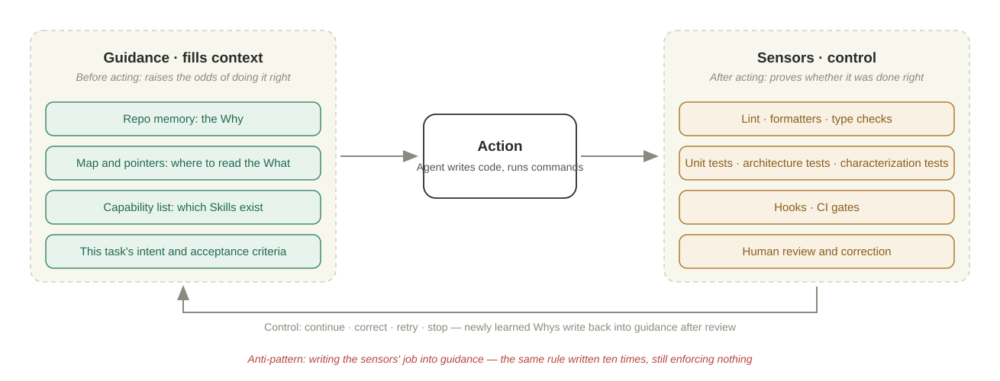
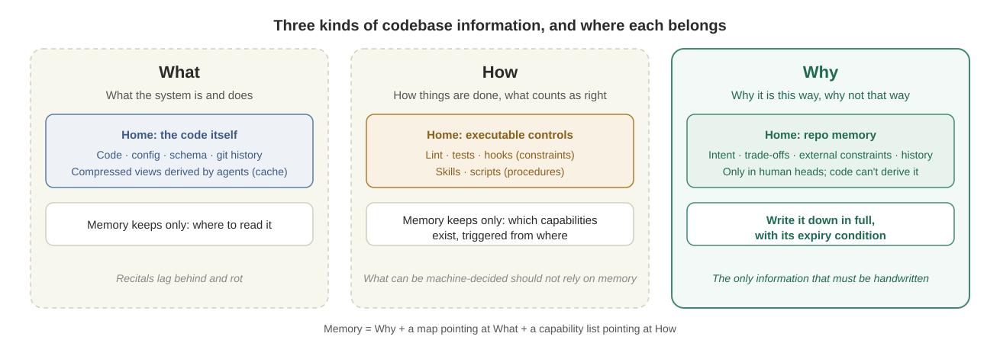
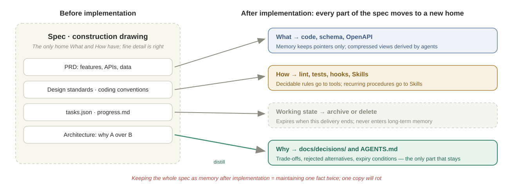
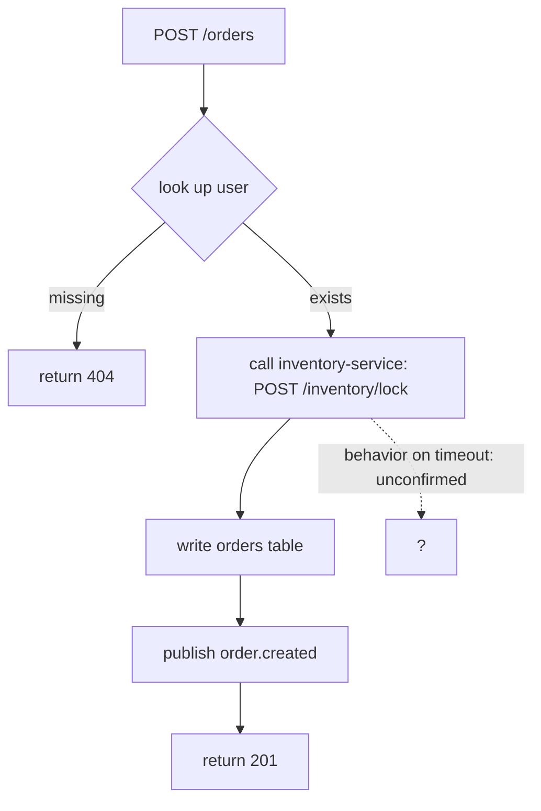
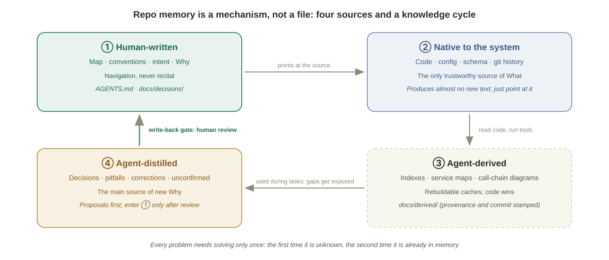
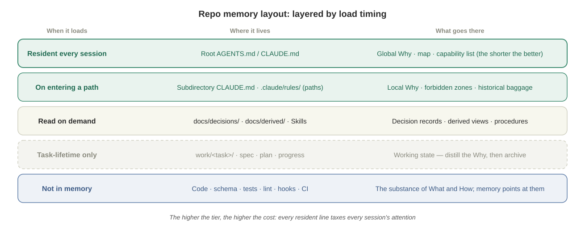
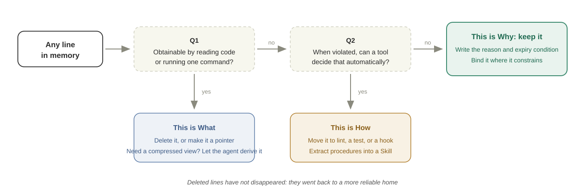

# Repo Memory: Store Only the Why

Last updated: 2026-11-10

> *The code tells the agent what the system does. The tools tell it whether it did it right. Only you can tell it why.*

The [agent memory files](../01-prompt/agents-md.md) chapter solves the entry-level problem: how to write a good `CLAUDE.md` / `AGENTS.md` for one repository. Less is more, write only what the agent cannot discover, organize by WHY → WHAT → HOW — those principles are enough for a solo developer, a single repo, a small-to-medium project.

But once the codebase grows, collaborators multiply, and the models get stronger, the same approach starts to fail: the file keeps getting longer, its contents drift away from the code, everyone on the team appends a few lines, and nobody dares delete any. The question stops being "how do I write this file" and becomes **how should this memory system be designed**.

The [Product, Business, and Engineering Foundation](product-business-engineering.md) chapter supplies the frame for looking at this problem: agentic development is a double loop, and the whole codebase is the harness. Seen through that frame, an agent's "memory" was never just `AGENTS.md` — the code itself, the types, the lint, the tests, the Skills, the derived indexes, the in-flight plans: everything that influences the agent's next action is memory; they differ only in how they act. This chapter calls all of it **Harness Memory** and answers three questions: how does each kind of memory act on the agent? Which constraints are already embedded in the code? And which must be made explicit out of human heads?

Within that panorama, the chapter's core answer is still one sentence: **the handwritten part stores only the Why; the What belongs to the code, and the How belongs to executable controls.** The structure is theory first, tools attached after — each section says what problem it solves, then gives the practice, the prompts, and the checklists.

| Section | Theory | Companion practice |
| --- | --- | --- |
| Why memory needs a redesign | Three new conditions; three memory failures | — (mental model only) |
| The harness's two jobs | Guidance and sensors; context-filling vs. control | Responsibility table |
| The Harness Memory panorama | How six kinds of memory act; the working / persistent mapping | Panorama table |
| Three kinds of information, three homes | What → code; How → controls; Why → memory | Five shapes of Why, Why-mining prompt |
| Inside the code vs. inside heads | The boundary between two kinds of constraint; the explicitation pipeline | Contrast table, two criteria |
| Spec coding, reread with this ruler | The lifecycle of a spec | Destination table for spec parts |
| Compressed views of What | Compress along boundaries; derived artifacts are caches; task-driven | Derivation Skill pipeline, provenance template |
| The presenter layer | Two readers of the same knowledge; disposable renderings | Artifact-to-judgment table |
| How memory grows | Reads and writes split across the loops; the write-back gate; avoiding self-confirmation | Write-back prompt, "unconfirmed" markers |
| The layout of memory | Layered by load timing | Directory structure, decision-record template |
| Eleven design principles | An upgrade of the agents-md principles | Three-question filter, Before/After, review checklist |
| Migrating existing memory | From a thick file to a memory system | Five-step migration with prompts |

---

## Why Memory Needs a Redesign

### From One File to One System

The entry-level memory file faces a simple scene: you, one repo, one agent. Any one of the following three conditions raises the design difficulty a full level:

| New condition | Pressure on memory | Design consequence |
| --- | --- | --- |
| **A large codebase** | The context window can't hold all the code, sometimes not even all the docs; the relationships among dozens of repos belong to none of them | Memory must be **index and compression**, not recital; cross-repo knowledge needs a home of its own |
| **Multiple collaborators** | Several humans and several agents write back into memory at once; each person remembers only the lines they added | You must settle **what gets in, who reviews, when things get deleted** |
| **Ever-stronger LLMs** | The stronger the model, the better it reads facts out of code and finds its own procedures | Hard-coded detail turns from help into **limitation**; the one thing the model cannot read out is the why |

The third condition is the easiest to overlook. A year ago the agent needed to be told "when adding an endpoint, create the schema first, then the route, then the service"; today's model learns that from reading three existing endpoints — and notices that your checklist is out of date. **The stronger the model, the less the What and How in memory are worth, and the more the Why is worth** — because the model can obtain the former on its own, and can never obtain the latter.

### Three Memory Failures

When a memory system is badly designed, it fails in three recognizable ways:

| Failure | Meaning | Typical symptom |
| --- | --- | --- |
| **Memory rot** | Memory recited the code; the code changed; the memory didn't | The file says "we use Webpack" long after the move to Vite; the agent hunts for files from an outdated directory description |
| **Memory bloat** | One rule added per mistake, additions only | The file runs to hundreds or thousands of lines, key constraints buried mid-file; the agent starts every session in the inefficient zone, and the most important rules are the ones ignored |
| **Memory amnesia** | The reasons that truly matter were never written down, or lived only in one session | The agent "tidies up" a deliberately preserved piece of legacy code; decisions reached in yesterday's session are unknown to today's |

The three failures point at one root cause: **no distinction between kinds of information**. What gets recited is What (it rots), what piles up is How that belonged to tools (it bloats), what goes missing is the Why only humans know (it gets forgotten).

> [Evaluating AGENTS.md — ETH Zurich (2026)](https://arxiv.org/abs/2602.11988)

ETH Zurich's empirical study puts numbers on "rot" and "bloat": agent-generated context files cut success rates by roughly 2–3% and raised cost by over 20%, and the root cause was **duplication** of information already in the repo; with repository docs stripped out, the same files produced a positive effect instead. **Duplicated What is not harmless redundancy — it is noise.**

---

## The Harness's Two Jobs: Filling Context and Control

Before discussing what memory should store, split the harness's responsibilities apart. Every step of local control in agent work has four parts — this is the anatomy of the previous chapter's inner loop:

| Part | Function | Examples |
| --- | --- | --- |
| **Guidance** | Feed-forward information before acting | Memory files, task instructions, examples, relevant references |
| **Action** | Model output or environment operations | Writing code, calling tools, running commands |
| **Sensors** | Evidence collected after acting | Tests, lint, type checks, logs, human corrections |
| **Control** | The next control decision | Continue, correct, retry, re-plan, stop |

Guidance raises the probability of doing it right; sensors prove whether it actually was done right. **Neither can substitute for the other**: no instruction, however detailed, can prove completion, and no test suite, however complete, can supply the context a task needs.

So the harness does two jobs: **filling context** (guidance) and **control** (sensors plus the control decision). Memory files belong to the first job only.



**The most common root of memory bloat is making guidance do control's job.** The typical sequence: the agent writes business logic in a controller, so you add "no business logic in controllers" to memory; two weeks later it does it again, so you bold the line; a month later, you prepend "IMPORTANT!". That rule now costs attention in every session and enforces nothing — the previous chapter's constraint-strength ladder explains why soft constraints inevitably decay: instructions are just part of probabilistic sampling, demonstration outweighs declaration, and there is no feedback loop. One ArchUnit or dependency-cruiser rule turns CI red the moment it is violated — that is control.

| Desired effect | Via guidance (memory) | Via sensors (control) | Pick |
| --- | --- | --- | --- |
| Uniform formatting and naming | "Use 2-space indent," "camelCase fields" | Formatter + lint | Sensors |
| Layers stay inside their borders | "Controllers only validate parameters" | Architecture tests / dependency rules | Sensors |
| Don't break existing behavior | "Mind compatibility when changing" | Characterization tests + CI gate | Sensors |
| Understand why a table must not be dropped | — a test can only report "dropping it breaks things," never the reason | Impossible | **Guidance** |
| Make the right trade-off in a new situation | Write down the reasoning behind the trade-off | Impossible | **Guidance** |

The pattern is clear: **what can be machine-decided goes to sensors; only what must be understood goes to guidance.** And what must be understood is almost always Why.

---

## The Harness Memory Panorama: Six Kinds, Two Lifespans

Spread out everything that influences the agent's next action and it sorts into six kinds, differing in mechanism, strength, author, and loop:

| Kind | Form | Mechanism | Strength | Who writes it | Read/written in which loop |
| --- | --- | --- | --- | --- | --- |
| **Structural memory** | The code itself, directory conventions, registries, the reference slice | Gets copied: the agent writes to existing patterns | Strongest and implicit — the wrong way is awkward to write, or doesn't exist | Humans design, agents perpetuate | Designed in the outer loop, read in the inner |
| **Executable constraints** | Types, lint, architecture tests, CI, hooks | Hard failure: violation turns red | Hard | Humans, or sunk down from corrections | The inner loop's sensors |
| **Procedural memory** | Skills, scripts, CLIs | SOPs loaded on demand | Soft; hardens once deterministic steps sink into a CLI | Humans, grown out of observed failures | The inner loop's guidance |
| **Derived memory** | Indexes, service maps, flow diagrams | Compressed views that spare re-reading the code | A cache — code wins on conflict | Agents generate, humans set the discipline | Read in the inner loop, rebuilt in the improvement loop |
| **Declarative memory** | AGENTS.md, path rules, ADRs, the glossary | Guidance: works only if the model reads and follows it | Soft, decays as context grows | Humans | Written in the outer loop, read in the inner |
| **Working state** | Spec, plan, progress | The current task's scene | — | The agent, continuously | This inner loop only |

This table maps onto the standard taxonomy used when people discuss agent memory. **Working memory** covers the task-lifetime things: the spec, the plan, progress, the compressed views loaded for this task — born and gone with the task. **Persistent memory** splits three ways: ADRs, Whys, and the glossary are **semantic memory** (knowing what and why); Skills, CLIs, and the reference slice are **procedural memory** (knowing how); correction history and review records are **episodic memory** (what happened), whose value is being distilled into the first two — once distilled, archive them. And note the easy misreading: **persistent does not mean handwritten** — derived artifacts are agent-generated and the reference slice is code — but persistent memory must be human-maintained: reviewing write-backs, checking expiry conditions, deciding deletions.

Two addenda. First, structural memory sits at the top because it doesn't require the agent to "remember": a rule is a declaration, code is a demonstration, and demonstration always outweighs declaration — the memory-side version of the previous chapter's constraint-strength ladder. Second, **code comments are memory too, and the most easily polluted kind**: when agents write comments they often record conversational residue like "last review said don't do this here," freezing a one-time correction into a permanent, misleading declaration. Lauren Tan went as far as banning code comments in her project — an extreme choice, but the problem it points at is real: without a gate on write-back, even the comments rot your memory.

The six kinds answer "how do they act on the agent." The next question is: which kind should a given piece of information go into? That turns on the nature of the information itself — What, How, or Why.

---

## Three Kinds of Information, Three Homes

Divide by "what is the most reliable source," and a codebase's information about itself comes in exactly three kinds:



| Information | Question it answers | Most reliable source | What memory should hold |
| --- | --- | --- | --- |
| **What** | What the system is and does | Code, config, schema, git history | Only "where to go read it" |
| **How** | How things are done here, what counts as done right | Lint, type checks, tests, hooks, Skills, scripts | Only "what capabilities exist, triggered from where" |
| **Why** | Why it is this way, why not that way | Human heads, PR threads, postmortems, chat logs | **Written down in full** |

### What: The Code Is the Most Accurate Memory

The most accurate source of facts about code is the code. Every secondhand retelling lags: docs go stale, code does not. Same for config and git history — how the environment is set up is in the config, and why a feature looks the way it does today has its clues sitting in `git log`.

So memory keeps only **pointers** for What. A good map is short enough for the agent to take in at a glance and accurate enough to find anything from:

| Don't write this (recital) | Write this (pointer) |
| --- | --- |
| A full directory tree | "Service boundaries and call relationships: `docs/derived/service-map.md`" |
| A stack list: React 18, Vite 5, Zustand… | Delete it — it's all in `package.json` |
| Paths and params for a dozen endpoints | "Endpoints: `openapi.yaml` is authoritative; regenerate with `make openapi`" |
| Database schema description | "Current schema: `python manage.py show_schema`" |

A map points at living sources. When the source changes, the map still holds; a recital starts expiring the moment it is written.

### How: What Can Be Machine-Decided Should Never Rely on Remembering

How describes procedure, and it has two homes better than memory:

| Kind of How | Examples | Home |
| --- | --- | --- |
| **Decidable constraints** | Responses wrapped in `Result<T>`; no dependencies outside the stack; empty lists return `[]` | Lint rules, architecture tests, contract tests, dependency allowlists, pre-commit hooks |
| **Recurring procedures** | The five steps for adding an endpoint; the pre-release checklist; updating API docs | A [Skill](../02-anatomy/skills.md) or a script, loaded on demand |
| **One-off instructions** | "No pagination needed this time" | The task instruction; never lands in files |

Memory keeps only the **capability list**: which tasks this repo supports, which Skill each is triggered from, what it produces. An agent picking up a task reads this one section and knows which chain to walk; a human wondering what the repo can do reads the same section.

The nature of a Skill deserves its own paragraph, because it is the thing most often mistaken for a guardrail. A Skill is teaching material for the soft tier: a stretch of high-quality context that transmits judgment and workflow — what to do first, check the code rather than guess when things are ambiguous, run verification before saying "done." Forbidding things is not its job; that belongs to lint, and lint doesn't get forgotten. Three corollaries. First, a Skill should grow out of real observed failures, not be drafted as a spec from thin air. Second, text that can be silently ignored must be measured: Lauren Tan runs evals as "unit tests" for Skills — a sub-agent performs tasks in a directory that gives no hint it's being evaluated, and another model judges the output — but evals can only raise the compliance rate, never make it 100%. Third, Skills shrink over time: as models strengthen, deterministic fixed steps sink into CLIs and scripts, and the instructions contract into a description of the workflow — **judgment stays with the model, mechanics go to code**.

### Why: The Only Thing That Must Be Handwritten

Every Why shares one property: **it is not in the code, not in the tools, and no amount of code-reading lets the agent derive it.** Code can tell you what judgment the system makes, never why that judgment was made back then. If no human writes it down, it leaves when people do — and lost knowledge is precisely what turns software into a legacy system.

The five common shapes of Why:

| Shape | Answers | Example | Where it usually hides |
| --- | --- | --- | --- |
| **Intent** | Who this module serves and what problem it solves | "The reconciliation service serves monthly finance closing only; real-time is a non-goal" | Product docs, requirements threads |
| **Trade-off** | Why A over B | "Join tables update by diff: delete-all-then-insert leaves a window where concurrent requests see no associations" | Design reviews, PR threads |
| **External constraint** | Who outside the code depends on it | "`external_key` is used as a cache key by an SDK customer; renaming it breaks that SDK" | Customer communications, postmortems |
| **Historical reason** | It looks wrong — why is it still here | "The `Dataset` table looks redundant; it came from a retired experiment and the data must be kept" | `git log`, veteran colleagues |
| **Expiry condition** | Under what premise this Why stops holding | "Once all customers are on the v1 API, `LegacyEvaluatorAdapter` can be deleted" | Usually nobody writes it — which is exactly what to fix |

The **forbidden zones** and **historical baggage** that [Working with Brownfield Codebases](legacy-codebases.md) calls worth a hundred times their length are, at bottom, all Why. Practice keeps re-confirming one more phenomenon: give the agent a rule involving an engineering trade-off as a bare "don't," and it keeps violating it; add the reason, and it not only complies but extends the reason to similar situations the rule never covered. **Why is the information that lets an agent generalize.**

### The Boundary: When a Convention Needs Its Reason

The brownfield chapter advises "state key conventions as hard rules, skip the reasons" — no contradiction with this chapter; the difference is the kind of convention:

| Kind of convention | Example | Treatment |
| --- | --- | --- |
| **Pure convention**, no engineering trade-off | snake_case fields; REST responses wrapped in `Result` | Hand it to a tool if possible; otherwise one hard line, no reason needed |
| **Carries an engineering trade-off** | Join-table updates use diff comparison | **Must carry its Why**, or the agent cannot judge new situations |

The test: **if the agent follows the rule to the letter yet errs in a similar scenario the rule doesn't cover, what the rule is missing is its Why.**

### How to Mine the Why

Why does not volunteer itself. It is scattered through PR threads, postmortems, veterans' heads, and the "can't understand this" spots in the code. The agent is good at finding these clues, but **must not fill in the answers for you**.

| Clue source | What it can surface | Tools |
| --- | --- | --- |
| Strange commits | What problem a branch or an exception was solving | `git log -S`, `git blame`, GitLens |
| PR and issue threads | Design trade-offs, rejected alternatives | GitHub / GitLab MCP |
| Postmortems | Forbidden zones: which changes caused incidents | Postmortem docs, on-call records |
| Code the agent can't parse | Shadows of lost business rules | Have the agent produce a question list |
| Conversations with original authors | Whatever none of the above surfaces | People |

**The Why-mining prompt:**

```text
Read the code under src/billing/ and its git history (git log --follow,
git blame). Find every spot whose reason cannot be seen from the code itself:
strange conditionals, exceptions for special accounts, code that looks
redundant but was never deleted, behavior inconsistent with its naming.

For each spot output: file and line, the behavior you observe, the title and
link of the relevant commits, and the question you need a human to answer.

Do not guess reasons. Do not write to any memory file. Output the question
list only; I will answer it.
```

The last paragraph is the key move: the agent **finds the gaps**, the human **fills in the reasons**. A Why the agent guessed is worse than no Why — it looks like knowledge and may be fabrication.

---

## Constraints Inside the Code, and Constraints That Must Be Made Explicit

Put the three kinds of information and the six kinds of memory together and you can answer the chapter's remaining two opening questions: which constraints are already embedded in the code, and which must be made explicit out of human heads.

| | Embedded in the code | Existing only in human heads |
| --- | --- | --- |
| Form | Types and signatures, invariants and their tests, dependency direction, directory conventions, behavior pinned by tests, the repo's existing patterns | Intent, trade-offs, external constraints, historical reasons, expiry conditions, taste and judgment |
| How it acts | Needs no remembering: wrong code won't compile, tests turn red, patterns get copied | Must be read and understood before it can influence behavior |
| How it's maintained | Evolves with the code, guarded by CI | Handwritten, carries expiry conditions, periodically re-reviewed |
| How it's lost | Can't be lost while the code exists | Leaves when people do |

So "making explicit" is a pipeline, not a single act:

1. **Mine**: implicit knowledge must first be seen — the method is the previous chapter's [Mining Implicit Knowledge](product-business-engineering.md#mining-implicit-knowledge-the-work-that-decides-future-performance); the prompt above is its Why-specific variant.
2. **Write it as Why**: findings land as prose first, with reason and expiry condition.
3. **Sink what can sink**: decidable parts become lint, tests, hooks; procedural parts become Skills or CLIs; structurable parts get worked into the code structure itself — until the wrong way is simply awkward to write.
4. **Only the remainder stays in memory**: what cannot sink is the Why that genuinely needs handwriting and long-term human maintenance.

Two practical criteria locate where a piece of knowledge is stuck in the pipeline: the agent follows a rule to the letter yet errs in an uncovered similar scenario — the rule lacks its Why, stuck at step 2 unfinished; the same mistake happens a second time — it should sink from prose into control, stuck at step 3 unmoved. The pipeline's end state: **constraints live in the code as far as possible, reasons live in memory in full, and human heads hold only what hasn't been made explicit yet.**

---

## Spec Coding, Reread with This Ruler

### The Two Camps Disagree About Time, Not Substance

The Chinese-only [spec coding chapter](../../zh-cn/03-power-user/spec-coding.md) has the agent work under a detailed specification: PRD, design standards, architecture doc, task list, progress file. In spec-driven development (SDD) practice, the spec gains a line every time the agent strays, growing from one page to many — it stores things very finely, and nearly all of it is What and How.

The other camp of practitioners reaches the opposite conclusion:

> [Matt Pocock: Skills for Real Engineers](https://github.com/mattpocock/skills)

| | Spec camp (SDD) | Code camp (Matt Pocock, poteto) |
| --- | --- | --- |
| **Core claim** | Get the spec right first and the agent executes it; patch the spec on every deviation | "The code is the battleground, not the spec." "The best spec is code." |
| **What they saw** | Without a spec, every module goes its own way: naming, response shapes, error codes all inconsistent | Generating against a spec long-term, code quality sinks round by round; a stale spec actively misleads the agent |
| **Alternative practice** | Layered specs: global, module, task | Align on design concepts first with `/grill-me`-style interrogation, then iterate in code with tests, vertical slices, and verification evidence |
| **When they're right** | **Before implementation**: the code doesn't exist yet | **After implementation**: the code now exists |

The two sides describe two phases of the same artifact. **Before implementation**, What and How have no code to live in; the spec is their only home, and writing it finely is correct — the spec is the construction drawing. **After implementation**, the spec's What now lives in code, its How in tests, lint, and Skills; keeping the spec as long-term memory means maintaining the same fact twice, and one of the two copies will rot.

### The Lifecycle of a Spec



Treat the spec as an artifact with a lifecycle, not as memory. Once implementation lands, every part of the spec moves to a new home:

| In the spec | New home after implementation | What stays in repo memory |
| --- | --- | --- |
| Functional requirements, APIs, data structures | Code, OpenAPI, schema, test cases | Pointers; plus scope decisions like "why this feature doesn't do X" |
| Design standards, coding conventions | Lint, design tokens, component library, architecture tests | Trade-off reasons no tool can express |
| Architecture proposal | Code structure + the agent-derived service map | **Why this architecture, which alternatives were dropped, when to revisit** |
| `tasks.json`, `progress.md` | Archive (or delete) | Nothing |
| Acceptance criteria | Tests | Nothing |

The spec coding chapter has been updated along this lifecycle with the long-term memory vs. working state distinction; see [the lifecycle of a spec](../../zh-cn/03-power-user/spec-coding.md#spec-的生命周期-从施工图到-why) (Chinese-only).

### Working State Is Not Memory

`tasks.json`, `progress.md`, and plan files are vital to one long task — they let a new session rebuild "where the project is" from the filesystem. But they are **working state**, with an explicit lifecycle:

| | Long-term memory | Working state |
| --- | --- | --- |
| **Content** | Why, the map, the capability list | Plans, task breakdowns, progress, this task's provisional decisions |
| **Lifespan** | Across tasks, across quarters | One delivery |
| **Writer** | Humans, or reviewed agent proposals | The agent, continuously |
| **At the end** | Carries expiry conditions, re-reviewed when due | Distill the Why, then archive or delete |

Mix state into memory and the next session will "restore" a scene that stopped existing three months ago.

---

## Compressed Views of What: Let the Agent Derive Them

### The Problem: The Code Doesn't Fit in Context

"What belongs to the code" meets a practical snag: a large codebase doesn't fit in the context window. Even on a modest project, stuffing in all the code scatters attention; and re-reading the same code from scratch for every task is slow and wasteful.

The solution is not humans writing What by hand but **letting the agent derive compressed views of What**, treated as caches. Humans can't finish writing these and shouldn't try: the volume is too large and it shifts with the code. Letting the agent derive them bolts an auto-regeneration engine onto memory — code changes, rerun the pipeline, out comes the fresh view.

### Compression Principles: Squeeze Out What Can Be Re-Fetched, Keep What Can't

**Compress along the architecture.** Architecture is already a compression of the code: how many parts, what each is responsible for, how they connect. That skeleton has the highest information density and the most stability. Keep the skeleton resident in the index; fetch details from the source on demand.

**Compress for the agent's weaknesses, not for human habits.** Many software-engineering best practices exist to fit human cognition. Think of a human as a model with a drastically limited context: unable to hold the system, we lean on layering and highly distilled domain models. The agent lacks that limitation; its weakness lies elsewhere:

| | The index a human needs | The index an agent needs |
| --- | --- | --- |
| **Focus** | How a service is layered inside: clean architecture vs. smart domain | The **boundaries and interactions** between services |
| **Reason** | Limited context; layering is how humans understand | One service's code fits in a single read; internals can always be re-read from source |
| **Weakness** | Can't read all the code | Reading one service **can't reconstruct** cross-service relationships |
| **What the index keeps** | Layering structure, domain model | Each service's responsibility, call relationships, data ownership, what a change here ripples into |

In one line: **cover the agent's weaknesses; don't duplicate its strengths.**

### The Derivation Pipeline: From Map to Behavior

Take a microservice system of a few dozen repos. The knowledge to extract belongs to no single repo — it describes the relationships among them — so it lives in a **separate workspace**, not inside some business repo:

```text
workspace/
├── AGENTS.md          # entry point: Why, map, capability list
├── repositories.md    # every repo address in the system
├── skills/            # the knowledge-derivation pipeline
├── checkout/          # read-only code copies managed by the agent
└── wiki/              # derived knowledge (cache)
```

Derivation is done by a few Skills that build on one another, each answering exactly one question:

| Skill | Question it answers | Input | Output | Discipline |
| --- | --- | --- | --- | --- |
| `repo-index` | How many repos, roughly what each does | `repositories.md` | `wiki/index.md` | Surface scan only; READMEs are clues — on conflict, code wins |
| `api-contracts` | Which APIs each service **provides** and **consumes** | Index + code | `wiki/{repo}/api.spec.md`, `api.contract.md` | Record cross-service boundaries only; unrecognized targets marked "unconfirmed" |
| `service-map` | Who calls whom, via which API | All specs and contracts | `wiki/service-map.md` (mermaid) | Consumers point at providers; unidentified providers get dashed lines, never dropped |
| `implement-flow` | What actually happens when each endpoint is called | Specs + code | `wiki/{repo}/endpoint-flows.md` | Externally visible behavior only; trace stops at the service boundary |

The last layer deserves its own note. An endpoint inventory is only **interface knowledge**; many tasks — adding regression tests, say — need **behavior knowledge**: given an input, what did the system look up, whom did it call, where does it branch. Drawing each endpoint's call chain as a mermaid diagram is near-lossless compression:



It drops implementation detail and keeps behavior — far cheaper than having the agent re-read the source every time. And the diagram is naturally an outline for regression tests: every branch, every downstream call, every write is a path worth a test, and the nodes marked "unconfirmed" are the ones to test first and the likeliest to hide mines.

In a monolith without clear service boundaries, the approach is unchanged — substitute **modules or packages** for "services": build the vocabulary mapping first, then extract inter-module contracts, and map **table-to-module ownership** with special care (who writes, who only reads) — a shared database is where agents misjudge monoliths most.

### Derived Artifacts Are Caches, Not Facts

Derived indexes, service maps, and flow diagrams obey three disciplines:

1. **Rebuildable**: generated by a Skill or script, rerun when the code changes; never hand-maintained.
2. **Provenance stated**: what generated it, from which commit, when.
3. **Code wins**: on conflict with the code, the code is right; a README that disagrees with the code is wrong too.

A provenance header at the top of each derived file lets both agent and human judge its trustworthiness at a glance:

```markdown
---
derived: true
generator: skills/implement-flow
source: checkout/order-service @ 3f2a9c1
generated_at: 2026-11-10
authority: Code wins. On conflict with the code, trust the code and rerun the generator.
---
```

Graphify, introduced in [Working with Brownfield Codebases](legacy-codebases.md), tags every edge `EXTRACTED` / `INFERRED` / `AMBIGUOUS` — the same discipline, tooled: **a map drawn by an agent must tell you which edges are fact and which are inference.**

### Task-Driven, Never Stockpiled

Knowledge serves tasks, and before a task happens you cannot know which knowledge it will need. The pipeline above grew exactly that way: `api-contracts` sufficed for impact analysis, and only when regression-test writing began did the gap appear — behavior knowledge was missing, hence `implement-flow`.

Trying to backfill the whole business context up front is futile; trying to extract all the knowledge up front is equally futile. The right rhythm is **fill on miss**:

1. Try the task with the knowledge you have.
2. Where reading fails or work stalls, the gap exposes itself.
3. Fill that gap from the code and from people, deciding whether the filling is Why (into memory) or What (into derivation).
4. The knowledge base grows one block; the next task grows the next.

The only thing worth building ahead of need is the skeleton.

---

## The Presenter Layer: The Memory Interface for Humans

Compressed views solve the agent's reading problem. But the same knowledge has a second reader: the human in the outer loop. The two readers need different things.

The agent wants machine-navigable compression — specs, contracts, flow-diagram source — the denser the better; it can always check back against the code. The human wants **a rendering that builds judgment fast**: the outer loop's bandwidth is human attention, and how many inner loops you can run in parallel is set by how long one output takes you to review. Agent output keeps multiplying while the human way of understanding it hasn't upgraded — that gap is becoming the whole system's bottleneck.

> Andrej Karpathy (X post): *"We'll be spending a lot more time trying to understand the outputs of language models."*

Karpathy offers concrete tactics: have the model write in ASD-STE100 — a controlled language originally designed for aerospace maintenance documentation, severely constrained and stylistically clean, which models know well (too strict? ask for "80% of the way to ASD-STE100"); and better than prose — diagrams, interactive HTML pages, and custom 3Blue1Brown-style explainer videos.

These artifacts form the memory system's **presenter layer**. Like derived views, they are "not a source of fact," but their lifespan is shorter still: derived views are standing caches rebuilt when code changes; presenter artifacts are **disposable**, generated for one review and discarded after reading. They don't enter memory, need no maintenance, and when stale are simply regenerated from the current state.

| Presenter artifact | Outer-loop judgment it serves |
| --- | --- |
| Diff walkthrough page: what changed, why, where the risk is | Can this output merge |
| Architecture-change diagram: dependencies before vs. after | Was structure broken; how big is the blast radius |
| Controlled-language summary of a decision | Should I sign off on this trade-off |
| Interactive exploration page: clickable call chains | Does the agent's understanding match the facts |

Pulling the presenter layer out on its own prevents two confusions. One: maintaining a for-humans document as if it were memory — it is a consumable, not an asset; a hand-maintained "architecture doc for humans" is a classic source of memory rot. Two: making humans read the compression built for agents — slow, exhausting, and the human soon retreats to "not reading at all," which costs the outer loop its sampling ability. **Compress for the agent, render for the human; both generated from the same source of fact, each shaped for its reader.**

---

## How Memory Grows: Four Sources and the Write-Back Gate

Seen through the double loop, memory's reads and writes divide cleanly. The **inner loop** reads memory, writes working state, and proposes distillations when a task ends — many agents can do this in parallel. The **outer loop** owns the write-back gate: humans review proposals, sample-review via the presenter layer, and sink corrections down the architecture > checks > tests > prose order. The **improvement loop** periodically rebuilds derived artifacts and walks the expiry conditions. The quality of memory is set not by how much the inner loop writes, but by how much the outer loop approves.

### Four Sources

Understanding Repo Memory as one file is not enough. It is a **mechanism for making knowledge available**, and it never had just one author:



| Source | Content | Who writes it | Place in this chapter's frame |
| --- | --- | --- | --- |
| **Human-written** | Map, conventions, intent | Humans | Why + pointers; short enough to scan, accurate enough to find anything |
| **Native to the system** | Code, config, git history | Already there | The only trustworthy source of What; memory only points |
| **Agent-derived** | Indexes, structure, summaries, flow diagrams | Agents | The compressed cache of What |
| **Agent-distilled** | Decisions, pitfalls, corrections | Agents propose, humans review | The main source of new Why |

The fourth source is what makes memory **alive**. While working, agents hit uncertainty, make judgments, step on mines, get corrected — each of these, once it happens, should be written back and become part of "known" at the next kickoff. A pitfall not written back will replay the same way next time, **and every replay is one unnecessary human intervention.**

Nor are the four sources four sealed boxes. The agent distills a batch of good tests; a human endorses a few; those are promoted into the "human-written" tier as new exemplars; the next batch of tests comes out better. Knowledge cycles through the four sources and compounds.

### The Write-Back Gate

On a solo project, letting the agent casually append to memory is tolerable. With collaborators, it quickly produces bloat and conflict. Write-back needs a gate, reviewed like code:

| Gate | Rule | Prevents |
| --- | --- | --- |
| **Proposal separate from decision** | The agent drafts "what we learned"; a human decides what enters long-term memory | Fabricated or local conclusions polluting the global |
| **Second time hardens** | A behavior becomes a rule only on its second correction; the first may be chance | Bloat from precautionary rules |
| **Ask first if a tool can take it** | New rules pass the three-question filter; decidable ones become lint or tests directly | Guidance doing control's job |
| **Reason and expiry required** | No Why, no entry | Rules nobody dares delete later |
| **Place it near its subject** | Local lessons go into the relevant directory or rule file, not the root | Root-file bloat |

**The end-of-session write-back prompt:**

```text
Review this session and list what might deserve long-term memory, each item
classified as:
- Why: a trade-off, external constraint, or historical reason (with evidence:
  commit, PR, conversation location)
- A decidable constraint: suggest the lint / test / hook to express it
- One-off information: relevant to this task only, not worth keeping

For Why items, suggest a location (root AGENTS.md / subdirectory /
docs/decisions/) and the expiry condition. Mark anything uncertain
"unconfirmed".

Do not modify any files. I will review and decide what gets written.
```

### Preventing the Self-Confirming Loop

When both derivation and distillation are done by agents, there is a systemic risk: if the flow diagram is the agent's **inference** about the code, and the tests are written only from the diagram, then all tests passing proves only that "the diagram and the tests agree with each other" — not that the system's behavior was understood. The harness becomes a machine for proving its own prior judgments correct.

| Risk | Counter |
| --- | --- |
| The agent guesses unreadable branches into plausible shapes | If unsure, mark "unconfirmed" — **no guessing** |
| Tests written from inference naturally all pass | Write **probe tests that pin current behavior** for every "unconfirmed" node, top priority |
| A failing probe gets its assertion edited until green | A failing probe **is not a bug, it is information**: write the real behavior back into the diagram and wait for a human call |
| Tests and production code change together | Test-backfill tasks **add tests only, never touch production code**, preserving an unpolluted reference plane |
| The whole loop has no external input | Bring in facts from outside the loop: runtime observation, human judgment, external specs |

The point of the loop is to multiply the value of human judgment — not to let humans be talked into their own process.

---

## The Layout of Memory: Layered by Load Timing

The [agent memory files](../01-prompt/agents-md.md) chapter covers Claude Code's five memory tiers (organization, user, project, local, conditional rules). Those are **the slots the tool provides**; this chapter cares about **which slot each piece of content belongs in**. One factor decides it: when does this information need to be loaded?



A repository organized on this principle:

```text
repo/
├── AGENTS.md                    # resident: global Why, map, capability list
├── CLAUDE.md                    # one line: @AGENTS.md (maintain one source of truth)
├── .claude/
│   ├── rules/
│   │   └── billing.md           # paths: src/billing/** — billing Whys and forbidden zones
│   └── skills/
│       ├── add-endpoint/        # How: procedures
│       └── sync-docs/
├── services/
│   └── server-core/
│       └── CLAUDE.md            # loaded on entering the directory: external_key and other local forbidden zones
├── docs/
│   ├── decisions/               # on demand: decision records (the full form of Why)
│   │   └── 0007-diff-update-for-tool-bindings.md
│   └── derived/                 # on demand: derived views (caches, provenance stated)
│       ├── service-map.md
│       └── endpoint-flows/
├── work/                        # task-lifetime: spec, plan, progress; archived when done
└── src/ tests/ .github/ ...     # not in memory: the substance of What and How
```

| Tier | Location | Contents | Budget | Lifespan and maintenance |
| --- | --- | --- | --- | --- |
| **Resident** | Root `AGENTS.md` | One-sentence project, global Whys, map, capability list, key commands | The shorter the better; past 150 lines, start sinking | Persistent (semantic); human-written, human-reviewed |
| **Path-triggered** | Subdirectory `CLAUDE.md`, rule files with `paths` | Whys that hold only for one area, forbidden zones, historical baggage | A few to a dozen items per file | Persistent (semantic); human-written, human-reviewed |
| **On-demand** | `docs/decisions/`, `docs/derived/`, Skills | Full decision arguments, derived views, procedures | Unlimited, but something must point to it | Persistent (semantic + procedural); decisions human-written, derived artifacts agent-rebuilt |
| **Task-lifetime** | `work/<task>/` | Spec, plan, progress | Archived at task end | Working memory; agent writes and discards |
| **Not in memory** | Code, tests, tool configs | The substance of What and How | — | Structural memory and executable constraints; guarded by CI |

### Decision Records: The Full Form of Why

The root file can afford one or two sentences of Why. Decisions needing a full argument go in `docs/decisions/`, with the root or subdirectory memory holding one sentence plus a link. An agent-friendly decision record:

```markdown
# 0007 Join-table updates use diff comparison

Status: active | Date: 2026-03-12 | Scope: src/agents/**, src/tools/**

## Context
Agent–tool associations are read continuously at runtime by the conversation engine.

## Decision
On update, compute the diff between the old and new sets; insert only
additions, delete only removals.

## Reason
Delete-all-then-insert leaves a window between the two statements in which
concurrent requests see "this Agent has no tools" — this has already caused
one production conversation outage. The same reasoning applies to any
association table read concurrently.

## Rejected alternatives
- Delete-all-then-insert: simpler, but has the window.
- Locking the whole table: closes the window, but blocks the conversation
  engine's reads.

## Expiry condition
If association reads move to a versioned snapshot cache, revisit this decision.
```

"Scope" lets it be loaded by path; "Reason" lets the agent extend it to similar situations; "Expiry condition" lets it one day be deleted safely.

---

## Agent-Friendly Repo Memory: Eleven Design Principles

The analysis above condenses into eleven principles. They are the upgrade of the ten writing principles in [agent memory files](../01-prompt/agents-md.md): that chapter teaches you to write one good file; this one teaches you to design a memory system that grows with the codebase and the team.

| # | Principle | In one line | Upgrade of which agents-md principle |
| --- | --- | --- | --- |
| 1 | **Handwrite only the Why** | Every line should be information findable nowhere in code, tools, or history | "Less is more" → now with a criterion for what to delete |
| 2 | **What gets pointers, not copies** | Tell the agent where to read, don't transcribe what you read | "Progressive disclosure" → pointers aim at living sources |
| 3 | **Constraints sink into controls** | Rules that lint, tests, or hooks can decide go to tools; memory keeps only the Why behind them | "Encode style in tools" → extended from formatting to every decidable constraint |
| 4 | **Procedures sink into Skills** | Recurring How becomes on-demand Skills; memory lists only capabilities | "Refactor repetition into Skills" → the entry point becomes a capability list, not a directory description |
| 5 | **Derived artifacts are caches** | Agent-generated indexes and maps are rebuildable, provenance-stamped, code-wins | "/init is continuous sync" → derived artifacts get an explicit authority level |
| 6 | **Memory separate from state** | Specs, plans, progress have lifecycles: distill the Why on completion, then archive | New |
| 7 | **Why binds near its subject** | A Why hangs at the location it constrains, loaded by path | "Layered CLAUDE.md" → layered by load timing, not org structure |
| 8 | **Write-back has a gate** | Agents propose, humans review; second correction hardens; uncertain means "unconfirmed" | "Second correction hardens" → extended to multi-human, multi-agent write-back |
| 9 | **Carry expiry conditions** | Every Why states the premise it rests on; premise gone, re-review or delete | New |
| 10 | **Demonstration beats declaration** | Code is the strongest memory: a reference slice and directory structure outwork any rule; structurable constraints get built into code structure | New |
| 11 | **Give humans a presenter layer** | Compression for agents and rendering for humans are different artifacts; presenter output is generated once and never maintained as an asset | New |

A few principles need unpacking.

**Principle 1 does not say What and How don't matter.** The opposite: they matter too much to be entrusted to the least reliable carrier. What's most reliable form is code; How's most reliable form is an executable check; memory is natural language — forgettable, misreadable, expirable.

**Principle 4: the entry point is a capability list, not a directory description.** As Skills multiply, the most valuable section of the root memory file is "what tasks are supported here" — how each is triggered, which Skill chain it walks, what it produces:

```markdown
## Supported tasks
| Task | Trigger | Skill chain | Output |
| --- | --- | --- | --- |
| Backfill regression tests for a service | "add regression tests for XX" | implement-flow → test-case-design → test-implement | endpoint-flows.md, test-cases.md, test code |
| Add a CRUD endpoint | "add an XX endpoint" | add-endpoint | route, service, tests |
| Sync API docs | "check whether docs still match" | sync-docs | diff report (no auto-fix) |
```

**Principle 7: binding near the subject loads Why on demand and slows its rot.** "`external_key` is an external SDK's cache key" in the root file taxes every session's attention; in `server-core/`'s sub-memory, it loads only when that area is touched. The nearer to the code, the likelier the person changing the code sees it — and the less likely it drifts from the code.

**Principle 9: expiry conditions make memory deletable.** Memory without expiry conditions only accumulates. On a team, nobody dares delete someone else's rule, because nobody knows whether it still holds — so files only grow, until bloat defeats them. A Why that states its premise tells the next person when it's expired.

**Principles 10 and 11 each have their own section above**: why demonstration beats declaration, see "The Harness Memory Panorama"; why the human rendering must be separate from the agent compression, see "The Presenter Layer."

### The Three-Question Filter

For every line already in memory, and every candidate line about to enter it, ask three questions in order:



1. **Can the agent get this by reading code or running one command?** → Yes: it's What. Delete it, or turn it into a pointer.
2. **When it's violated, can a tool decide that?** → Yes: it's How. Move it to lint, a test, or a hook; extract procedures into a Skill.
3. **Neither?** → It's Why. Keep it, write the reason and expiry condition, place it where it constrains.

### Before / After

Here is a typical "spec-style" memory file, mixing What, How, state, and half-finished Why:

```markdown
## Project structure
- src/controllers/  controllers
- src/services/     business logic
- src/repositories/ data access

## Stack
- Spring Boot 3, MyBatis-Plus, MySQL 8, Redis

## Conventions
- Entity classes take no prefix
- Responses are uniformly Result<T>
- Controllers only validate parameters; no business logic
- Empty lists return []
- Do not introduce factory/strategy design patterns
- Do not update tool bindings by delete-all-then-insert

## Steps to add an endpoint
1. Create XxxController under controllers/
2. Create XxxService under services/
3. …

## Current progress
- Provider module done; working on the Agent module
```

Run each line through the three-question filter:

| Original content | Q1 | Q2 | Destination |
| --- | --- | --- | --- |
| Project structure | Yes (read the directories) | — | Delete; cross-service relationships point to the derived service map |
| Stack | Yes (`pom.xml`) | — | Delete |
| No entity prefix, `Result<T>`, layering rules, empty lists | No | Yes | Move to ArchUnit and lint; memory keeps one line: "changes must pass `make check`" |
| Steps to add an endpoint | — | — | Extract into an `add-endpoint` Skill; list it under capabilities |
| Current progress | — | — | Working state; move to `work/`, archive at task end |
| No design patterns | No | No | **Why**: add the reason and expiry condition |
| No delete-all-then-insert | No | Hardly | **Why**: add the reason, link decision record 0007 |

After the rewrite:

```markdown
# order-platform

Model and tool management for an internal Agent platform. Two maintainers;
readability over extensibility.

## Map
- Service boundaries and calls: docs/derived/service-map.md (derived; code wins)
- Decision records: docs/decisions/ (read the ones in scope before changing)

## Constraints enforced by tools
- Layering, response shape, naming: `make check` (ArchUnit + lint). Changes must pass.

## Why
- No design-pattern abstractions: two maintainers; the cost of understanding
  indirection exceeds the payoff of extensibility. Revisit when the team grows
  to parallel work on one module.
- Concurrently-read association tables update by diff, never
  delete-then-insert: see docs/decisions/0007.

## Supported tasks
- Add a CRUD endpoint: /add-endpoint → route, service, tests
- Sync API docs: /sync-docs → diff report
```

Nothing deleted has disappeared: the directory structure is in the code, the naming and layering rules are in `make check`, the procedure is in a Skill, the progress belongs to its task. **Every line that remains is something the agent could not find on its own.**

### The Review Checklist

Periodically (say, at the end of each iteration) review memory against five questions:

1. **Any recital?** Anything replaceable by `ls`, `cat package.json`, or reading code should be deleted or pointer-ized.
2. **Any repeatedly violated rule?** A rule violated more than twice should become a sensor, not get bolded.
3. **Does every Why have its reason?** Items with a "don't" but no "because" either get their reason added — or were decidable constraints all along.
4. **Any stale state?** Is `progress.md`, an old plan, an already-implemented spec still being read by agents?
5. **Any expiry conditions triggered?** Walk the premises; re-review or delete the ones that no longer hold.

---

## Migrating Existing Memory: Five Steps

Already have a several-hundred-line `CLAUDE.md`? No rewrite needed. Migrate in this order; every step commits and reverts independently.

1. **Audit.** Have the agent classify every line with the three-question filter, **report only, no edits**:

   ```text
   Review AGENTS.md and every subdirectory CLAUDE.md line by line. Classify
   each item:
   - What: obtainable from code, config, or a command. Name the source.
   - Decidable How: a tool can detect violations. Suggest the lint / test / hook.
   - Procedural How: recurring steps. Suggest whether to extract a Skill.
   - Working state: progress, plans, provisional decisions.
   - Why: none of the above. Mark whether it states its reason and expiry
     condition.
   Output one table. Do not modify any files.
   ```

2. **Sink the controls.** Starting from the most-violated decidable rules, turn them into lint or tests one by one. As each lands, delete its line from memory, keeping at most "enforced by `make check`."

3. **Extract the procedures.** Turn step lists into Skills (filter them with the repeatable / parameterizable / automatable test from [Working with Brownfield Codebases](legacy-codebases.md)), and write the capability list into the root file.

4. **Complete the Whys.** For audit items with a "don't" but no "because," a human adds the reason and expiry condition; full arguments become decision records; locally-scoped ones move to their directories.

5. **Install the gate.** Put the write-back prompt, the three-question filter, and the review checklist into the team process itself — for example as a `memory-review` Skill triggered when a PR touches memory files.

The sign that migration is done is not a shorter file. It is this: **when the agent makes the same mistake again, your first instinct is to add a check, not a line of prose.**

---

## Anti-Patterns

| Anti-pattern | Symptom | Fix |
| --- | --- | --- |
| **Reciting the code** | Memory holds directory trees, stack lists, full endpoint inventories | Pointers instead; if a compressed view is needed, let the agent derive it |
| **Rules standing in for tests** | The same rule rewritten and re-violated, louder each time | Turn decidable rules into lint, architecture tests, or hooks |
| **The spec as long-term memory** | Six months after implementation, the spec is still the agent's main reference — and disagrees with the code | Distill the Why after implementation; archive the spec |
| **State never cleaned up** | `progress.md` describes a task from three months ago | Archive at task end; new sessions never restore from old state |
| **Letting the agent fill in the Why** | Forbidden zones and historical baggage "helpfully" fabricated by the agent | The agent lists questions, humans write answers; uncertain means "unconfirmed" |
| **Ungated write-back** | Every session appends a few lines; the file grows without limit | Agents propose, humans review; second correction hardens |
| **Derived artifacts posing as fact** | An agent-generated architecture diagram treated as authority; conflicts with code go unnoticed | Stamp provenance and commit; code wins; rebuild regularly |
| **Stockpiling up front** | Weeks spent backfilling business context and extracting all knowledge before work starts | Skeleton only; task-driven, fill on miss |
| **The self-confirming loop** | Tests written from inferred diagrams all pass, yet nobody actually understands the behavior | Probe tests + write real behavior back + facts from outside the loop |
| **Maintaining human-facing docs as assets** | A hand-maintained "human architecture guide" drifts ever further from the code | Move it to the presenter layer: generate on demand from the source of fact, discard after reading |
| **No expiry conditions** | Nobody dares delete any line, because nobody knows if it still holds | Every Why states its premise; review on schedule |

---

## Summary

This chapter asked: **when the codebase grows, collaborators multiply, and models strengthen, how should an agent's memory system be designed?** Under those three conditions the entry-level memory file fails in three ways — recited What rots, piled-up How bloats, missing Why gets forgotten. The root cause is not distinguishing kinds of information.

The argument runs along one line:

1. **The harness does two jobs: filling context and control.** Memory serves only the first. Decidable constraints go to sensors; only what must be understood goes to guidance; guidance doing control's job is where bloat comes from.
2. **Harness Memory has six kinds and two lifespans.** Structure, constraints, procedures, derivations, declarations, state — each with its own mechanism and strength; working memory lives and dies with the task, persistent memory is not necessarily handwritten but must be human-maintained. Code is the strongest memory of all: demonstration beats declaration.
3. **Three kinds of information, three homes.** What's most reliable source is code; How's most reliable form is executable control; Why is in neither and cannot be derived — **only a human can write it down**.
4. **Making things explicit is a pipeline.** Mine from heads, write as Why, sink what can sink into controls or code structure, and only the remainder stays in memory; literal compliance plus nearby mistakes means a missing Why, the same mistake twice means time to sink.
5. **The spec is a construction drawing, not memory.** Before implementation, write it finely; after, What and How move into code and tests, only the Why distills into long-term memory, and working state gets archived.
6. **The same knowledge has two readers.** The agent's compressed views derive along boundaries, carry provenance, defer to code; the human's presenter layer is generated once per judgment, serves the outer loop, and is never maintained as an asset.
7. **Memory's reads and writes divide across the loops.** The inner loop reads memory, writes state, proposes distillations — in parallel; the outer loop owns the write-back gate and sampling review; the improvement loop rebuilds derivations and re-reviews expiry conditions.
8. **Lay out by load timing, with expiry conditions.** Global Why resident, local Why near its subject, full arguments on demand, state time-boxed; every Why states when it expires.

The goal of this design is not a shorter memory file. It is that every kind of information lives in its most reliable place: **facts stay in the code, rules land in checks, and handwritten memory carries only what could never be recovered once forgotten.** Get there, and the codebase itself is the agent's best memory — and its best harness. The success or failure of the coding is written into that harness before the agent starts work.

---

## References

> [Evaluating AGENTS.md — ETH Zurich (2026)](https://arxiv.org/abs/2602.11988)
>
> [Matt Pocock: Skills for Real Engineers](https://github.com/mattpocock/skills)
>
> [Addy Osmani: AGENTS.md](https://addyosmani.com/blog/agents-md/)
>
> [《Claude Code 企业级老项目改造实战》— 极客时间](https://time.geekbang.org/column/article/976338)

- poteto (Lauren Tan): the pstack / poteto-mode workflow and the positions "the best spec is code" and "code is the best agent memory"; talk on agent engineering (reposted by the UninformedInvestors channel, 2026-08) — evals for Skills, banning code comments, judgment to the model and mechanics to code
- Andrej Karpathy: X post on understanding language-model output — the controlled language ASD-STE100, diagrams, interactive HTML pages, explainer videos
- Xu Hao: Agent First Workspace — the four sources of a knowledge base, constructing a knowledge base for legacy systems, task-driven knowledge extraction
