# 智能体前端开发：从生成、品味到验证

Last updated: 2026-11-10

> *Frontend is WAY harder for AI than backend. That's because it's flying blind.*
> —— Matt Pocock，2026 年 1 月

让智能体写后端，它像一个靠谱的工程师；让它写前端，它像一个闭着眼睛改 CSS 的人。这不是模型「不会前端」，而是前端缺少后端天然拥有的东西：**一个机器能判定对错的信号。**

过去两年，前端 AI 工具的瓶颈依次经历了三次迁移：**先是「能不能生成」，然后是「生成得好不好看」，最后是「生成的东西对不对」。** Google、OpenAI 和 Anthropic 对这三个问题给出了不同的答案，社区又在它们之间长出了一整套 Skill 生态。理解这些路线的差异，是理解「今天该怎么做」的前提。

本章的结论可以压缩成一句话：**凡是智能体判断不了的，就用工程手段把它变成它能判断的；剩下真正需要人的，只有审美判断。**

| 章节 | 回答的问题 |
| --- | --- |
| 为什么前端更难 | 后端为什么「简单」，前端缺了什么 |
| 瓶颈的三次迁移 | 生成 → 品味 → 验证，每一阶段解决了什么、暴露了什么 |
| 三条路线 | Google、OpenAI、Anthropic 各把品味和验证放在哪里，以及它们为何殊途同归 |
| 做法一：收窄生成空间 | 把审美问题降级成结构问题 |
| 做法二：把品味写下来 | DESIGN.md、设计 Skill、三层拆解、多变体 |
| 做法三：验证阶梯 | 给每个问题配最便宜、能抓住它的尺子 |
| 做法四：调节自主性 | 小步快跑，人只站在审美判断那一级 |
| 贯穿示例与反模式 | 一个 SaaS 后台「成员管理」页的全流程；常见失败 |

---

## 为什么前端对智能体更难

### 后端为什么「简单」

后端任务是**类型化、可测试、可精确描述**的。一个函数签名、一组测试、一份接口文档，构成了一个没有歧义的靶子。智能体在终端里运行代码、读编译错误、跑测试、根据失败信息迭代——每改一次都能拿到客观信号。

这也解释了为什么 SWE-bench 这类智能体基准几乎清一色是后端任务：不是行业偏心，而是只有在那里，「对就是对、错就是错」。

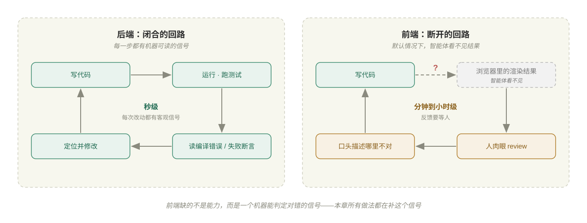

### 前端的四个结构性缺口

| 缺口 | 具体表现 | 为什么类型和测试兜不住 |
| --- | --- | --- |
| **视觉正确性** | 「这个布局看起来对不对」必须渲染出来再用眼睛判断 | 终端里只有代码，没有像素 |
| **上下文依赖** | 同一条样式在 1440px 下完美，在 375px 下崩掉；换个浏览器、换个父组件结果又不同 | 代码是静态的，效果是代码 × 视口 × 组合的乘积 |
| **反馈回路断裂** | 后端默认有 test runner；前端默认什么都没有 | 智能体写完一大坨代码，然后等人来肉眼 review |
| **约束维度过多** | DOM 结构、组件状态、可访问性、响应式断点、设计一致性 | 只有极少数维度能被类型系统捕获 |

在这四个缺口之上，还有第五个问题：**审美趋同。** 在没有指引时，模型会取训练分布的均值——Anthropic 把这种结果直接叫作 **AI slop aesthetics**：Inter 字体、白底紫色渐变、三张卡片并排的落地页。它不是错，只是平庸，而平庸恰恰是用户最先察觉「这是 AI 做的」的地方。

### 一个重要的边界

「前端更难」很容易被误读成「前端不适合用 AI」。更准确的说法是：**前端里负责视觉的那一层不适合放手。**

一个前端代码库里有大量和后端很像的代码：数据获取、状态机、表单校验、路由、类型定义。这些部分智能体依然表现良好，因为类型和测试兜得住。真正的难点集中在一个窄带里——渲染结果和审美。本章所有的做法，本质上都是**把这个窄带收得更窄**。

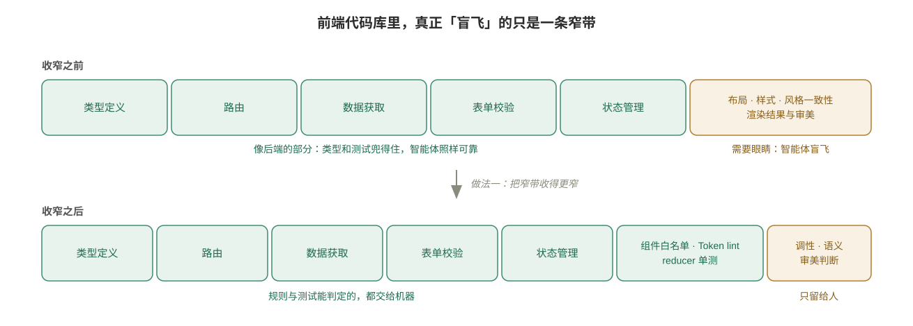

---

## 瓶颈的三次迁移

### 序章：生成不再是问题（2024 年以前）

从 2017 年 pix2code 用神经网络把截图转成代码，到 2023 年 GPT-4 发布会上把手绘草图变成网页、Vercel v0 用一句话生成 React 组件，再到一批截图转代码的开源项目，这一阶段只证明了一件事：**模型能写出页面。**

2024 年 5 月 **GPT-4o** 把原生多模态带进主流，截图、草图、设计稿成为日常输入。从这时起，「能不能生成」不再是瓶颈。真正的问题浮出水面：所有人生成的页面都长得差不多，而且没人知道它们在浏览器里是不是真的能用。

### 第一次迁移：从生成到品味

当生成变得廉价，竞争点就从「能不能做」转向「做得好不好看」。三家厂商在 2025 年不约而同地把**审美**当作前端能力的卖点：

- **2025-05**，Google 发布 Gemini 2.5 Pro「I/O 版」，登顶以人类偏好打分的 WebDev Arena 榜单，演示从一段 YouTube 视频直接生成交互式学习应用；同月推出 **Stitch**，从文字或图片生成 UI 设计稿和前端代码。
- **2025-08**，OpenAI 发布 GPT-5，专门强调前端：内部测试中 70% 的情况下比 o3 更受偏好，并且「对间距、字体和留白有更好的理解」。
- **2025-11**，Anthropic 发布 **`frontend-design` Skill** 和配套文章《Improving frontend design through Skills》，第一次把「如何摆脱 AI 审美」写成一份可安装的文本。

品味的问题在于：它对一个具体产品而言不是通用的。模型再有审美，也不知道**你的**产品应该长什么样。于是品味的载体开始从模型权重向**文件**转移——2026 年 3 月 Google Stitch 提出 **DESIGN.md**，4 月把它开源为跨工具规范。

### 第二次迁移：从品味到验证

好看不等于对。一个视觉精美、但弹窗点不开、窄屏下错位、加载态卡死的页面，比一个丑但能用的页面更糟。

2025 年下半年起，三家都开始把**浏览器放进智能体的闭环**：GPT-5-Codex 能查看自己做出的界面截图（2025-09）；Chrome DevTools MCP 让智能体读 DOM、Console 和性能 trace（2025-09）；Google Antigravity 的浏览器子智能体自己点完流程、录屏截图（2025-11）；Claude Code 接入 Claude in Chrome，「在终端里构建，在浏览器里验证」（2025-12）。

方法论也随之成形。Matt Pocock 在 2026 年 1 月给出了诊断（「前端在盲飞」），此后几个月里陆续给出了处方：TDD Skill、原型 Skill、用 reducer 和状态机把逻辑剥离 UI，直到 11 月那句「每日提示词」——

> How do we make this change fully verifiable?

| 阶段 | 解决了 | 暴露出 | 对你意味着 |
| --- | --- | --- | --- |
| 生成 | 从零到页面 | 千篇一律、不知对错 | 不必再为「能不能生成」花精力 |
| 品味 | 摆脱默认审美 | 通用品味≠你的产品 | 把设计语言写成文件 |
| 验证 | 智能体能自检 | 浏览器慢、有盲区、自述不可信 | 搭验证阶梯，人只做审美判断 |

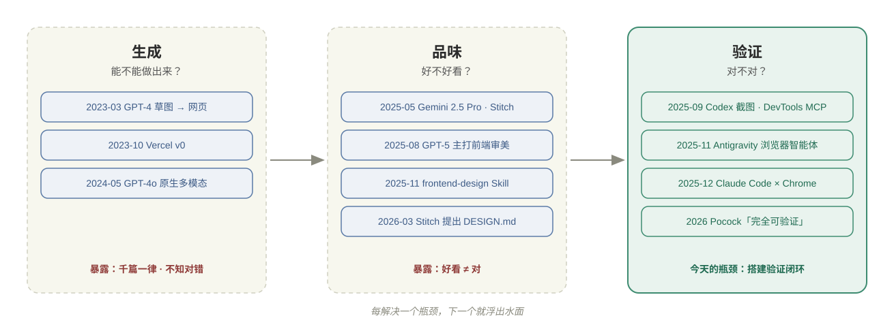

---

## 三条路线：品味和验证放在哪里

同样面对「生成 → 品味 → 验证」，三家厂商做出了截然不同的押注。最好的比较维度是两个问题：**品味放在哪里？验证放在哪里？**

### Google：从设计侧进入，用 Stitch 和 Antigravity 串起一条管线

Google 的打法是**多模态模型、设计工具和开放格式**三样一起推，再加上一样别家没有的东西：Chrome 浏览器。看它的路线，最好的办法是看 Stitch 这一年多是怎么一步步接进开发链路的。

**模型的感知力是底座。** Gemini 从一开始就以多模态、尤其是视频理解作为差异点。2.5 Pro I/O 版的标志性演示是「视频 → 应用」。到了 Gemini 3（2025-11），Google 推出 **generative UI**：Gemini 应用会针对一个问题当场设计并编码一个专属界面（dynamic view），不再只回一段文字。在 Google 看来，**界面本身就是模型输出的一种形态**。

**Stitch 从设计玩具长成了设计入口。** 它的演进分四步：

| 时间 | 发生了什么 | 意义 |
| --- | --- | --- |
| 2025-05 | Stitch 发布：从文字或图片生成 UI 设计稿和前端代码，可粘贴进 Figma | 面向设计师和产品经理，起点在设计侧，不在 IDE |
| 2025-12 至 2026-02 | 发布 Stitch SDK、Stitch MCP 和 `stitch-skills`，Stitch 上架 Antigravity 的 MCP 商店 | 设计能力变成智能体可调用的工具：在 Antigravity 里直接「生成屏幕」「取回屏幕」 |
| 2026-03 | 改版为无限画布（「vibe design」），引入 **DESIGN.md** | 设计规则第一次有了可导出、可导入的文件形态 |
| 2026-04 至 05 | DESIGN.md 开源为规范（2026-04-21，带 linter 和 WCAG 对比度检查）；I/O 2026 推出实时协作的 Stitch Agent，支持导入现有代码库和设计文件，并能导出到 AI Studio、Antigravity 和 Netlify | 管线贯通：设计 → 契约 → 落地 |

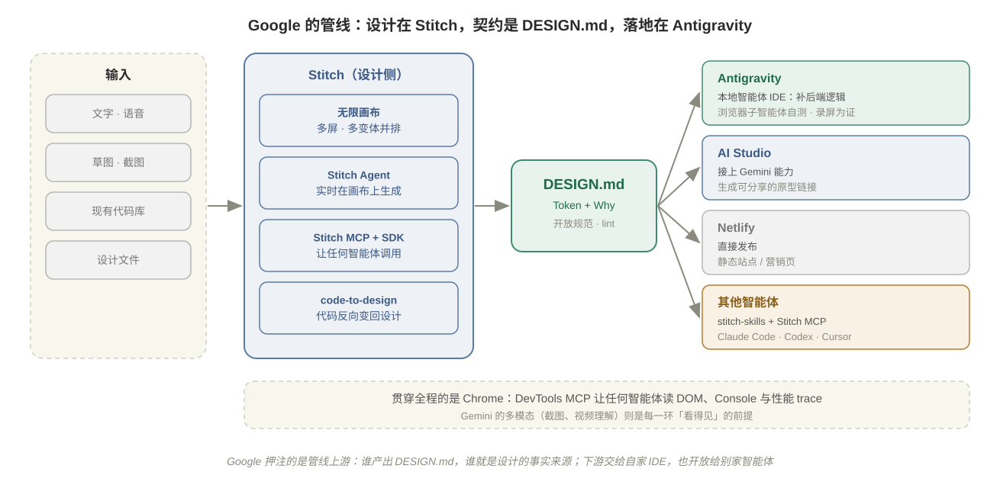

**Antigravity 是这条管线的下游。** 它是 Google 在 2025-11 推出的智能体开发平台，内置一个浏览器子智能体：在隔离的 Chrome 里跑完流程，把截图和录屏作为交付物（Artifacts）交给人审阅。Stitch 导出的屏幕进入 Antigravity 后，智能体补上后端逻辑，再自己在浏览器里点一遍。整条链路覆盖设计、实现和验证三段，而且三段都在 Google 自家的工具里。

周边的产品各补一块：

- **AI Studio** 负责最快出原型。Stitch 设计导出到这里，接上 Gemini 能力，生成一个不需要账号就能点击的分享链接。
- **Jules** 是云端异步智能体，克隆仓库、跑测试、开 PR，适合不需要盯着看的任务。
- **Chrome DevTools MCP**（2025-09）把 DevTools 开放给**任何**智能体，可以读 DOM、Console 和性能 trace。

**开放是这条路线的另一半。** `stitch-skills` 的安装说明把 Codex、Claude Code 和 Cursor 放在 Antigravity 前面；里面还有反向的 Skill，`code-to-design` 把现有前端代码变回 Stitch 设计稿，`extract-design-md` 直接从源码抽出 DESIGN.md。Google 并不要求你用它的 IDE。它要的位置在上游：**如果设计语言是一个任何智能体都能读的文件，那么产出这个文件的工具，就是设计的事实来源。**

**一句话：Google 把品味放在 Stitch 画布和 DESIGN.md 里，把验证放在 Chrome 里。** 自家的 Antigravity 是最顺的下游，但 DESIGN.md 和 Stitch MCP 也同样交给别家智能体使用。

### OpenAI：品味练进模型，生态收进 Codex 插件

OpenAI 的路线是**平台式**的。模型自己要有审美，Codex 自己要能看；设计格式它不去定义，而是把各家设计工具都接进 Codex。

**第一步，品味内化于模型。** GPT-5（2025-08）把前端审美当作模型能力来宣传，讲的是间距、字体和留白。言下之意，品味首先是**训练问题**，其次才是上下文问题。2026-03 的《Designing delightful frontends with GPT-5.4》是配套的操作手册，要点有三条：

- 先定约束，默认最多两种字体、一个强调色；
- 给参考图或情绪板，再配上 Playwright 让模型自查；
- **前端任务先用低推理强度**，低或中档推理往往产出更好的前端。

**第二步，验证收进 Codex。** GPT-5-Codex（2025-09）做前端任务时会查看截图、检查自己的进度，并把界面截图附给你审阅。2026-04，Codex 桌面应用加入内置浏览器和**评论模式**：你在渲染出的页面上点一个元素写意见，智能体同时拿到截图和对应的 DOM 节点。人介入的方式是「在页面上指着说」，不用先写规范文件。

**第三步，用插件市场把生态收进来。** 2026-03-27，Codex 上线插件市场。一个**插件**把 Skill、应用连接和 MCP 服务器打包成一次安装，可以来自官方目录，也可以来自仓库级或个人级的市场。前端相关的插件分两类：

| 类别 | 插件 | 做什么 |
| --- | --- | --- |
| 设计源（第三方） | Figma | 读 Figma 帧转代码、建 Code Connect 映射、为项目生成设计系统规则，也能把界面写回画布 |
| | Stitch | Google 在 `stitch-skills` 仓库里直接提供 Codex 插件市场的安装方式 |
| | Canva、MagicPath、Lovable 等 | 素材、组件库、应用生成器 |
| 工作流（官方） | Build Web Apps | 前端从概念到实现，外加 React、shadcn/ui、Stripe、Supabase 的最佳实践 Skill |
| | Product Design | 构思方向、从 URL 或截图转代码、设计 QA |
| | Build Web Data Visualization | 图表、仪表盘、可视化报告 |

早先单独发布的 `frontend-skill` 也随之并入 Build Web Apps 插件。插件里最值得看的是 `frontend-app-builder` 这个 Skill，它代表了 OpenAI 对前端品味的答案：**概念图即规格。**

1. 先用 Image Gen 为每个主要区块画一张高清概念图，人确认后，这张图就是「生产设计规格」，实现时不允许再自由发挥。
2. 编码前从图里抽出一套小型设计系统，包括 Token、字号层级、组件族和容器规则。
3. 分区实现，每做完一区就在内置浏览器里截图，和概念图对照。
4. 交付前必须把概念图和最新截图并排看一遍，写下**偏差台账**（哪里不一致、证据是什么、修了没有），直到「一家优秀的设计公司会签字」为止。

Skill 里有一句话很能代表这种思路：

> Functional QA does not count as fidelity QA.

点得通、构建过都不够，必须逐项比对。这和 Anthropic 的「列出趋同默认值」是两种做法。OpenAI 用图像生成把审美先**固化成一张图**，再把实现变成一个可比对的保真问题。

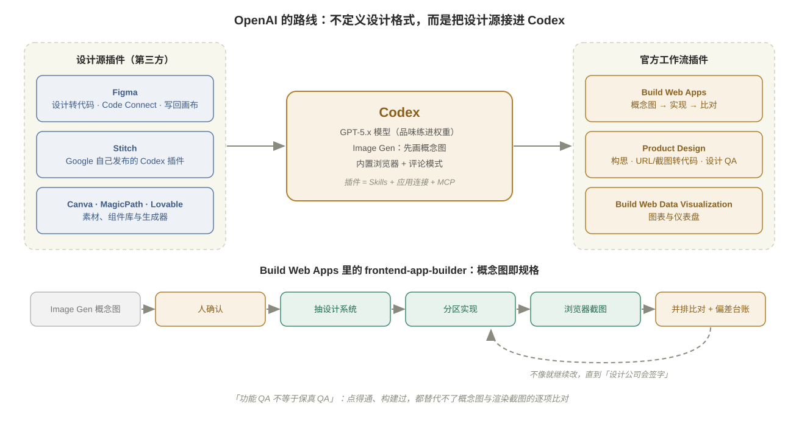

**一句话：OpenAI 把品味放在模型权重和生成出来的概念图里，把验证放在 Codex 内置浏览器和图像比对里。** 生态上，它不跟 Google 争设计格式，而是让 Figma、Stitch、Canva 都作为插件接进 Codex。

### Anthropic：把品味写成可组合的文本，把验证交给 harness

Anthropic 的路线是 **harness（智能体外壳）优先**：模型是通用智能体，前端能力通过可安装、可阅读、可修改的扩展注入。

1. **品味是一个 Skill。** `frontend-design` 的方法论是三步：**识别模型趋同的默认值 → 给出具体的替代方案 → 把指引放在合适的抽象高度**，并按需加载，不污染其他任务。它是一份任何人都能读懂、fork 和改写的 Markdown，2026 年被大幅重写，开始点名新的 AI 痕迹并加入「规划 → 评审 → 构建 → 批评」流程——**品味是一份持续追加的黑名单与替代方案，而不是一次训练的结果。**
2. **验证是 harness 的一个能力。** Claude Code 通过 MCP 接入 Playwright / DevTools，并在 2025-12 直接集成 Claude in Chrome：读 Console 错误、网络请求和 DOM 状态，按设计稿检查页面。
3. **设计侧的补位。** 2026-04 推出 **Claude Design**（Anthropic Labs 研究预览）：读取代码库和设计文件为团队建立设计系统，在画布上迭代，再打包交给 Claude Code 实现。这是 Anthropic 第一次从设计侧进入，但终点仍然是 harness。

**一句话：Anthropic 把品味放在 Skill 文本里，把验证放在 Claude Code 这个 harness 里。** 它的直接后果是一个爆发的社区生态。

### 社区：在三条路线之间长出 Skill 生态

因为 Skill 是开放格式的纯文本，社区在 2025 年底到 2026 年迅速填满了各个层次。按「它主要产出什么」可以分成六层：

| 层 | 回答的问题 | 代表 |
| --- | --- | --- |
| ① 品味 / 判断 | 该不该往这个方向走？否决平庸输出 | `frontend-design`、Taste、Refactoring UI |
| ② 设计知识 | 合理的选项有哪些？ | UI UX Pro Max（风格、配色、字体搭配数据库） |
| ③ 设计方法 | 怎样从方向走到系统？ | Impeccable（audit / polish / extract）、Interface Design（只做产品型 UI，带设计记忆）、StyleSeed、Hallmark |
| ④ 模板与参考 | 能不能直接复用现成设计系统？ | awesome-design-md、Awesome Design Skills（DESIGN.md + SKILL.md 成对） |
| ⑤ 设计上下文 | 决定如何跨会话持久化？ | DESIGN.md 规范、Oh My Design、从网站提取 DESIGN.md 的 BrandMD / DesignPull |
| ⑥ 产出环境 | 怎样做出原型、演示、幻灯片？ | Huashu Design、Open Design、Stitch Skills |

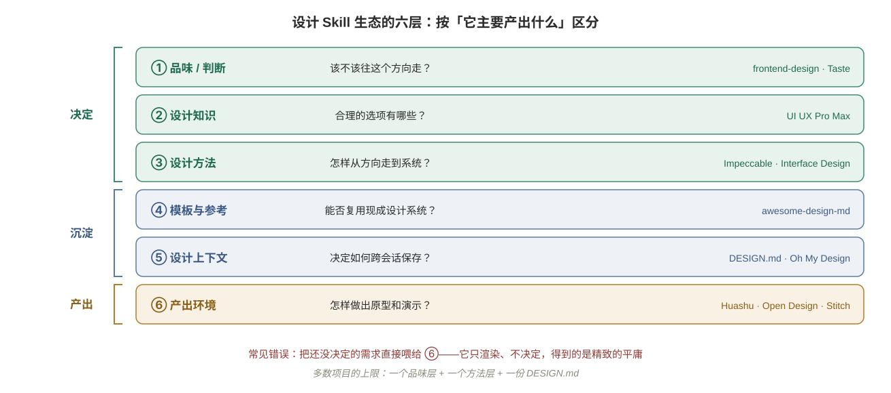

把它们混为一谈是最常见的错误：需要定方向时用了打磨工具，需要持久化时用了知识库。**⑥ 层只负责渲染，不负责决定——把一个没有决定的需求喂给 ⑥ 层工具，得到的是精致的平庸。**

注意这里的分工与 Awesome Design Skills 的成对设计不谋而合：**DESIGN.md 回答「应该长什么样」，SKILL.md 回答「智能体应该怎么干活」。**

### 对比：殊途同归

| | Google | OpenAI | Anthropic |
| --- | --- | --- | --- |
| 进入点 | 设计侧（Stitch → Antigravity 管线） | 模型能力 + Codex 插件市场 | 智能体外壳（Claude Code） |
| 品味的载体 | Stitch 画布 + DESIGN.md 文件 | 模型权重 + Image Gen 概念图即规格 | Skill 文本 + 社区生态 |
| 验证的载体 | Chrome（Antigravity 浏览器子智能体、DevTools MCP） | Codex 内置浏览器 + 概念图与截图比对 | harness（Chrome 集成、MCP） |
| 人在哪里介入 | 设计画布、审阅录屏 | 确认概念图、在渲染页面上点评 | 编辑 Skill / 设计系统，审阅证据 |
| 生态策略 | 定义开放格式，产出端托管 | 不定格式，用插件把设计源接进来 | 扩展开放，可 fork |

三条路线起点不同，到 2026 年却收敛到同一个三元组：

1. **一份写下来的设计上下文**（DESIGN.md、设计系统、Skill）；
2. **一个能看图的模型**；
3. **一个在闭环里的浏览器。**

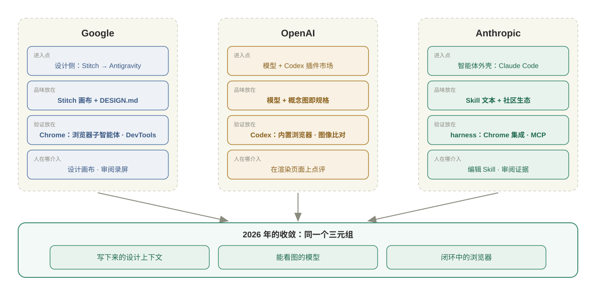

这个收敛本身就是最重要的结论：**不管你用哪家的工具，高质量的智能体前端开发都需要你提供这三样东西。** 下面的做法因此与工具无关。

---

## 做法一：收窄生成空间——把审美问题降级成结构问题

「这个页面看起来对吗」是一个主观问题，智能体判断不了。「这个页面有没有只用允许的组件和 Token」是一个结构问题，一个脚本就能判断。**最有杠杆的一步，是先把前者尽可能多地转换成后者。**

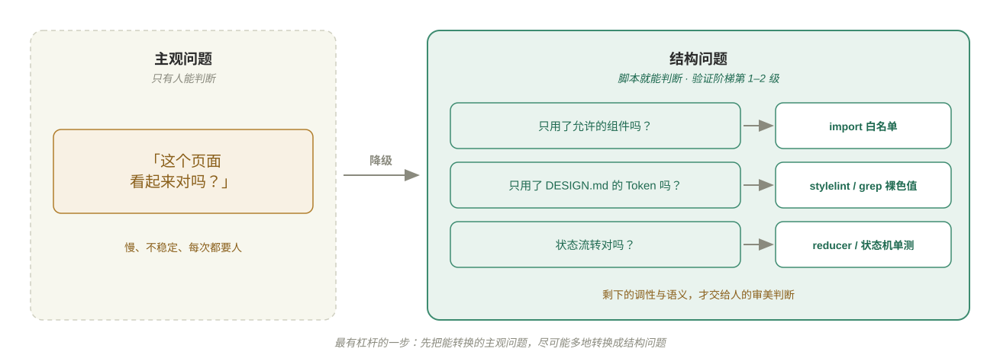

### 组件先行

先把公共组件封装好，之后的业务页面只做配置：字段、查询条件、操作按钮、绑定的接口。这样智能体在业务页面上的「自由发挥空间」被收窄到几乎只剩数据。

以一个典型的 SaaS 管理后台为例，技术栈是 React + TypeScript + shadcn/ui，换成 Vue 或其他组件库道理相同。后台里大部分页面都是「列表 + 弹窗表单 + 增删改查」，所以先用一条指令生成五个公共件：

| 组件 | 接口 | 职责 |
| --- | --- | --- |
| `DataTable.tsx` | Props：`columns`、`fetcher`、是否分页；暴露 `refresh()` | 自动管理 loading、分页参数与数据请求 |
| `FormDialog.tsx` | Props：`title`、`width`、`schema`；`open` 控制显隐；`openWith(data?)`；回调 `onSubmit` | 传 data 为编辑，不传为新增 |
| `useConfirm.ts` | 接收确认文案与 API 方法 | 一行完成「确认删除 → 调接口 → 提示成功」 |
| `useRequest.ts` | 接收 API 方法，返回 `{ data, loading, error, execute }` | 自动管理请求三态 |
| `notify.ts` | 导出 `notifySuccess` / `notifyError` / `notifyWarning` | 统一通知 |

**描述清楚接口和行为，让智能体一次性生成；你的精力放在验证它们好不好用上。** 之后每个新模块基本只换数据源：成员管理、API 密钥、账单记录都是同一套组件配不同的列和接口，接真实后端时只需把 mock 数据换成 API 调用。

### 写成可检查的规则

组件库只有被强制使用才有意义。在 `CLAUDE.md` / `AGENTS.md` 里写明，并尽可能交给 lint：

```text
- 页面只能使用 src/components 与 shadcn/ui 中已有的组件；
  没有合适的组件时不要自己造，停下来列出缺口交给我决定。
- 颜色、圆角、间距只能使用 DESIGN.md 中的 Token（CSS 变量），禁止写裸的十六进制色值和 px 魔法数。
- 不使用原生 alert / confirm，统一用 useConfirm 和 notify。
```

第二条可以用一个 stylelint 规则或一段 grep 脚本检查；第一条可以用 import 白名单检查。一旦规则变成脚本，「风格一致」就从需要人看的事，变成了验证阶梯第一级就能抓住的事。

### 把逻辑剥离 UI

前端代码里那些「像后端」的部分，要让它真的像后端。一个有「新增 / 编辑 / 校验失败 / 提交中 / 提交成功」五种状态的弹窗，如果状态散落在组件的各个 `ref` 和事件处理里，唯一的验证方式就是在浏览器里把每条路径点一遍。

按 Pocock 的建议，把状态流转写成 **reducer 或状态机**：输入当前状态和一个动作，返回新状态，不碰 DOM。UI 层只渲染状态、派发动作，保持「哑」。

```text
把这个弹窗的状态逻辑抽成纯函数 reducer（dialogReducer.ts，不 import 任何 React / DOM 代码），
状态至少包含 closed / creating / editing / submitting / error。
先为每个状态转换写单测（含：提交中重复点击、提交失败后再次编辑、关闭时重置表单），
测试通过后再让组件改为只调用 reducer。
```

Pocock 的体会是：每当智能体写出一个状态机或 reducer，健壮性都会有一次明显的跃升。原因很简单——大部分「对不对」从浏览器掉回了单测。

---

## 做法二：把品味写下来

收窄空间之后，剩下的是真正的审美问题。这里的原则是：**不让模型猜，也不让它每次从第一性原理推导你的品牌。**

### 用咨询模式定设计方向

「帮我设计一个好看的界面」只会得到分布的均值。先不写代码，让智能体当设计顾问，输入层层递进：

| 维度 | 示例回答（团队协作 SaaS 的管理后台） |
| --- | --- |
| 产品是什么 | 团队协作工具的管理后台：成员、权限、账单、API 密钥 |
| 用户是谁 | 团队管理员，每周来几次，追求快速完成操作 |
| 想要什么风格 | 浅底、信息密度中等、克制，带一点科技感 |
| 色调偏好 | 主色蓝紫系，辅色青色或薄荷绿 |
| 参考锚点 | Linear、Supabase 的视觉风格 |

```text
先不要写代码。你现在是这个产品的设计师。
产品：一个团队协作工具的管理后台（成员、权限、账单、API 密钥）；用户是团队管理员。
风格：浅色背景，带科技感点缀，干净、不花哨。
色调：主色蓝紫系，辅色青色或薄荷绿。
参考：Linear 和 Supabase 的视觉风格。
请输出完整的设计系统：主色 / 辅色 / 背景色阶 / 文字色阶 / 圆角 / 阴影 / 过渡动效，
用 CSS 变量表示；每一组选择附一句理由。
```

**参考锚点是信息量最大的一项。**「参考 Linear」几个字就传递了一整套间距、字重和克制程度的约定。OpenAI 的指南给出了同样的建议：提供参考图或情绪板，并在一开始就收紧约束（字体不超过两种、一个强调色）。

拿到结果后快速 review 调性——刺不刺眼、对不对味；对比度够不够交给 linter，不需要逐个色值较真。

### 沉淀成 DESIGN.md

设计系统不能只活在一次对话里。把它写成仓库根目录的 `DESIGN.md`（[规格编码](spec-coding.md)第二步的 `DESIGN_STANDARDS.md` 就是它），格式遵循 Google 开源的规范：

- **YAML front matter 放 Token**：颜色、字体、圆角、间距等精确值，并在代码里落地成 CSS 变量。
- **Markdown 正文放理由**：为什么侧边栏用接近纯黑但不是纯黑；为什么「禁用」不用红色。

规范自己的总结最到位：

> Tokens give agents exact values. Prose tells them why.

这和[代码库记忆](repo-memory.md)的结论一致：精确值交给可校验的结构，手写只留 Why。不要往里放组件实现步骤和逐页样式——那会很快过期。

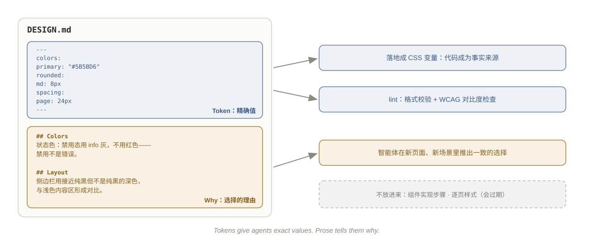

起点有三种：**从零**用上面的咨询提示词；**有参考站点**用提取工具（BrandMD 偏确定性的 Token 提取，DesignPull 用视觉模型提取意图）；**想要成熟品牌风格**从 awesome-design-md 拿一份改。无论哪种，最后都用 `npx @google/design.md lint` 校验。

### 选设计 Skill：按层组合，DESIGN.md 优先

| | 设计 Skill | DESIGN.md |
| --- | --- | --- |
| 回答 | 怎样不像 AI 做的；怎样走设计流程 | 这个产品长什么样 |
| 范围 | 跨项目、通用 | 单个产品 |
| 加载 | 按需触发 | 改界面时总是读取 |
| 冲突时 | 让位 | 优先 |

按任务选层，而不是装一大堆：

| 场景 | 组合 |
| --- | --- |
| 0→1 后台 / SaaS / 智能体控制台 | 产品型 UI 方法（如 Interface Design）+ 设计知识库查配色与图表 + DESIGN.md |
| 0→1 落地页 / 营销站 | 品味层（`frontend-design` 定方向，Taste 否决平庸）+ 方法层构建 |
| 已有界面太丑 | Impeccable audit → Refactoring UI 修层级与间距 → polish |
| 80 分到 95 分 | 光学细节与动效打磨类 Skill |

装得越多，相互竞争的风格指令越多。**一个品味层 + 一个方法层 + 一份 DESIGN.md**，是大多数项目的上限。

### 结构 → 行为 → 细节

品味不只是配色。向智能体描述复杂页面时，顺序是**结构 → 行为 → 细节**，顺序乱了就会返工——在结构没对齐时描述交互细节，智能体会在错误的布局上把细节做得很精致。

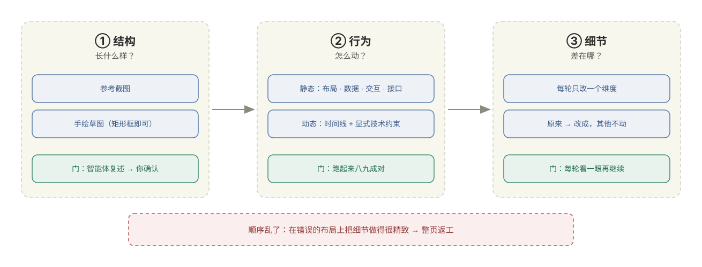

**结构：先对齐「长什么样」。** 给一张成熟产品的截图或一张手绘草图（矩形框标注区域即可），然后**先让智能体用文字复述它理解的结构，确认后再动手**。

**行为：按交互类型分别描述。**

- **静态交互（离散型）用四维度**：布局（元素如何排列）、数据（展示哪些字段、状态如何区分）、交互（每个操作的完整流程）、接口（每个操作对应哪个 API）。
- **动态交互（连续型）用时间线**：1 → 2 → 3，每一步说清什么触发、页面如何响应，并**显式声明技术约束**——那些「不说不知道、说了就能做好」的细节：

```text
1. 用户按回车：输入框清空并禁用，列表追加用户消息和「思考中」占位。
2. 用 POST 发起流式请求（SSE over POST 不能用 EventSource，要用 fetch + ReadableStream）。
3. 每个 chunk 追加到占位消息并增量渲染 Markdown；
   只有用户本来在底部时才自动滚动，用户上翻时不抢滚动条。
4. 流结束恢复输入框；出错时在该条消息下显示重试，不弹全局错误。
```

**细节：增量调整。** 跑起来通常八九成对；剩下的每轮只改一个维度，说清「原来 → 改成」，其他保持不动（见后文贯穿示例）。

### 视觉方向：让人在几个真正不同的选项之间选

让智能体「换个风格再试」，往往只是换了颜色的同一个布局。Pocock 的 `/prototype` 思路是把工作切开：**方案构造交给 AI，审美判断交给人。**

```text
在 /prototype/members 这条临时路由上做三个可以切换的版本（?variant=a|b|c）：
三者必须在结构上不同（例如表格 / 卡片网格 / 左右分栏），而不只是配色不同；
都用真实数据和真实条数渲染。我选定后，你再把选中的那个接进主流程。
```

两条硬要求：**结构上分歧**，以及**用真实数据和真实密度**——在空页面上评审的变体永远看起来都不错。选定后，把选择的理由写回 DESIGN.md。

---

## 做法三：验证阶梯

收窄和写下之后，剩下的「对不对」交给验证。原则只有一条：**每个问题都有一把最便宜的尺子，把它压到能抓住它的最低一级。**

| 级别 | 尺子 | 抓什么 | 速度 |
| --- | --- | --- | --- |
| 1 | **类型检查 + Lint**（含 Token / 组件白名单规则） | 字段拼错、Props 不匹配、裸色值、越界组件 | 秒级 |
| 2 | **纯逻辑单测**（reducer、状态机、composable） | 状态流转、边界条件、异常分支 | 秒级 |
| 3 | **组件测试 / Story** | 单个组件在各种 Props 与状态下的渲染与交互 | 十秒级 |
| 4 | **浏览器验证**（快照、点击、多断点） | 页面级集成：路由、弹窗、接口联调、响应式 | 分钟级 |
| 5 | **视觉回归**（截图对比） | 「你动了不该动的地方」 | 分钟级 |
| 6 | **人的审美判断** | 好不好看、调性对不对、语义对不对 | 取决于你 |

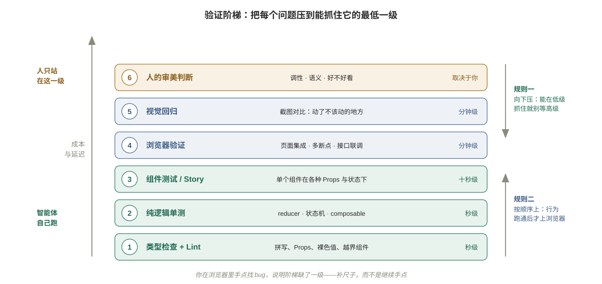

### 规则一：向下压

一个 bug 能用第 2 级抓住，就不要等到第 4 级。这就是做法一要把逻辑剥离 UI、把风格变成 lint 规则的原因——**剥出来，它才能往下掉。**

### 规则二：按顺序上

浏览器测试放在行为跑通之后。Pocock 在 `/tdd` Skill 里记录过一个真实案例：智能体先写了 Playwright 测试，然后在漫长的循环里反复重跑——「浏览器测试慢到红绿循环不再划算」。把「浏览器测试在行为跑通后再写」写进 `CLAUDE.md`。同理，审美评审放在功能验收之后；在一个会报错的页面上讨论配色是浪费。

### 规则三：浏览器验证要覆盖「上下文依赖」

第 4 级的价值，恰恰在于补上前文的第二个缺口。让智能体至少在三个视口（如 375 / 768 / 1440）各走一遍关键流程，而不是只在默认窗口里看一眼。

端到端验收用一条数据走完整链路：

- **标准用例**：新增 → 查询 → 编辑 → 删除；特殊动作（重发邀请、批量导入）全程验证。
- **三类场景**：正常流程；异常流（友好提示，屏蔽底层堆栈）；边界场景（无数据、权限不足、超时）。

### 规则四：视觉回归代替反复目视

第 5 级把「看起来变了没有」变成一次可自动判定的像素 diff：Playwright 的 `toHaveScreenshot`，或 Chromatic、Percy 这类服务。基线由人确认一次，之后智能体每次改 UI 都会收到机器信号，而不需要你每次重新看。

如果团队已经有了视觉回归，「盲飞」的缺口就基本补上了；此时再叠加一堆人工审批关卡，只会增加摩擦而不降低风险。**工程手段的价值在于补上缺失的反馈，而不是无差别地限制智能体。**

### 规则五：审证据，不审自述

智能体说「已验证」不算数。三个真实的盲区：

- Anthropic 的长时智能体实验里，**浏览器原生 alert 对智能体不可见**，依赖它的功能 bug 更多。
- 有实践者报告，Antigravity 生成的「成功」演示录屏，实际上拍的是一排 Suspense 加载中的转圈。
- Simon Willison 发现智能体有时会直接改演示记录文件，而不是通过工具真正执行。

所以要让验证留下可审阅的证据（快照、截图、断言日志），并审视证据本身：截图里是否真的是加载完成的状态？断言是否真的检查了你关心的东西？

### 一句提示词

把这句放在每个前端任务的开头：

```text
How do we make this change fully verifiable?
（这次改动怎样才能完全可验证？先列出你会用阶梯的哪几级、每级验证什么、会留下什么证据，再动手。）
```

它会迫使智能体主动去补尺子：给 reducer 写单测、启动 dev server、在浏览器里走一遍，而不是写完就报告完成。前提是你已经在 `CLAUDE.md` 里写好 dev server 的启动命令、端口和测试账号。

---

## 做法四：调节自主性

后端任务可以「一句话下去、智能体跑二十分钟、你来验收」。视觉类产出不行。Pocock 反复用一个比喻：**智能体默认开得比车灯照得还远**（outrunning your headlights）——反馈的速度就是你能跑的速度上限。

前端的节奏应该是：

```text
计划或草案 → 人确认结构 → 小步实现 → 自动验证（阶梯 1–5）→ 人做审美判断 → 写回 DESIGN.md
```

自主性跟着验证覆盖率走：

| 这一块的验证覆盖 | 适合的自主性 |
| --- | --- |
| 有类型、单测、浏览器用例、视觉回归 | 可以放手长时间运行 |
| 有单测和浏览器用例，无视觉回归 | 小步提交，每步看截图 |
| 只有类型检查 | 先补尺子，再放手 |
| 纯视觉探索（新页面方向） | 多变体 + 人选，不追求一次做对 |

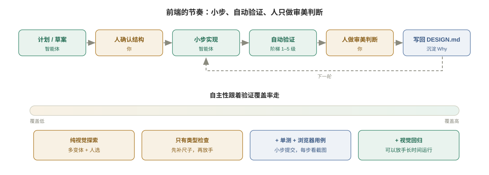

---

## 贯穿示例：一个「成员管理」页从「能用」到「好看」

几乎每个 SaaS 后台都有一个成员管理页：列出团队成员，能邀请、改角色、停用和移除。它足够普通，正好用来把上面的做法串起来。

1. **定设计方向**：用咨询提示词得到蓝紫主色、浅底的设计系统，以 CSS 变量落地，写进 DESIGN.md。
2. **先做外壳**：侧边栏是用户第一眼看到的地方，改起来效果最明显。深色背景，接近纯黑但不是纯黑；菜单项白字、透明底，hover 微亮，选中态左侧一条 3px 主色竖线；每项配图标；底部是折叠按钮和版本号。可以有科技感，但不能花哨到影响使用。
3. **统一布局**：顶栏左边是面包屑，右边是用户信息；内容区浅灰底，白卡片配轻阴影和圆角；每页顶部是「标题 + 描述 + 右侧操作区」；间距统一为页面 24px、卡片 20px、元素 16px；主按钮用主色，次按钮白底描边，危险操作用红色。
4. **组件先行**：一条指令生成五个公共件（见做法一）。
5. **把状态剥出来**：「邀请成员」弹窗的状态写成 reducer，先过单测（见做法一）。
6. **生成成员管理页**（mock 数据），然后做五轮「看 → 说 → 改」，每轮只改一个维度：

| 轮次 | 维度 | 原来 → 改成 | 归属的验证级别 |
| --- | --- | --- | --- |
| 1 | 布局 | 表格与标题区间距 24px → 16px；行高 52px；操作按钮间隔 8px | 6（人），之后进视觉回归基线 |
| 2 | 色调 | 状态标签：已激活用绿色，待接受邀请用蓝色，已停用用灰色，**不用红色**，因为停用不是错误 | 6（人），理由写回 DESIGN.md |
| 3 | 邀请弹窗 | 宽 600 → 520px；邮箱输入框加示例 placeholder；角色下拉附上每个角色的一句权限说明；label 统一宽度并右对齐 | 3（组件）+ 6 |
| 4 | 响应式 | 宽度 < 1200px 时侧边栏自动折叠；窄屏隐藏「最近登录」和「加入时间」两列 | 4（多断点浏览器验证），智能体可自检 |
| 5 | 整体微调 | 表头浅灰；分页器居右，上方加分割线；「邀请成员」按钮加 + 图标；行 hover 微微变色；「编辑」用主色文字按钮，「移除」用红色文字按钮 | 6，之后进视觉回归基线 |

第 2 轮是典型的审美判断：**智能体出初稿，你来判断，判断一旦做出就写回 DESIGN.md**，下一个页面就不用再说一遍。

最终验收按阶梯走：

- reducer 单测全绿；
- 在 375 / 768 / 1440 三个宽度下走完「邀请 → 改角色 → 停用 → 移除」；
- 移除前有二次确认，成功后有提示；
- 列表为空、权限不足、接口超时三种情况都有截图为证；
- 最后由人确认视觉回归基线。

你不需要会写 CSS，但要能说清楚「哪里不对」和「应该怎样」。每一轮「看 → 说 → 改」都在练这种判断力。

---

## 反模式

| 反模式 | 为什么失败 | 改成 |
| --- | --- | --- |
| 「帮我设计一个好看的界面」 | 没有信息，只能取均值 | 产品 / 用户 / 风格 / 色调 / 参考锚点 |
| 让智能体自由写 CSS | 每个页面一种风格，无法检查 | 组件白名单 + Token lint |
| 设计系统只存在于对话里 | 下一个会话从头再猜 | DESIGN.md + CSS 变量 |
| DESIGN.md 塞满实现步骤 | 很快过期 | 只放 Token 和 Why |
| 装一堆设计 Skill | 风格指令相互竞争 | 一个品味层 + 一个方法层 + DESIGN.md |
| 把未决定的需求喂给原型工具 | 精致的平庸 | 先定方向，再产出 |
| 结构没对齐就写交互细节 | 整页返工 | 先让智能体复述结构 |
| 「换个风格」只换了颜色 | 没有真正的选项 | 要求结构上不同的变体 |
| 在空页面上评审 | 空页面永远好看 | 真实数据、真实密度 |
| 状态逻辑散落在组件里 | 只能在浏览器里手点 | reducer / 状态机 + 单测 |
| 一上来先写浏览器测试 | 循环太慢 | 行为跑通后再写 |
| 只在一个窗口宽度下验证 | 漏掉上下文依赖 | 多断点走关键流程 |
| 相信「已验证」 | 自述与执行可能不一致 | 审截图、快照、断言等证据 |
| 用原生 alert / confirm | 对浏览器智能体不可见 | 组件库对话框 |
| 你在浏览器里手点找 bug | 缺一级尺子 | 补上对应级别的自动验证 |

---

## 小结

1. **前端难，是因为缺少可验证的信号，而不是模型不会写。** 后端天然有 test runner，前端要你亲手造。
2. **瓶颈已从生成迁移到品味，再迁移到验证。** 三家厂商路线不同——Google 用 Stitch → DESIGN.md → Antigravity 串起设计到代码的管线，OpenAI 把品味放进模型和「概念图即规格」、用插件把设计源接进 Codex，Anthropic 把品味写成 Skill、验证交给 harness——但最终都收敛到「设计上下文 + 能看图的模型 + 闭环中的浏览器」。
3. **收窄生成空间**：组件先行、Token 与组件白名单写成 lint、逻辑剥离 UI——把审美问题降级成结构问题。
4. **把品味写下来**：咨询式定方向，沉淀 DESIGN.md，按层选 Skill，结构 → 行为 → 细节，多变体让人选。
5. **验证阶梯**：类型 → 单测 → 组件 → 浏览器 → 视觉回归 → 人。向下压、按顺序上、审证据。
6. **自主性跟着验证覆盖率走**，人只站在审美判断那一级。

### 前端任务检查清单

- [ ] 仓库里有 DESIGN.md（Token + Why），Token 已落地为 CSS 变量，并通过 lint
- [ ] 组件白名单与「禁止裸色值」已写进规则并由脚本检查
- [ ] 复杂状态在 reducer / 状态机里，有单测
- [ ] 需求按「结构 → 行为 → 细节」给出，结构已由智能体复述确认
- [ ] 至多一个品味层 Skill + 一个方法层 Skill
- [ ] `CLAUDE.md` 写明 dev server 启动方式、测试账号，以及「浏览器测试在行为跑通后再写」
- [ ] 关键流程在多个断点下走过，正常 / 异常 / 边界三类场景有证据
- [ ] 视觉回归基线已由人确认
- [ ] 每个审美判断都写回了 DESIGN.md

---

## 参考资料

**难点与方法论**

- Matt Pocock，「Frontend is WAY harder for AI than backend」（X，2026-01）：<https://x.com/mattpocockuk/status/2010728707997278296>
- Matt Pocock，*Essential AI Coding Feedback Loops For TypeScript Projects*：<https://www.aihero.dev/essential-ai-coding-feedback-loops-for-type-script-projects>
- Matt Pocock，`/tdd` Skill：<https://www.aihero.dev/skills-tdd>
- Matt Pocock，`/prototype` Skill：<https://www.aihero.dev/skills-prototype>
- Matt Pocock，*The secret to building robust frontend apps with agents*：<https://www.youtube.com/watch?v=r8FYE2ZOj0E>
- Matt Pocock，「How do we make this change fully verifiable?」：<https://x.com/mattpocockuk/status/2118313863917564136>
- Anthropic，*Effective harnesses for long-running agents*：<https://www.anthropic.com/engineering/effective-harnesses-for-long-running-agents>

**Google**

- Gemini 2.5 Pro I/O 版：<https://developers.googleblog.com/en/gemini-2-5-pro-io-improved-coding-performance/>
- Stitch：<https://developers.googleblog.com/stitch-a-new-way-to-design-uis/>
- Gemini 3 与 generative UI：<https://blog.google/products/gemini/gemini-3-gemini-app/>
- Google Antigravity：<https://developers.googleblog.com/build-with-google-antigravity-our-new-agentic-development-platform/>
- Stitch MCP 上架 Antigravity（Stitch 官方 X，2026-02）：<https://x.com/stitchbygoogle/status/2024605622302625923>
- Stitch I/O 2026 更新（Stitch Agent、导出到 AI Studio / Antigravity / Netlify）：<https://blog.google/innovation-and-ai/models-and-research/google-labs/stitch-updates/>
- `stitch-skills`（含 code-to-design、extract-design-md，及 Codex / Claude Code 安装方式）：<https://github.com/google-labs-code/stitch-skills>
- Stitch DESIGN.md 开源公告：<https://blog.google/innovation-and-ai/models-and-research/google-labs/stitch-design-md/>
- DESIGN.md 规范：<https://github.com/google-labs-code/design.md>
- Chrome DevTools MCP：<https://developer.chrome.com/blog/chrome-devtools-mcp>

**OpenAI**

- *Introducing GPT-5 for developers*：<https://openai.com/index/introducing-gpt-5-for-developers/>
- *Introducing upgrades to Codex*（GPT-5-Codex）：<https://openai.com/index/introducing-upgrades-to-codex/>
- *Designing delightful frontends with GPT-5.4*：<https://developers.openai.com/blog/designing-delightful-frontends-with-gpt-5-4>
- *Codex for (almost) everything*（内置浏览器）：<https://openai.com/index/codex-for-almost-everything/>
- Codex 插件文档：<https://developers.openai.com/plugins/build/plugins>
- OpenAI 官方插件仓库：<https://github.com/openai/plugins>
- Build Web Apps 插件（`frontend-app-builder`）：<https://github.com/openai/plugins/tree/main/plugins/build-web-apps>
- Figma 插件：<https://github.com/openai/plugins/tree/main/plugins/figma>

**Anthropic**

- *Improving frontend design through Skills*：<https://claude.com/blog/improving-frontend-design-through-skills>
- `frontend-design` Skill：<https://github.com/anthropics/skills/tree/main/skills/frontend-design>
- Claude in Chrome：<https://claude.com/resources/articles/claude-for-chrome>
- Claude Design：<https://www.anthropic.com/news/claude-design-anthropic-labs>

**社区**

- awesome-design-md：<https://github.com/VoltAgent/awesome-design-md>
- Awesome Design Skills：<https://github.com/bergside/awesome-design-skills>
- Impeccable：<https://github.com/pbakaus/impeccable>
- Interface Design：<https://github.com/Dammyjay93/interface-design>
- Taste Skill：<https://github.com/Leonxlnx/taste-skill>
- UI UX Pro Max：<https://github.com/nextlevelbuilder/ui-ux-pro-max-skill>

## 延伸阅读：浏览器在闭环里

本章不比较浏览器工具，以下供按需选用：

- Playwright MCP：<https://github.com/microsoft/playwright-mcp>
- Vercel agent-browser：<https://github.com/vercel-labs/agent-browser>
- Simon Willison，*Introducing Showboat and Rodney*：<https://simonwillison.net/2026/Feb/10/showboat-and-rodney/>
- Storybook MCP：<https://github.com/storybookjs/mcp>
- Figma MCP Server：<https://www.figma.com/blog/introducing-figma-mcp-server/>
