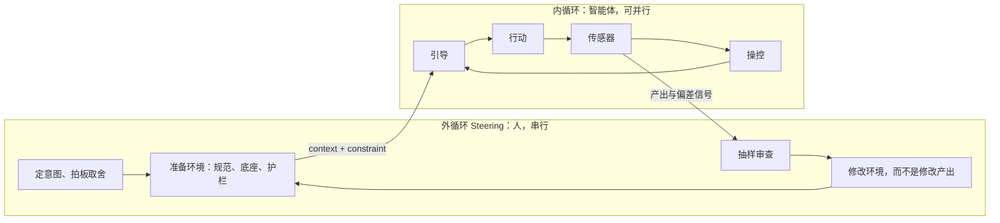

# 产品、业务与工程底座：智能体开发的三层分工

Last updated: 2026-11-10

> *智能体不会留白。你没定的那一层，它会替你定——而且定得看起来很合理。*

[规格编码](spec-coding.md)一章给出了从想法到产品的六步流程：先写 Spec，再定设计标准、做架构、建记忆、开始编码。流程本身不难记，难的是每一步里到底在决定什么。一份 PRD 里混着用户需求、业务规则和技术选型；一个「新增功能」的任务里，同时改了页面、业务判断和 HTTP 客户端的超时配置。

本章要回答的是：**为什么真正工程化的项目，需要把产品层、业务层和工程底座层分开想、分开做、分开验收？这种分层在 Agentic Coding 的工作流里应该如何体现？** 回答它需要先换一个视角：三层分工不只是软件工程的最佳实践，它本身就是在给智能体供给 context 与 constraint——而供给的场所，就是代码库本身。

第四章的[产品与业务定义](../04-team/product-business-definition.md)和[技术架构与部署设计](../04-team/architecture-and-deployment-design.md)已经给出了两份文档该写什么、模板长什么样。本章不重复模板，而是讲三层为什么要分、每一层如何进入智能体的工作流，并给出两个具体设计：**项目开始时的工程组件初始化**，以及**项目进行中的重构与组件提炼**。

| 章节 | 理论 | 配套做法 |
| --- | --- | --- |
| 为什么要分三层 | 内外双循环；代码库就是 Harness；三层 = context 与 constraint 的供给 | 循环图、三层对照表 |
| 隐性知识的挖掘 | 未挖掘的空白会被默认值填上，默认值会成为示范 | 三层隐性项清单、挖掘产物去向表 |
| 产品层 | 四类需求；需求到可测试的落差 | 盘问会话、验收示例提示词 |
| 业务层 | 领域概念 → 规则 → 不变量 | 领域四问、术语表 |
| 工程底座层 | 约束强度阶梯；软约束为什么衰减 | 架构决策九步 |
| 业务与工程的切分 | 依赖方向、组件目录、可执行约束 | 切分规则清单 |
| 设计 A：工程组件初始化 | 外循环搭环境：先底座、再参考切片、后业务 | 六阶段协议与提示词 |
| 设计 B：重构与组件提炼 | 改进循环：证据驱动的提炼；纠正的顺序 | 六步循环与两个案例 |
| 三层在工作流中的映射 | 每个阶段在哪个循环、动哪一层、谁拍板 | 全景表 |

---

## 为什么要分三层

### 先看全景：Agentic Coding 的双循环

在谈分层之前，先建立一个贯穿本章和[代码库记忆](repo-memory.md)一章的模型：智能体开发由两个嵌套的循环组成。

**内循环**是智能体执行一个有界任务的循环：引导（任务指令、Skill、记忆文件）→ 行动（写代码、调用工具）→ 传感器（测试、lint、类型检查）→ 操控（继续、纠正、重试）。这个循环里几乎没有人：传感器给出机器可判定的信号，智能体据此自我纠正。正因为不依赖人，**内循环可以并行**——十个智能体同时推进十个任务，互不等待。

**外循环（Steering loop）**是人的循环：定意图、拍板取舍、抽样审查产出、发现偏差后修改环境。这些判断没有机器能替代——要不要做多租户、这个抽象值不值得引入、这次产出能不能合并，都只能由人决定。外循环天然是串行的，带宽就是你的注意力。



两个循环的交界处是**环境**：智能体从环境里读取 context（它需要知道什么）和 constraint（它不能做什么），再把产出和偏差信号交还给环境的维护者。而这个环境不是别的，**就是代码库本身**——Spec、术语表、底座组件、参考切片、测试、lint 规则，乃至每一行已有的业务代码，都是 Harness 的组成部分。智能体一次任务的质量上限，在它开始工作之前就被这个环境划定了。

Cursor 工程师 Lauren Tan（poteto）把这个关系讲成一条信任曲线：你能并行跑多少个智能体，取决于你有多信任它们；而信任不是靠感觉培养的，是靠工程手段一点点挣来的。她给内循环下过一个很干脆的成立判据：**一个循环只有在智能体能自己检查结果时才成立**——否则那只是「你改一下、我看一眼」的往返，永远无法并行。

在这两个循环之外还有一个更慢的**改进循环**：当你把一次纠正沉淀为对未来的保留性变更——一条新 lint 规则、一个新 Skill、一次底座重构——你就离开了本次任务。注意区分：在任务内重新规划仍属于内循环；只有对未来的提示词、工具、记忆或代码结构做出保留下来的变更，才算改进。本章后面的设计 A 和设计 B，分别就是外循环「搭建环境」和改进循环的操作协议。

### 三层各自回答什么

一个能长期演进的软件系统，背后有三类性质完全不同的决策：

- **产品层**回答「为谁、解决什么问题、做到什么程度算完成」。它的输入是用户和市场，输出是范围、非目标和验收标准。
- **业务层**回答「这个领域里有哪些概念、它们遵守什么规则」。订单不能在已发货后取消、Agent 必须绑定一个可用模型——这些规则与用什么语言、什么框架无关。
- **工程底座层**回答「代码怎么组织、跑在哪里、出错了怎么办」。模块边界、统一的错误模型、外部调用的超时与重试、日志和部署方式，都属于这一层。

三层的差异不只是内容不同，而是**变化速度、验证方式和决策者都不同**：

| 维度 | 产品层 | 业务层 | 工程底座层 |
| --- | --- | --- | --- |
| 回答的问题 | 做什么、不做什么 | 领域规则是什么 | 怎么组织、部署、容错 |
| 变化速度 | 快（随反馈调整） | 中（随业务理解加深） | 慢（改一次影响全局） |
| 在仓库中的位置 | Spec、验收示例、非目标清单 | 领域模块、术语表、规则测试 | 底座模块、架构规范、CI 与 lint |
| 验证方式 | 用户视角的端到端验收 | 业务规则级单元测试 | 构建、启动、架构测试、性能基线 |
| 谁拍板 | 产品负责人 / 你 | 领域专家 / 你 | 架构负责人 / 你 |
| 智能体的角色 | 追问者、调研员 | 翻译者（概念 → 结构） | 执行者（按规范生成） |
| 给智能体的 context | 范围、非目标、验收示例 | 术语表、领域模型、规则的原因 | 组件目录、参考切片、架构规范 |
| 给智能体的 constraint | 非目标清单（软） | 不变量 + 规则级测试（硬） | lint、架构测试、依赖规则（硬） |
| 主要在哪个循环被决定 | 外循环 | 外循环定规则，内循环执行 | 外循环前置设计，改进循环演进 |

一个人做项目时，三顶帽子都戴在你头上。但帽子是同一个人戴的，不代表决策可以混在一起做。

表的最后三行值得单独看一眼。按双循环的视角，三层分工的实质是：**把外循环要供给内循环的 context 和 constraint 按性质分成三股**，各自有自己的载体、强度和演进速度。「这是软件工程的最佳实践」反而是副产品——就算你一个人干活、不在乎工程规范，只要你想让智能体并行地替你做事，这三股供给就一样都不能少。

### 为什么智能体让分层更重要

在没有智能体的年代，三层混在一起的代价会慢慢暴露：写得慢，问题就在写的过程中被发现。智能体改变了两件事。

**第一，智能体会补齐每一层的空白。** 你说「帮我做个 Agent 管理」，它可能顺手把权限体系、版本控制、审计日志全给你加上——这是产品决策；它把「Agent 必须绑定可用模型」的校验写进 Controller——这是业务规则放错了位置；它在这个功能里新写了一个 HTTP 客户端，超时是默认的无限等待——这是底座被绕过了。每一个决定局部都合理，加在一起就是失控。

**第二，智能体会放大已有的模式。** 智能体写新代码时，最可靠的参考是仓库里已有的代码。第一个功能怎么写，后面十个功能就会怎么写。如果第一个功能把业务规则写在了 UI 里，这个错误会被复制十次。

所以三层混杂会表现为三种典型失效：

| 失效 | 混在一起的是 | 典型症状 |
| --- | --- | --- |
| **范围漂移** | 产品决策被智能体做了 | 功能越做越多，没人记得是谁决定要做的 |
| **规则泄漏** | 业务规则落进了接口层或页面 | 同一条规则在三个地方各写一遍，改一处漏两处 |
| **底座重造** | 底座能力被每个功能各自实现 | 五种分页写法、三种错误返回格式、每处超时不同 |

分层的意义，就是让每一类决策**在正确的时间、由正确的人、写进正确的位置**——然后让智能体在这个结构里执行。用双循环的语言说：三种失效的共同点，是本该在外循环做的决策被留给了内循环。

---

## 隐性知识的挖掘：决定未来表现的那部分工作

三层要供给的 context 和 constraint，有相当一部分从未被说出来。它们在用户的预期里、领域专家的直觉里、你对自己团队运维能力的了解里。智能体遇到这些空白不会停下来问，而是用自己的默认值填上；默认值一旦进入代码，就成了仓库里的示范，会被后续每一个任务复制。**所以挖掘隐性知识不是前期的文书工作，而是决定后续所有内循环上限的工程投入。**

### 每一层都有自己的隐性项

| 层 | 显性的部分 | 隐性的部分 | 不挖掘的后果 |
| --- | --- | --- | --- |
| 产品层 | 用户明确提出的功能 | 隐性需求、非目标、业务约束、质量属性 | 智能体替你决定了产品范围 |
| 业务层 | 「要能创建 Agent」这样的功能名 | 未言明的规则、例外、状态约束 | 校验缺失，或写进了错误的位置 |
| 工程底座层 | 技术栈选型 | 团队规模、运维能力、性能预期、外部依赖的真实行为 | 底座按「教科书默认值」搭建，与你的现实脱节 |

### 挖掘的方法：让智能体反过来问你

> [Matt Pocock: Skills for Real Engineers](https://github.com/mattpocock/skills)

Matt Pocock 的 skills 仓库里最受欢迎的是 `/grill-me`：让智能体反过来盘问你，直到双方达成共识。它能火说明了一件事——**执行已经不是瓶颈，瓶颈移到了把隐性知识显性化上。** Pocock 把「智能体没做我想要的东西」列为第一大失效模式，并引用《程序员修炼之道》：「没有人确切知道自己想要什么。」过去开发慢，模糊会在一次次沟通中被磨掉；现在智能体几分钟交付一个完整实现，模糊直接固化成代码。

盘问只是形式，背后的方法对三层通用：

- **方向反转**：不是你向智能体交代，而是智能体帮你把隐性项问出来。它擅长枚举分支，你擅长做判断。
- **事实与决策分离**：能从仓库或文档查到的事实，智能体自己去查；只有决策才交给人。
- **按依赖顺序提问**：不在你还没决定用户是谁的时候，就问权限要分几级。
- **从「看不懂」反向挖**：存量代码里智能体读不懂的判断和例外，正是丢失的隐性知识留下的影子——让它列问题清单，人来回答（做法见[接手存量代码库](legacy-codebases.md)）。
- **从纠正历史挖**：你反复纠正智能体的那些瞬间，就是还没写下来的隐性约束所在。
- **不许猜**：挖不到答案的标「待确认」。智能体编出来的答案比空白更危险。

### 挖掘产物的去向

挖出来的东西不能停留在会话记录里。每一类都有确定的归宿，分别由一层承接：

| 挖掘产物 | 去向 | 承接的层 |
| --- | --- | --- |
| 隐性需求、边界场景 | 验收示例 → 端到端测试 | 产品层 |
| 未言明的规则与例外 | 不变量 + 规则级测试 | 业务层 |
| 可判定的工程约束 | lint、架构测试、目录结构 | 工程底座层 |
| 取舍的原因、外部约束、历史包袱 | 写成 Why，进代码库记忆 | [代码库记忆](repo-memory.md) |

接下来三节分别讲三层如何完成从隐性到可验证的落地。

---

## 产品层：从用户说的，到可以测试的

### 四类需求

用户明确说出来的，只是需求的一部分。一个完整的需求至少包含四类：

| 类型 | 含义 | 例子（团队内部 AI 平台） |
| --- | --- | --- |
| **显性需求** | 用户明确表达的 | 「我要能配置多个模型供应商」 |
| **隐性需求** | 用户默认存在、不会主动说的 | API Key 不能明文展示；供应商挂了要能看出来 |
| **业务约束** | 来自组织和场景，而非用户个人 | 50 人内部使用，不需要多租户；数据不能出内网 |
| **非功能期望** | 质量属性 | 流式回复要有打字机效果；单机能撑住 |

智能体最擅长处理显性需求，最容易忽略的是后三类。更麻烦的是，被忽略的隐性需求不会报错——默认值有时恰好对，有时恰好错，你很难一眼看出来。用上一节的方法盘问时，后三类就是追问的重点。

### 需求到可测试，还有几级台阶

即使需求问清楚了，从「需求」到「可以验证」之间仍然有落差。「支持多模型管理」不是一个能测试的东西。中间至少有四级台阶：

| 台阶 | 产出 | 例子 | 智能体的角色 |
| --- | --- | --- | --- |
| 想法 | 一句话问题陈述 | 团队想在内网用多个大模型 | 调研标杆、整理功能全景 |
| 需求 | 范围与非目标 | 做供应商 CRUD + 连通性测试；不做计费 | 提出取舍建议，由你拍板 |
| 场景 | 主路径与边界场景 | 新增供应商 → 测试连通 → 列表显示状态 | 枚举遗漏的分支 |
| 验收示例 | Given / When / Then | 给定 Key 错误，当点击测试，则状态为「不可用」并显示原因 | 起草示例，你逐条确认 |
| 可执行测试 | 端到端或接口测试 | `test_connectivity_with_invalid_key` | 把示例翻译成测试代码 |

台阶跳得越多，智能体自由发挥的空间越大。**验收示例是产品层交给下游的最小可执行契约**：它足够具体，智能体可以照着写测试；又足够贴近用户语言，你可以一眼判断对不对。

范围取舍可以用三个问题快速过一遍：没有它产品还成立吗？做到什么程度够用？能不能一句话说清楚？完整的五步定义和模板见第四章的[产品与业务定义](../04-team/product-business-definition.md)。

### 配套提示词

盘问会话（没有安装 grill-me 时的等价写法）：

```text
我要做 <一句话想法>。在写任何代码之前，请盘问我，直到我们对需求达成共识。

规则：
- 把需求拆成一棵决策树，每轮只问前置条件已确定的问题，并给出你的推荐答案。
- 重点追问四类需求：显性需求、用户不会主动说的隐性需求、组织与场景带来的业务约束、质量属性。
- 能从仓库或文档里查到的事实，自己去查，不要问我。
- 每轮结束时列出「已确定 / 仍待定」两栏。
- 在我确认达成共识之前，不要开始实现。
```

验收示例生成：

```text
基于已确认的需求，为 <功能> 写验收示例。

- 用 Given / When / Then 格式，每个场景一条。
- 覆盖主路径、至少三个边界场景（错误输入、外部依赖失败、权限或状态不允许）。
- 只描述用户可观察的行为，不写实现细节。
- 列出你认为我还没决定、但示例需要的假设，单独标出。
```

---

## 业务层：把领域概念变成规则

### 业务层为什么要单独存在

产品层说「要能创建 Agent」，工程底座层提供数据库和 HTTP 框架。中间还缺一层：**Agent 到底是什么？它由哪些东西组成？什么状态下不能删除？** 这些问题既不是用户需求，也不是技术选型，而是领域知识。

业务层的价值在于**它是三层里最稳定、最值钱、也最容易被埋没的部分**。页面可以重做，框架可以换，但「Agent 必须绑定一个可用模型」这条规则会一直有效。如果它散落在 Controller 的 if 里、前端的表单校验里、某个定时任务里，它就没有被真正拥有。

### 领域四问

面对一个陌生的业务概念，可以先让智能体帮你建立认知，用四个问题把概念问透：

1. **这是什么？**——在当前业务场景里，这个词具体指什么。
2. **它和相近概念有什么区别？**——Agent 和普通对话的差别在哪里；「对话记忆」和「知识检索」是不是一回事。
3. **构建或使用它需要配置什么？**——逐层列出组成要素。
4. **它的边界在哪里？**——本项目做到哪一步，什么不归它管。

四问之后，再把概念映射到数据结构：需要几张表、表之间什么关系、哪些字段是配置、哪些是状态。这一步智能体擅长给出多种方案，你要做的是**对每个方案追问「这样做有什么收益」**，再拍板。

### 规则要写成不变量，放在业务模块里

业务规则最好的形态是**不变量**：无论从哪个入口进来，都必须成立的条件。

```text
不变量示例（Agent 模块）：
- 一个 Agent 必须绑定且仅绑定一个模型；该模型所属供应商必须处于启用状态。
- 被任何会话引用的 Agent 不能物理删除，只能停用。
- 工具绑定列表更新时，只增删差异项，不整体替换（保留调用统计）。
```

不变量放在业务模块内部，由业务层的代码强制执行，并配上**规则级测试**——不需要启动 Web 服务器、不需要真实数据库就能跑。这样做有两个直接好处：智能体改接口层时不可能绕过规则；规则本身变了，只需要改一处。

用挖掘一节的语言说，写不变量就是把一条隐性规则从人的脑子搬进代码：搬完之后它成为代码之内的约束，智能体绕不过，也不需要「记得」。但不是所有规则都搬得动——「被引用的 Agent 不能物理删除」可以变成测试，「为什么关联表要用差异更新」却只能作为原因写下来。前者是可执行的控制，后者是 Why；这条分界线在[代码库记忆](repo-memory.md)一章展开。

### 在智能体工作流里的做法

- **维护术语表**。把领域词汇写进 `GLOSSARY.md`（或等价文件）。Pocock 在仓库 README 里称之为「共享语言」：智能体用一个词就能说清楚的事，不用二十个词。命名、文件名、测试名都按术语表来，代码库对智能体也更好导航。
- **先问边界，再说「做一个 X」**。任务描述里写清楚这个功能依赖哪些业务规则、不负责什么。只说「创建 Agent」，智能体大概率漏掉前置校验。
- **业务代码不依赖框架**。业务模块只依赖底座提供的抽象（仓储接口、时钟、ID 生成器），不直接引用 HTTP 框架或 ORM 的具体类型。这样业务规则可以脱离运行环境测试，智能体改底座时也不会误伤业务。
- **决策写原因**。为什么关联表用差异更新、为什么不做多租户——这类原因写进 ADR，详见[代码库记忆](repo-memory.md)一章的「只存 Why」。

---

## 工程底座层：为什么工程设计要单独做、要前置

### 业务需求推导不出工程结构

很多人认为工程结构可以「边写边长出来」。但业务需求本身不会告诉你：代码分几个模块、跨模块怎么调用、外部服务超时怎么处理、部署在一台机器还是一个集群、日志要带哪些字段。这些问题的答案取决于**团队规模、运维能力、性能预期和演进方向**——这些都不在需求文档里。

更重要的是，工程底座是三层里**最难改**的。业务规则改一条，影响一个模块；错误返回格式改一次，影响所有接口和所有前端调用。底座的每一个决定，都会被后面每一行代码继承。

在智能体工作流里还要加上一条：**底座决定了智能体会复制什么**。仓库里没有统一的外部调用客户端，智能体每次都会新写一个；仓库里已经有一个封装好超时、重试和错误映射的客户端，并且规范里写明了必须用它，智能体就会照着用。前置的工程设计，本质上是**提前决定智能体将要放大的模式**。

### 约束的强度阶梯

> Lauren Tan（poteto，Cursor）：关于智能体工程的演讲（UninformedInvestors 频道转载，2026-08）

底座能动用的约束手段不是等强的。Lauren Tan 把它们从强到弱排成五层：

| 层级 | 形式 | 执行者 | 失效方式 |
| --- | --- | --- | --- |
| 代码库结构 | 功能分目录、registry 自动发现、参考切片 | 无——错误写法根本不顺手，甚至不存在 | 设计不好反而增加摩擦 |
| 静态分析 | lint、类型检查、import 边界、架构测试 | 机器，硬失败 | 被显式豁免绕过 |
| AI 审查 | 自动 PR 审查 | 模型评审 | 判断有漏，会放过 |
| Rules | AGENTS.md、风格指南 | 模型自觉遵守 | 上下文长了就衰减 |
| Skills | 按任务注入的指令 | 模型自觉遵守 | 同上，且更难验证 |

前两层会让 CI 变红，是硬约束；后三层依赖模型「记得并愿意遵守」，是软约束。她的警告很直接：如果你的约束体系里只有 rules、风格指南和 AI 审查，代码库迟早会腐坏——这是时间问题，不是概率问题。软约束必然衰减，机理有三个：

1. **指令是概率采样的一部分。** 当上下文被十几万 token 的代码塞满、任务压力又逼着智能体「先让它跑起来」时，写在记忆文件第 40 行的「不要这样写」在注意力里的权重会下降。而且它不会报错，只会被安静地违背。
2. **示范的权重高于声明。** 智能体最爱复制既有模式。一个坏例子不是一次事故，而是一个会被复制 N 次的模板；规则是「声明」，代码是「示范」，示范永远赢。
3. **没有反馈闭环。** 一条软规则被违反时，没有任何机器判红。它无法被修正，只能一直被重复。

由此可以把底座的设计目标说得更激进：**不断收窄可能的代码空间，直到正确写法成为阻力最小的路径。** 智能体一定会抄近道——它只看得见上下文里那部分代码，顺手编辑已经打开的文件，编译通过就收工。你没法让它看见全部，那就把近道修成正路：「正规做法」是新建一个文件、「绕过去」要碰五个文件时，它自然选正规那条。设计 A 里的参考切片，就是你主动放进仓库的示范；组件目录加 lint 禁用底层库，就是把第四层的规则抬进前两层。

### 工程设计的九步

工程设计可以分为代码层面和系统层面两个阶段。每一步都可以让智能体参与，但每一步的判断都由你来做：

| 阶段 | 步骤 | 你要做的判断 |
| --- | --- | --- |
| 代码层面 | 1. 列出这次要回答的架构问题 | 范围：代码维度（模块、组织、调用规则）+ 系统维度（部署、瓶颈、外部依赖） |
| | 2. 要求至少三个方案并附权衡 | 强制每个方案说清楚放弃了什么、获得了什么 |
| | 3. 用约束清单筛方案 | 团队规模、技术栈复杂度、运维能力、未来扩展——技术上最优 ≠ 对你最优 |
| | 4. 对选中方案逐点追问 | 「一个人真的维护得了微服务吗？」「60 秒超时会不会切断正常对话？」 |
| | 5. 验证改动成本 | 「如果将来要拆分，改动量有多大？」改动小说明留了余量 |
| | 6. 固化成可执行的规范 | 写给执行者看，具体到能直接照做，说清楚边界 |
| 系统层面 | 7. 部署全貌 + 「现在做 / 暂不做」表 | 每个暂不做的项目写明理由 |
| | 8. 瓶颈地图 + 分阶段扩展路线 | 每个阶段有明确触发条件，条件不到就不动 |
| | 9. 数据与性能规范 | 主键、时间字段、索引、分页、大表预判——约束智能体后续写 SQL 的边界 |

九步的产物最终都要进入执行系统：架构规范进 `CLAUDE.md` 或模块 README，可判定的规则进 lint 和架构测试。完整的决策清单和模板见第四章的[技术架构与部署设计](../04-team/architecture-and-deployment-design.md)。

---

## 业务与工程的切分：Agentic Coding 中的做法

知道要分层还不够，还要让分层**在智能体每天的工作中自动成立**。下面五条是切分的核心做法。

### 1. 依赖只能单向

业务模块依赖底座提供的抽象，底座不知道任何业务的存在。

```text
modules/<domain>  ──依赖──▶  foundation（错误模型、外部调用客户端、数据访问基类……）
foundation        ──✗──▶   modules/<domain>
modules/a         ──✗──▶   modules/b 的内部实现（只能通过 b 暴露的服务接口）
```

这条规则的意义在于：底座可以被所有业务复用，也可以被单独升级；业务模块之间可以并行开发，将来也能被拆出去。

### 2. 底座暴露少量组件，并维护一份组件目录

底座不应该是一堆零散的工具函数，而应该是**少量、稳定、有清晰契约的组件**。为了让智能体知道「有什么可以用」，底座需要一份组件目录：

```markdown
# foundation 组件目录

| 组件 | 用途 | 入口 | 不要做的事 |
| --- | --- | --- | --- |
| AppError / 错误码 | 所有业务错误 | foundation/errors | 不要在业务代码里拼接错误字符串 |
| HttpClient | 所有外部 HTTP 调用（含超时、重试、错误映射） | foundation/http | 不要直接引用底层 HTTP 库 |
| Paged<T> | 列表接口分页 | foundation/paging | 不要自己写 offset 计算 |
```

这份目录是 What 的压缩视图，应该尽量靠近代码、能从代码重新生成，并标明来源——这正是[代码库记忆](repo-memory.md)一章所说的「派生物是缓存，不是事实」。

### 3. 规则落到可执行的控制里

「业务模块不能直接引用底层 HTTP 库」如果只写在 `CLAUDE.md` 里，迟早会被违反。能被判定的规则，交给工具：

| 规则 | 可执行的控制 |
| --- | --- |
| 依赖方向 | import-linter（Python）/ dependency-cruiser（JS/TS）/ ArchUnit（Java） |
| 禁用底层客户端 | lint 规则：`foundation/` 之外禁止 import 原始 HTTP 库 |
| 统一错误返回 | 架构测试：所有接口返回类型必须是统一响应 |
| 模块不越界 | 架构测试：模块间只能引用对方的 `api` 包 |

这样，智能体违反规则时会立刻在 CI 或 hook 里收到反馈，而不是等你在 review 里发现。

### 4. 一个任务只动一层

给智能体的任务尽量只落在一层：要么是业务功能（使用底座），要么是底座改动（不夹带业务）。**底座改动需要人审批**，因为它的影响半径是全局。如果一个业务任务发现底座缺能力，正确的做法是停下来，把它拆成一个独立的底座任务。

### 5. 按影响半径分配 review 精力

审查智能体的输出时，按影响半径排序：

```text
结构问题（整个项目）> 底座组件（所有业务）> 配置（单个实例）> 占位与局部代码（单个文件）
```

发现智能体偏离规范时，做两件事：让它修正当前输出；再把这条规范补进文档或变成 lint 规则，防止复发。

---

## 设计 A：项目开始时的工程组件初始化

这一节给出一套技术栈无关的初始化协议。核心思路是：**在写任何业务逻辑之前，先让整个系统的骨架能启动，并且先决定智能体将要复制的那个模板。** 用双循环的话说：设计 A 是外循环的开局动作——在第一个内循环启动之前，把它要读的 context 和要撞的 constraint 都放进环境。

它和常见的「脚手架 → 公共层 → 空壳 → 联调 → 启动脚本」五步法的区别在于两点：开头加了「决策落盘」，中间加了「参考切片」。前者确保智能体从第一行代码开始就有约束锚点；后者确保智能体复制的第一个模式是你设计过的，而不是偶然形成的。

### 目标结构

下面是一个技术栈无关的目录示例，具体名称可以按语言习惯调整：

```text
project/
├── CLAUDE.md                    # 导航 + 架构规则 + 为什么
├── GLOSSARY.md                  # 领域术语
├── docs/
│   ├── spec/                    # 产品层：范围、非目标、验收示例
│   └── adr/                     # 决策记录
├── foundation/                  # 工程底座：不含任何业务
│   ├── errors/  http/  data/  logging/  config/  testing/
│   └── CATALOG.md               # 组件目录
├── modules/
│   ├── _reference/              # 参考切片：完整走通各层的示例模块
│   └── <domain>/
│       ├── domain/              # 业务规则与不变量，不依赖框架
│       ├── application/         # 用例编排
│       └── adapters/            # 接口层、持久化实现
├── web/                         # 前端（同样有 foundation 与业务页面之分）
└── Makefile                     # dev / test / check 一键入口
```

### 六个阶段

| 阶段 | 做什么 | 验收命令 | 人的审查重点 |
| --- | --- | --- | --- |
| P0 决策落盘 | 一句话产品定义、非目标、架构决策写进 `CLAUDE.md` 与 ADR | 无（人读） | 每条规则是否具体到可执行 |
| P1 项目容器 | 构建系统、模块声明、依赖版本、目录结构；零业务代码 | 构建系统能解析所有模块 | 模块划分与依赖方向是否符合 P0 |
| P2 底座组件 | 错误模型、外部调用客户端、数据访问基类、日志、配置、测试夹具 | 最小调用链测试通过 | 契约是否统一、是否有业务泄漏进来 |
| P3 参考切片 | 一个示例模块完整走通各层，并配齐测试 | 切片的规则测试 + 接口测试通过 | 这是智能体以后要复制的样板，逐行看 |
| P4 业务空壳 + 行走骨架 | 所有业务模块与页面占位；一条端到端健康检查链路 | 所有入口可达；健康检查端到端返回成功 | 路由无冲突、链路无断点 |
| P5 一键启动与护栏 | `make dev / test / check`；架构 lint；CI | clone 后一条命令跑起来；违规代码让 `check` 失败 | 护栏是否真的能拦住违规 |

六个阶段的人参与度不是均匀的：P0 和 P3 是人的两个重点关口——P0 决定约束，P3 决定示范；P1、P2、P4 的生成可以大胆交给智能体，用验收命令兜底。

#### P2 的底座组件清单

底座要做的不是「把所有可能用到的东西都封装一遍」，而是**把每个业务模块都一定会用到、并且必须保持一致的能力**提前统一：

| 组件 | 职责 | 为什么必须提前统一 |
| --- | --- | --- |
| 错误模型 + 统一响应 | 错误码、可携带上下文的异常、全局捕获、统一返回格式 | 前后端都依赖它，事后改要动所有接口 |
| 外部调用客户端 | 超时、重试、错误映射、日志 | 不统一时每处超时不同，线上故障被放大 |
| 数据访问基类 | 公共字段、分页、软删除、事务 | 不统一时每个模块一种分页写法 |
| 日志与追踪 | 统一格式、请求 ID 透传 | 出问题时能串起一次请求 |
| 配置 | 分环境加载、密钥不入库 | 避免硬编码与泄漏 |
| 测试夹具 | 测试数据库、假的外部服务、时钟 | 让业务规则测试快且稳定 |
| 前端请求层与通用组件 | 请求封装（loading / error 三态）、表格、表单弹窗、确认操作 | 业务页面只需关心「调哪个接口、显示哪些字段」 |

每个组件的验收标准是：写一个最小调用，确认整条链路贯通；再确认它确实减少了后续模块的重复代码。

#### P3 参考切片：最关键的一步

参考切片是一个**故意做得完整的示例模块**：有实体、有一条业务规则和对应的规则测试、有用例编排、有持久化实现、有接口、有前端列表页和表单，全部使用底座组件。它的业务可以很简单（例如一个 `DemoItem`），但每一层的写法都必须是你希望智能体以后照抄的写法。

为什么这一步最关键：智能体在新模块里遇到不确定时，会去仓库里找最相似的代码。参考切片就是你主动提供的「最相似的代码」。后续每一个业务模块的任务，都可以这样开头：

```text
参照 modules/_reference 的结构和写法，实现 <业务模块>。
业务规则见 docs/spec/<功能>.md 的验收示例；只使用 foundation/CATALOG.md 中列出的组件。
```

#### 每个阶段的提示词要限定范围

初始化阶段最常见的问题，是智能体「顺手」多做了。每个阶段的提示词都要明确声明边界：

```text
当前阶段：P1 项目容器。
只创建构建配置、模块声明和目录结构。
不写任何业务代码，不写逻辑实现，不写测试。
完成后运行 <构建解析命令>，把输出贴给我，然后停下。
```

```text
当前阶段：P2 底座组件 —— 外部调用客户端。
按 CLAUDE.md 中「外部调用」一节的规则实现：默认超时、按异常类型区分是否重试、统一错误映射、记录请求日志。
只改 foundation/http 与它的测试；不要修改任何 modules/ 下的文件。
写一个调用假服务的最小测试，覆盖成功、超时、5xx 三种情况，运行并贴出结果。
完成后更新 foundation/CATALOG.md 中对应的一行。
```

### 三条贯穿初始化的原则

- **按依赖拓扑序拆任务**：先容器、再底座、再参考切片、最后业务。一次生成的代码量超过你一次能 review 的量，就继续拆。
- **每步用可执行命令验收**：编译通过、测试通过、健康检查返回成功。智能体生成的代码肉眼看往往没问题，问题在运行时才暴露。
- **底座做到「够用」就停**：只统一一定会用到、必须一致的能力。其他的等到设计 B 里，有证据了再提炼。

---

## 设计 B：项目进行中的重构与组件提炼

初始化阶段建好的底座不可能完美。随着业务模块越来越多，新的重复会出现，原来的边界会变得别扭。智能体在这里是一把双刃剑：

> [Matt Pocock: Skills for Real Engineers — #4 We Built A Ball Of Mud](https://github.com/mattpocock/skills)

Pocock 的判断是：智能体能大幅加快编码，也就同样加快了软件熵增，代码库变复杂的速度前所未有。他给出的解法是「重新开始关心代码设计」，并建议每隔几天就用 `/improve-codebase-architecture` 扫一遍代码库，寻找可以「加深」的模块。

本节把这件事设计成一个可重复的循环。它就是前面说的改进循环：信号来自内循环（重复的错误、重复的 review 意见），处置发生在外循环（人判定分层、选接口），产物保留给未来的所有任务。

### 原则：先跑通，再提炼；提炼要有证据

功能开发时，**先用最直接的方式跑通**。不同供应商的连通性测试接口不同，先写 if-else，不急着上设计模式。这样做的好处是：快速验证整条链路；在跑通的过程中积累「哪里真的重复」的证据；重构时有真实场景支撑，而不是拍脑袋抽象。

但「先跑通」不等于「永远不收拾」。提炼的时机由**证据**决定，而不是由感觉决定。

### 触发信号

出现下面任何一种信号，就值得进入提炼循环：

| 信号 | 含义 | 如何发现 |
| --- | --- | --- |
| **三次重复** | 同一模式出现第三次（Rule of Three） | 让智能体扫描相似代码 |
| **智能体反复犯同一个错** | 底座缺了一个本该统一的能力 | 回看 review 记录与纠正历史 |
| **改动放大** | 一个小需求要改很多文件 | 看最近的 diff 规模 |
| **浅模块** | 接口几乎和实现一样复杂，理解一个概念要在很多小文件间跳 | 架构扫描 |
| **重复的 review 意见** | 同一句意见写了三次 | review 记录 |
| **重复的测试准备** | 每个测试文件都在搭一样的数据和假服务 | 测试代码扫描 |

注意第二条：在智能体工作流里，「智能体总是写错」本身就是一个架构信号。与其在 `CLAUDE.md` 里第三次大声强调，不如把这个能力提炼成底座组件，让正确的写法成为最省事的写法。

### 纠正的顺序：架构 > 检查 > 测试 > 文字

信号出现后，先别急着往记忆文件里加一行字。Lauren Tan 的 pstack 把纠正写成了显式顺序（`/correct`）：智能体犯了同一个错，先问能不能用架构或数据结构让它**写不出来**；不行，就问能不能变成 lint 或 CI 检查，让它**过不去**；再不行，找一个能捕获它的测试；只有前面都不成立，才退回到文档和规则。而且新加的检查必须能在一个真实的历史错误上失败——否则加一条「看起来合理」的规则不算数。

她还给过一个更直白的判据：**每次你在 review 里写下「不要这样做」，都该把它当成一个代码异味**——那意味着你在用人力执行一条本该由机器执行的规则。一条 review 评论只影响那一个 PR，一条 lint 规则影响之后所有 PR。这正是约束强度阶梯的操作版：纠正永远往更硬的层下沉。

### 六步提炼循环

#### 第一步：扫描——让智能体给出带证据的候选清单

```text
扫描最近 <N> 次提交涉及的模块，找出组件提炼候选。

对每个候选列出：
- 证据：涉及的文件与行号，至少三处
- 重复的是什么：结构、规则，还是基础设施能力
- 你的分层建议：留在业务模块 / 提炼到 foundation / 暂不处理
- 推荐强度：强 / 值得探索 / 推测

只出清单，不要提出接口设计，不要改代码。
```

先扫描热点区域（最近改动频繁的地方），因为提炼的收益来自「让以后的修改更容易」，长期不动的代码不急。另一个反直觉的做法：扫描出的坏模式不立刻动手，先追加进一个文档，过几天回看——往往发现其中一半是同一种病。**缓冲本身就是一种诊断工具**：它把零散的发现聚成模式，让你一次修根因，而不是十次修表象。

#### 第二步：判定——放在哪一层

候选不一定都该进底座。判定表：

| 情况 | 去向 |
| --- | --- |
| 重复的是某个领域的规则（如「供应商状态判定」） | 提炼到该业务模块内部，不进底座 |
| 重复的是跨业务、与领域无关的能力（如分页表格、带重试的外部调用） | 提炼到 foundation |
| 只出现了两次，或各处差异还在变化 | 暂不处理，记一笔，等第三次 |
| 提炼后接口和实现一样复杂 | 不提炼——这是浅模块，会增加而不是减少理解成本 |

最后一条可以用 Ousterhout 在《软件设计的哲学》中「深模块」的视角检验：好的模块用简单的接口提供大量功能。Pocock 的 `improve-codebase-architecture` 把它具体成了一个**删除测试**：设想删掉这个模块，复杂度是会集中到别处（说明它有价值），还是只是挪了个位置（说明它是浅的）？

#### 第三步：接口先行——智能体提方案，人选

```text
针对候选「<名称>」，给出 2–3 种接口设计。

每种设计说明：
- 调用方代码会变成什么样（给出两个现有调用点改写后的样子）
- 隐藏了哪些复杂度，暴露了哪些
- 放弃了什么
先不要实现。
```

接口是最难改的部分，也是最需要人判断的部分。选定之后，写一条 ADR 说明为什么选它。

#### 第四步：安全网——先锁住现有行为

重构之前，为即将被替换的调用点补上**特征测试**（Characterization Test）：不评价现有行为对不对，只把它锁住，确保重构前后一致。做法详见[接手存量代码库](legacy-codebases.md)一章。

#### 第五步：绞杀式迁移——先一处，再批量，最后删旧

> [Martin Fowler: Strangler Fig Application](https://martinfowler.com/bliki/StranglerFigApplication.html)

不要让智能体一次性把所有调用点都换掉：

1. **提炼 + 迁移一处**：实现新组件，只迁移一个调用点，跑通全部测试。你逐行 review 这一处——它会成为后续迁移的模板。
2. **批量迁移**：按模块分批迁移剩余调用点。调用点之间相互独立时，可以交给多个子智能体并行，每个只负责一个模块，各自跑测试。
3. **删除旧路径**：所有调用点迁移完毕后，删除旧代码。旧路径不删，智能体以后还会学着用。

#### 第六步：固化——让旧模式不再回来

提炼完成后，要防止智能体在下一个功能里又写回老样子：

- **加护栏**：增加 lint 规则或架构测试，禁止旧写法（例如禁止在 `foundation/` 之外直接调用底层 HTTP 库）。
- **更新组件目录和参考切片**：让新组件出现在智能体最先看到的地方。
- **写下 Why**：在 ADR 里记录为什么提炼、为什么放在这一层、什么情况下这个决定会失效。

### 两个例子

**后端：供应商连通性测试。** 第一版用 if-else 按供应商类型分支：OpenAI 兼容接口一种写法，Claude 一种，本地模型一种。到第三个供应商时，信号出现了：每个分支都在重复「组装请求 → 调用 → 解析错误 → 映射状态」，而且智能体在新增分支时两次忘了设超时。判定：「供应商协议差异」是业务模块内的规则，提炼为模块内的适配器接口（每种供应商一个实现）；「超时与错误映射」是跨业务能力，下沉到 foundation 的外部调用客户端。迁移顺序：先把 OpenAI 兼容分支改成适配器并跑通测试，再迁移其余两个，最后删掉 if-else，并加一条架构测试：适配器之外不得直接发起供应商请求。

**前端：分页列表。** 供应商、Agent、知识库三个页面各自写了分页表格，loading、空状态和错误提示各不相同。判定：与领域无关的跨业务能力，提炼进前端 foundation 的通用表格组件。先迁移供应商页面并逐行 review，再让子智能体并行迁移另外两个页面，最后更新参考切片，让下一个列表页从一开始就用新组件。

### 节奏

- **重构和功能不混在同一个任务或 PR 里。** 混在一起时，review 无法区分「行为变了」还是「结构变了」。
- **每交付几个功能，安排一次提炼窗口。** 跑一次扫描，处理排名最高的一两个候选，不求一次清干净。
- **提炼本身也是一个任务**，走同样的流程：盘问 → 方案 → 测试 → 实现 → 验收。

---

## 三层在工作流中的映射

把前面的内容放在一张表里，就是一个项目从想法到持续演进时，三层分别在哪个阶段被决定、由谁拍板、如何验证：

| 阶段 | 主要涉及的层 | 产出 | 智能体的角色 | 人的关口 | 验证方式 | 所在循环 |
| --- | --- | --- | --- | --- | --- | --- |
| 需求澄清 | 产品层 | 范围、非目标、验收示例 | 盘问、调研标杆 | 确认达成共识 | 验收示例逐条确认 | 外循环 |
| 领域建模 | 业务层 | 术语表、不变量、数据模型 | 解释概念、给出多种建模方案 | 选定方案 | 规则级测试 | 外循环 |
| 工程设计 | 工程底座层 | 架构规范、ADR、部署与瓶颈地图 | 给出方案与权衡、回答追问 | 拍板架构形态与约束 | 改动成本推演 | 外循环 |
| 初始化（设计 A） | 工程底座层 | 底座组件、参考切片、行走骨架、护栏 | 按阶段生成 | 审查底座与参考切片 | 构建、测试、健康检查、`make check` | 外循环搭环境 |
| 功能交付 | 业务层为主 | 业务模块 | 参照参考切片按层实现 | 业务规则与边界场景 | 验收示例对应的测试 | 内循环，可并行 |
| 重构提炼（设计 B） | 业务层 ↔ 底座层 | 新组件、迁移、护栏 | 扫描、提方案、批量迁移 | 判定分层、选接口 | 特征测试、架构测试 | 改进循环 |

中间的「功能交付」阶段，可以按一个固定节奏走：

1. **先咨询，再动手**：让智能体做领域调研、评估现成依赖、给出数据模型方案，你逐点追问后拍板。
2. **复用底座**：只写业务逻辑，分页、缓存、外部调用、表单都用现成组件。
3. **按层自下而上拆任务**：实体 → 持久化 → 业务规则 → 用例 → 接口 → 页面，每个任务只涉及一层，产出可独立验证。
4. **先跑通，不超前设计**：差异先用最直接的方式处理，把提炼留给设计 B。
5. **端到端验收**：从用户视角走完所有路径——新增、列表刷新、状态展示、异常场景——而不是只看接口返回。

节奏跑起来之后，外循环的审查方式也要跟着变。人不可能逐行读十个并行内循环的全部产出——逐个拦截的审查者是质检员，会把并行度压回一。可行的方式是**抽样而非拦截**：传感器（测试、架构检查、验收示例）守住底线，人抽样读产出；发现问题时不去改那个 PR，而是回到环境——加一条 lint、收紧一个类型、修一个 Skill、更新参考切片，让这个错误再也写不出来。纠正的单位从「一次产出」变成「环境本身」，一次修正惠及之后的所有内循环。

这个节奏能跑得快的前提，是前面的产品定义、业务建模、工程设计和初始化都已到位。**准备工作没做，后面的速度快不起来；准备工作做好了，一个完整的业务模块可以在半天内交付。**

---

## 反模式

| 反模式 | 症状 | 修正 |
| --- | --- | --- |
| **从功能名直接开写** | 「做一个审批模块」，智能体生成了流程引擎、通知、权限 | 先盘问，写问题陈述、非目标和验收示例 |
| **让智能体决定产品范围** | 功能越来越多，没人记得是谁决定要做的 | 智能体只提建议，范围由人拍板并写进非目标 |
| **业务规则散落在接口层** | 同一条校验在 Controller、前端、定时任务里各写一遍 | 写成不变量，放进业务模块，配规则级测试 |
| **第一个功能成了偶然的模板** | 后续模块照抄了第一个功能的临时写法 | 初始化时专门做参考切片，并逐行审查 |
| **每个功能各造一遍底座** | 五种分页、三种错误格式、超时各不相同 | 底座组件前置；组件目录 + lint 禁用底层库 |
| **过早抽象** | 只用过一次就做成通用组件，接口和实现一样复杂 | 先跑通；三次重复再提炼；做删除测试 |
| **重构与功能混在一起** | 一个 PR 既改行为又改结构，review 无从下手 | 拆成独立任务；先锁行为，再动结构 |
| **提炼了但不加护栏** | 新组件做好了，智能体下一个功能又写回老样子 | 删除旧路径、加 lint 或架构测试、更新参考切片 |
| **用 review 评论代替检查** | 同一句「不要这样做」在 review 里写了三次 | 当作代码异味：按架构 > 检查 > 测试 > 文字下沉 |
| **逐个拦截并行产出** | 人读不过来，并行度退回一个智能体 | 传感器守底线，人抽样审查；纠正改环境而不是改产出 |

---

## 小结

本章讨论的是：**为什么工程化的项目要把产品层、业务层和工程底座层分开，以及这种分层如何进入 Agentic Coding 的双循环。**

1. **智能体开发是内外双循环。** 内循环由智能体执行、传感器判定，可以并行；外循环由人定意图、拍板、抽样审查、修改环境，天然串行。两个循环的交界处就是代码库——它整个就是 Harness。
2. **三层回答三类不同的问题，供给三股 context 与 constraint。** 产品层定范围与验收，业务层定领域规则，底座层定组织、部署与容错。它们变化速度不同、验证方式不同、决策者不同。
3. **智能体让分层更重要。** 它会用默认值补齐每一层的空白，也会放大已有的模式。混在一起就是范围漂移、规则泄漏和底座重造。
4. **隐性知识的挖掘决定内循环的上限。** 让智能体反过来问：事实自查、决策问人、不许猜；挖掘产物各有归宿——验收示例、不变量、lint，以及只能写成 Why 的部分。
5. **约束有强度阶梯。** 代码库结构和静态分析是硬约束，AI 审查、rules、Skill 是会衰减的软约束；底座设计的目标是把正确写法变成阻力最小的路径。
6. **初始化时先定样板（设计 A）。** 决策落盘 → 容器 → 底座组件 → 参考切片 → 行走骨架 → 护栏；P0 与 P3 是人的两个重点关口。
7. **演进中按证据提炼（设计 B）。** 出现信号再动手，纠正按架构 > 检查 > 测试 > 文字下沉；审查抽样而非拦截，修环境而不是修产出。

智能体让写代码变得便宜，但没有让决策变得便宜。分层的目的，是让每个决策都被做一次、做在对的地方，然后让智能体在这个结构里放心地快。三层的产出——验收示例、不变量、组件目录、参考切片、ADR——最终都会落进代码库，成为智能体下一次开工时读到的记忆。这些记忆如何分类、如何维护、哪些必须由人手写，是[代码库记忆](repo-memory.md)一章的主题。

---

## 参考资料

> [Matt Pocock: Skills for Real Engineers](https://github.com/mattpocock/skills)（`grill-me`、`grill-with-docs`、`improve-codebase-architecture`）
>
> [Martin Fowler: Strangler Fig Application](https://martinfowler.com/bliki/StranglerFigApplication.html)
>
> [Alistair Cockburn: Walking Skeleton](https://wiki.c2.com/?WalkingSkeleton)

- John Ousterhout：《A Philosophy of Software Design》——深模块与浅模块
- Martin Fowler：《Refactoring》——Rule of Three
- Lauren Tan（poteto，Cursor）：关于智能体工程的演讲（UninformedInvestors 频道转载，2026-08）——信任曲线、约束五层、`/correct` 纠正顺序、抽样而非拦截
- 《Claude Code 企业级全链路开发实战》课程笔记——产品定义五步法、架构设计九步、工程初始化五步与 Hify 案例

---

上一章：[规格编码](spec-coding.md) ｜ 下一章：[代码库记忆：只存 Why](repo-memory.md) ｜ 相关：[产品与业务定义](../04-team/product-business-definition.md)、[技术架构与部署设计](../04-team/architecture-and-deployment-design.md)、[接手存量代码库](legacy-codebases.md)
