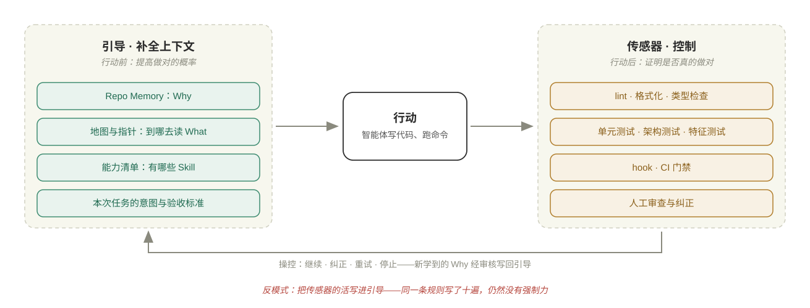
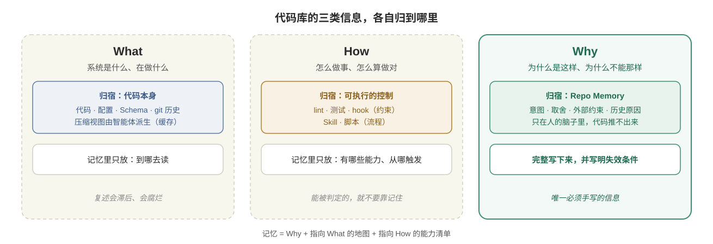
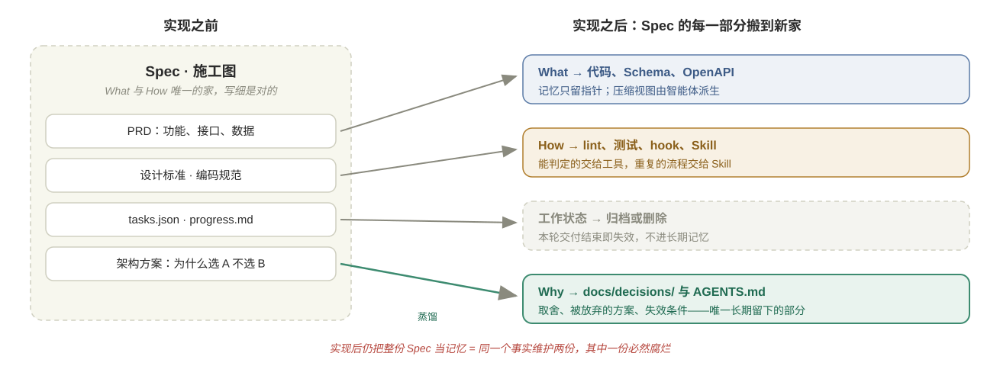
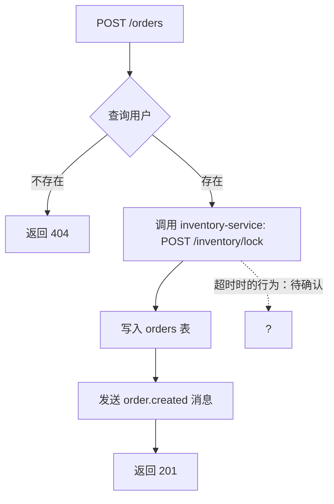
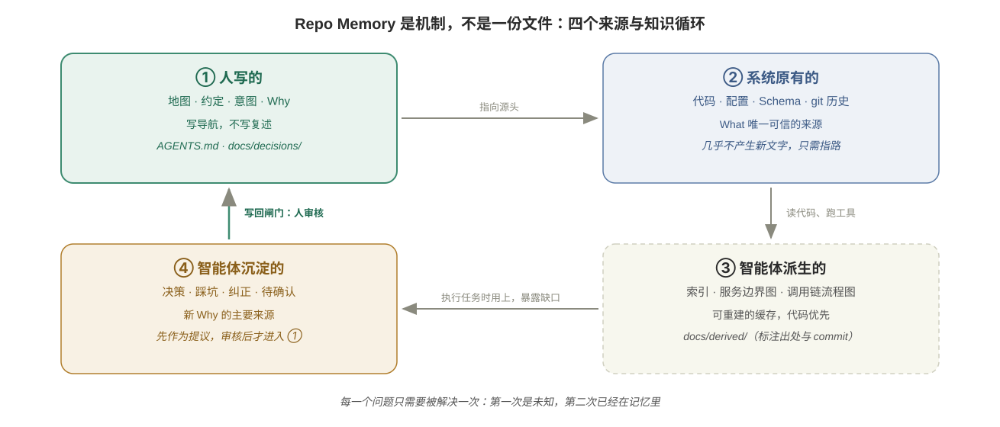
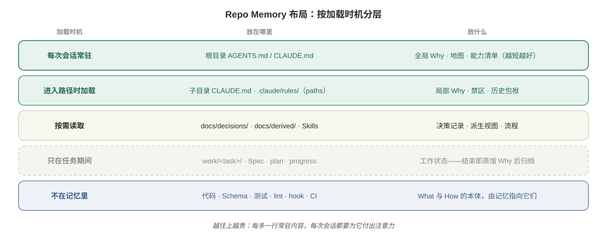
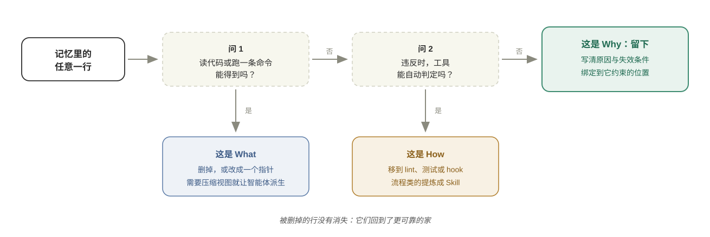

# 代码库记忆：只存 Why

Last updated: 2026-11-10

> *代码会告诉智能体系统在做什么，工具会告诉它做得对不对。只有你能告诉它为什么。*

[智能体记忆文件](../01-prompt/agents-md.md)一章解决的是入门问题：怎样为一个仓库写好一份 `CLAUDE.md` / `AGENTS.md`。少即是多、只写智能体发现不了的、按 WHY → WHAT → HOW 组织——这些原则在单人、单仓库、中小规模的项目里足够用。

可一旦代码库变大、协作者变多、模型变强，同样的做法会开始失效：文件越写越长，内容和代码对不上，团队里每个人都往里追加几条，谁也不敢删。问题不再是「这份文件怎么写」，而是**这套记忆系统应该怎么设计**。

[产品、业务与工程底座](product-business-engineering.md)一章给出了观察这个问题的框架：智能体开发是内外双循环，整个代码库就是 Harness。顺着这个框架看，智能体的「记忆」从来不只是 `AGENTS.md`——代码本身、类型、lint、测试、Skill、派生的索引、进行中的计划，所有会影响智能体下一步行为的东西都是记忆，只是作用方式不同。本章把它们统称为 **Harness Memory**，回答三个问题：每一类记忆如何作用于智能体？哪些约束已经蕴含在代码之内？哪些必须从人的脑子里显性化出来？

在这个全景下，本章的核心答案仍然只有一句话：**手写的那部分只存 Why；What 交给代码，How 交给可执行的控制。** 本章的结构是先讲道理，再挂工具——每一节先说明它解决什么问题，再给出做法、提示词和检查清单。

| 章节 | 理论 | 配套做法 |
| --- | --- | --- |
| 为什么记忆需要重新设计 | 三个新条件；三种记忆失效 | ——（只建立心智模型） |
| Harness 的两件事 | 引导与传感器；补全上下文与控制 | 职责划分表 |
| Harness Memory 全景 | 六类记忆的作用机制；working / persistent 映射 | 全景表 |
| 三类信息，三个归宿 | What → 代码；How → 控制；Why → 记忆 | Why 的五种形态、挖掘 Why 的提示词 |
| 代码之内与人脑之中 | 两类约束的分界；显性化流水线 | 对照表、两个判据 |
| 用这把尺子重看规格编码 | Spec 的生命周期 | Spec 各部分的去向表 |
| What 的压缩视图 | 按边界压缩；派生物是缓存；任务驱动 | 派生 Skill 流水线、出处标注模板 |
| Presenter 层 | 同一份知识的两个读者；一次性的呈现 | 产物与判断对照表 |
| 记忆如何长大 | 读写按循环分工；写回闸门；防自证 | 写回提示词、待确认标记 |
| 记忆的布局 | 按加载时机分层 | 目录结构、决策记录模板 |
| 十一条设计原则 | 对 agents-md 十条原则的升级 | 三问过滤器、Before/After、审查清单 |
| 迁移现有记忆 | 从厚文件到记忆系统 | 五步迁移流程与提示词 |

---

## 为什么记忆需要重新设计

### 从一份文件到一套系统

入门阶段的记忆文件面对的是一个简单场景：你一个人，一个仓库，一个智能体。下面三个条件中的任何一个出现，记忆的设计难度都会跳一级：

| 新条件 | 记忆面临的压力 | 设计上的后果 |
| --- | --- | --- |
| **大代码库** | 上下文窗口装不下全部代码，甚至装不下全部文档；几十个仓库之间的关系不属于任何一个仓库 | 记忆必须是**索引与压缩**，而不是复述；跨仓库知识需要独立的归属 |
| **多人协作** | 多个人、多个智能体同时往记忆里写回；每个人只记得自己加的那几条 | 必须明确**什么能进、谁来审、什么时候删** |
| **LLM 能力持续升级** | 模型越强，越能自己从代码里读出事实、自己找到做法 | 写死的细节从帮助变成**限制**；模型唯一读不出的是「为什么」 |

第三个条件最容易被忽略。一年前，智能体需要你告诉它「新增接口时先建 schema、再写 route、再写 service」；今天的模型读三个现有接口就能学会，而且能发现你那份步骤清单已经过时。**模型越强，记忆里关于 What 和 How 的内容越不值钱，关于 Why 的内容越值钱**——因为前者模型可以自己获得，后者永远获得不了。

### 三种记忆失效

记忆系统设计不当时，会以三种可识别的方式失效：

| 失效 | 含义 | 典型症状 |
| --- | --- | --- |
| **记忆腐烂** | 记忆复述了代码，代码变了，记忆没变 | 文件写着「我们用 Webpack」，项目早已迁到 Vite；智能体按过期的目录说明去找不存在的文件 |
| **记忆膨胀** | 每次出错补一条规则，只增不减 | 文件长到几百上千行，关键约束埋在中段；智能体一启动就进入低效区，最重要的规则反而被忽略 |
| **记忆失忆** | 真正重要的原因从未写下，或只存在于某次会话 | 智能体出于「整洁」统一了一段刻意保留的旧代码；昨天会话里达成的决策，今天的会话一无所知 |

三种失效指向同一个根因：**没有区分信息的种类**。复述的是 What（会腐烂），堆积的是本该交给工具的 How（会膨胀），遗漏的是只有人知道的 Why（会失忆）。

> [Evaluating AGENTS.md — ETH Zurich (2026)](https://arxiv.org/abs/2602.11988)

ETH Zurich 的实证研究给了「腐烂」和「膨胀」一个量化注脚：智能体生成的上下文文件让成功率下降约 2–3%、成本上升 20% 以上，根源是它们与仓库里已有的信息**重复**；把仓库文档剥离之后，同样的文件反而带来正收益。**重复的 What 不是无害的冗余，而是噪声。**

---

## Harness 的两件事：补全上下文与控制

在讨论记忆存什么之前，先把 Harness 的职责拆开。智能体工作中的每一步局部控制都包含四个部分——这正是上一章内循环的解剖图：

| 部分 | 功能 | 示例 |
| --- | --- | --- |
| **引导** | 行动前的前馈信息 | 记忆文件、任务指令、示例、相关参考 |
| **行动** | 模型输出或环境操作 | 写代码、调用工具、执行命令 |
| **传感器** | 行动后收集的证据 | 测试、lint、类型检查、日志、人工纠正 |
| **操控** | 下一次控制决策 | 继续、纠正、重试、重新规划、停止 |

引导提高做对的概率，传感器证明是否真的做对。**两者不能互相替代**：再详细的指令也无法证明完成，再完整的测试也给不了执行任务所需的全部上下文。

所以 Harness 做两件事：**补全上下文**（引导）和**控制**（传感器与操控）。记忆文件只属于第一件事。



**记忆膨胀最常见的根源，是让引导去干控制的活。** 一个典型过程是这样的：智能体在 Controller 里写了业务逻辑，你在记忆里加一条「Controller 不写业务逻辑」；两周后它又犯了，你把这条加粗；一个月后再犯，你加上「重要！」。这条规则占着每一次会话的上下文，却没有任何强制力——上一章的约束强度阶梯解释过软约束为什么必然衰减：指令只是概率采样的一部分，示范的权重高于声明，而且没有反馈闭环。一条 ArchUnit 或 dependency-cruiser 规则能在它违反的那一刻让 CI 变红——这才是控制。

| 你想要的效果 | 用引导（记忆）实现 | 用传感器（控制）实现 | 应该选 |
| --- | --- | --- | --- |
| 统一格式与命名 | 「使用 2 空格缩进」「字段用 camelCase」 | 格式化器 + lint | 传感器 |
| 分层不越界 | 「Controller 只做参数校验」 | 架构测试 / 依赖规则 | 传感器 |
| 不破坏现有行为 | 「修改时注意兼容」 | 特征测试 + CI 门禁 | 传感器 |
| 理解为什么不能删某张表 | ——测试只能报告「删了会挂」，说不出原因 | 无法实现 | **引导** |
| 在新场景下做出正确取舍 | 写清取舍的理由 | 无法实现 | **引导** |

规律很清楚：**能被判定的交给传感器，需要被理解的才交给引导。** 而需要被理解的，几乎都是 Why。

---

## Harness Memory 全景：六类记忆，两级寿命

把「会影响智能体下一步行为的东西」全部摊开，可以分成六类。它们的作用机制、强度、写入者和所在循环都不同：

| 类别 | 形式 | 作用机制 | 强度 | 谁写 | 在哪个循环被读写 |
| --- | --- | --- | --- | --- | --- |
| **结构记忆** | 代码本身、目录约定、registry、参考切片 | 被复制：智能体照既有模式写 | 最强且隐性——错误写法不顺手，甚至不存在 | 人设计，智能体延续 | 外循环设计，内循环被读 |
| **可执行约束** | 类型、lint、架构测试、CI、hook | 硬失败：违反即判红 | 硬 | 人写，或由纠正下沉而来 | 内循环的传感器 |
| **程序记忆** | Skill、脚本、CLI | 按需加载的 SOP | 软；确定性步骤下沉为 CLI 后变硬 | 人写，从失败中长出 | 内循环的引导 |
| **派生记忆** | 索引、服务地图、流程图 | 压缩视图，省去重读代码 | 缓存——与代码冲突时以代码为准 | 智能体生成，人定纪律 | 内循环被读，改进循环重建 |
| **声明记忆** | AGENTS.md、路径规则、ADR、术语表 | 引导：靠模型读到并遵守 | 软，随上下文增长衰减 | 人 | 外循环写，内循环被读 |
| **工作状态** | spec、plan、progress | 本次任务的现场 | —— | 智能体随时更新 | 仅本次内循环 |

这张表与业界讨论智能体记忆时的通用分层可以对上。**Working memory（工作记忆）**对应任务期的东西：spec、计划、进度、为本次任务加载的压缩视图——随任务生灭。**Persistent memory（持久记忆）**又分三种：ADR、Why、术语表是**语义记忆**（知道「是什么、为什么」）；Skill、CLI、参考切片是**程序记忆**（知道「怎么做」）；纠正历史和 review 记录是**情景记忆**（发生过什么），它们的价值在于被蒸馏成前两者，蒸馏完就该归档。注意一个容易误读的点：**持久记忆不等于全部手写**——派生物由智能体生成，参考切片本身是代码——但持久记忆必须由人维护：审核写回、检查失效条件、决定删除。

两点补充。第一，结构记忆排在最强的位置，是因为它不需要智能体「记得」：规则是声明，代码是示范，而示范的权重永远高于声明——这是上一章约束强度阶梯的记忆版。第二，**代码注释也是记忆，而且是最容易被污染的一类**：智能体写注释时经常在记录「上次 review 说这里不要这样写」这类对话残留，把一次性的纠正固化成永久的、误导性的声明。Lauren Tan 在她的项目里干脆禁用了代码注释——这个选择极端，但指出的问题是真的：没有闸门的写回，连注释都会让记忆腐烂。

六类记忆回答的是「它们如何作用于智能体」。下一个问题是：一条具体的信息应该放进哪一类？这就要回到信息本身的性质——What、How，还是 Why。

---

## 三类信息，三个归宿

用「谁是最可靠的来源」来划分，一个代码库里关于自身的信息只有三类：



| 信息 | 回答的问题 | 最可靠的来源 | 记忆里应该放什么 |
| --- | --- | --- | --- |
| **What** | 系统是什么、在做什么 | 代码、配置、Schema、git 历史 | 只放「到哪去读」 |
| **How** | 这里怎么做事、怎么算做对 | lint、类型检查、测试、hook、Skill、脚本 | 只放「有哪些能力、从哪触发」 |
| **Why** | 为什么是这样、为什么不能那样 | 人的脑子、PR 讨论、事故复盘、聊天记录 | **完整写下来** |

### What：代码就是最准的记忆

关于代码最准确的事实来源就是代码本身。任何二手转述都会滞后：文档会滞后，代码不会。配置和 git 历史同理——环境怎么搭看配置，一个功能为什么长成今天这样，`git log` 里躺着线索。

所以 What 在记忆里只保留**指针**。一份好的地图短到智能体一眼能看完，又准到它能据此找到任何东西：

| 别这样写（复述） | 改成这样（指针） |
| --- | --- |
| 一棵完整的目录树 | 「服务边界与调用关系见 `docs/derived/service-map.md`」 |
| 技术栈清单：React 18、Vite 5、Zustand…… | 删掉——`package.json` 里都有 |
| 十几个接口的路径与参数 | 「接口以 `openapi.yaml` 为准，运行 `make openapi` 重新生成」 |
| 数据库表结构说明 | 「当前 Schema：`python manage.py show_schema`」 |

地图指向的是活的源头。源头变了，地图仍然成立；复述则从写下那一刻起就开始过期。

### How：能被判定的，就不要靠记住

How 描述的是做法，它有两个比记忆更好的归宿：

| How 的种类 | 例子 | 归宿 |
| --- | --- | --- |
| **可判定的约束** | 返回格式统一为 `Result<T>`；不引入技术栈以外的依赖；列表为空返回 `[]` | lint 规则、架构测试、契约测试、依赖白名单、pre-commit hook |
| **重复的流程** | 新增接口的五个步骤；发版前检查清单；更新接口文档 | [Skill](../02-anatomy/skills.md) 或脚本，按需加载 |
| **一次性的做法** | 「这次不需要分页」 | 本次任务指令，不落盘 |

记忆里只留**能力清单**：这个仓库支持哪些任务、各自从哪个 Skill 触发、产出什么。智能体接到任务时看这一段就知道该走哪条链；人想知道这个仓库能干什么，也看这一段。

Skill 的性质值得单独交代，因为它最容易被错当成护栏。Skill 是软层里的教学材料：一段高质量的上下文，传递判断和工作流——先做什么、遇到模糊情况去查代码而不是猜、说「完成」之前先跑验证；禁止什么不是它的职责，那是 lint 的，lint 不会被忘掉。由此有三个推论。其一，Skill 要从真实观察到的失败中长出来，而不是凭空写规范。其二，一段能被静默忽略的文字必须被测量：Lauren Tan 用 eval 给 Skill 当「单元测试」——子智能体在看不出自己被评测的目录里执行任务，另一个模型当裁判打分——但 eval 只能提高遵循率，不能把它变成 100%。其三，Skill 会越来越短：模型变强后，确定性的固定步骤下沉到 CLI 和脚本，指令收缩成工作流描述——**判断留给模型，机械交给代码**。

### Why：唯一必须手写的东西

Why 有一个共同点：**它不在代码里，不在工具里，智能体读多少代码也推不出来。** 代码只能告诉你系统做了什么判断，不能告诉你当年为什么这样判断。人不写下来，它就会随人员更替消失——而知识丢失，正是软件退化为遗留系统的根本原因。

Why 常见的五种形态：

| 形态 | 回答 | 例子 | 通常藏在哪里 |
| --- | --- | --- | --- |
| **意图** | 这个模块为谁解决什么问题 | 「对账服务只服务财务月结，不追求实时性」 | 产品文档、需求讨论 |
| **取舍** | 为什么选 A 不选 B | 「用差异比对更新关联表：全量删除再插入会让并发请求瞬间看不到任何关联」 | 设计评审、PR 讨论 |
| **外部约束** | 代码之外谁依赖它 | 「`external_key` 被某 SDK 客户当作缓存键，重命名会直接破坏该 SDK」 | 客户沟通、事故复盘 |
| **历史原因** | 看起来不对，为什么还在 | 「`Dataset` 表看似重复，来自已下线的实验功能，数据仍需保留」 | `git log`、老员工 |
| **失效条件** | 在什么前提下这条 Why 不再成立 | 「全部客户迁到 v1 API 后，`LegacyEvaluatorAdapter` 可删除」 | 通常没人写——这正是要补的 |

[接手存量代码库](legacy-codebases.md)一章中价值「百倍于篇幅」的**禁区**与**历史包袱**，本质上全是 Why。实践中还有一个反复被验证的现象：一条涉及工程取舍的规则，只写「不要这样做」时智能体常常照犯；补上原因之后，它不仅遵守，还会把原因推广到规则没覆盖的相似场景。**Why 是让智能体举一反三的那部分信息。**

### 边界：约定什么时候要带理由

存量项目一章建议「关键约定只写硬规则，不写理由」，与本章并不矛盾——区别在于约定的种类：

| 约定类型 | 例子 | 处理方式 |
| --- | --- | --- |
| **纯约定**，没有工程取舍 | 字段用 snake_case；REST 响应包在 `Result` 里 | 能交给工具就交给工具；交不了就写一行硬规则，不需要理由 |
| **涉及工程取舍** | 关联表更新用差异比对 | **必须带 Why**，否则智能体在新场景下无法判断 |

判断标准：**如果智能体照着规则字面做，却在一个规则没覆盖的相似场景里犯了错，那么这条规则缺的就是 Why。**

### 如何挖掘 Why

Why 不会自己出现。它散落在 PR 讨论、事故复盘、老员工的脑子里，以及代码中那些「看不懂」的地方。智能体擅长找到这些线索，但**不能替你填写答案**。

| 线索来源 | 能挖到什么 | 工具 |
| --- | --- | --- |
| 奇怪的提交 | 某个分支、某个例外是为了解决什么问题 | `git log -S`、`git blame`、GitLens |
| PR 与 Issue 讨论 | 设计取舍、被否决的方案 | GitHub / GitLab MCP |
| 事故复盘 | 禁区：哪些改动曾引发事故 | 复盘文档、On-call 记录 |
| 智能体读不懂的代码 | 丢失的业务规则留下的影子 | 让智能体列出问题清单 |
| 与原作者的对话 | 以上都找不到的部分 | 人 |

**挖掘 Why 的提示词：**

```text
阅读 src/billing/ 下的代码和它的 git 历史（git log --follow、git blame），
找出所有「从代码本身看不出原因」的地方：奇怪的判断、特殊账户的例外、
看起来多余却没被删除的代码、与命名不一致的行为。

对每一处输出：文件与行号、你观察到的行为、相关提交的标题与链接、
你认为需要人回答的问题。

不要猜测原因，不要写入任何记忆文件。只输出问题清单，我来回答。
```

最后一段是关键动作：智能体负责**发现缺口**，人负责**填写原因**。智能体猜出来的 Why 比没有 Why 更危险——它看起来像知识，却可能是编造的。

---

## 代码之内的约束，与必须显性化的约束

把三类信息和六类记忆放在一起，可以回答本章开头的后两个问题：哪些约束已经蕴含在代码之内，哪些必须从人的脑子里显性化出来。

| | 蕴含在代码之内 | 只存在于人的脑子里 |
| --- | --- | --- |
| 形式 | 类型与接口签名、不变量及其测试、依赖方向、目录约定、测试固化的行为、仓库里的既有模式 | 意图、取舍、外部约束、历史原因、失效条件、品味与判断标准 |
| 作用方式 | 不需要智能体记得：写错编译不过、测试判红、照既有模式写 | 必须被读到、被理解，才能影响行为 |
| 维护方式 | 随代码演进，由 CI 守护 | 人手写，带失效条件，定期复审 |
| 遗失的方式 | 代码还在就不会丢 | 随人员更替消失 |

于是「显性化」是一条流水线，而不是一次动作：

1. **挖掘**：隐性知识先要被看见——方法见上一章的[隐性知识的挖掘](product-business-engineering.md#隐性知识的挖掘-决定未来表现的那部分工作)，本节上面的提示词是它的 Why 专用版。
2. **写成 Why**：挖出来的先落成文字，带原因与失效条件。
3. **能下沉的下沉**：可判定的部分变成 lint、测试、hook；流程化的部分变成 Skill 或 CLI；可结构化的部分进一步改造成代码结构——让错误写法根本不顺手。
4. **剩下的才留在记忆里**：下沉不动的，才是真正需要手写、需要人长期维护的 Why。

两个实用判据，帮你定位一条知识停在流水线的哪一级：智能体照字面遵守了规则，却在规则没覆盖的相似场景里犯错——这条规则缺 Why，停在第 2 步没写完；同一个错误出现第二次——它该从文字下沉为控制，停在第 3 步没动。流水线的终点状态是：**约束尽可能活在代码里，原因全部活在记忆里，人脑里只留还没来得及显性化的部分。**

---

## 用这把尺子重看规格编码

### 两派的分歧，其实是时间上的

[规格编码](spec-coding.md)让智能体在一份详细规格下工作：PRD、设计标准、架构文档、任务列表、进度文件。按规格驱动开发（SDD）的做法，规格会在每次智能体跑偏后补一条，从一页纸长成几页——它存得非常细，几乎全是 What 和 How。

另一派实践者的结论正好相反：

> [Matt Pocock: Skills for Real Engineers](https://github.com/mattpocock/skills)

| | 规格派（SDD） | 代码派（Matt Pocock、poteto） |
| --- | --- | --- |
| **核心主张** | 先把规格写对，智能体照着执行；跑偏一次补一条 | 「The code is the battleground, not the spec.」「the best spec is code.」 |
| **他们看到的** | 没有规格时，每个模块各自为政：命名、返回格式、错误码都不一致 | 长期按规格生成，代码质量逐轮下降；规格过时后反而误导智能体 |
| **替代做法** | 分层规格：全局、模块、任务 | 先用 `/grill-me` 一类的追问对齐设计概念，然后在代码里用测试、垂直切片和验证证据迭代 |
| **在什么时候是对的** | **实现之前**：代码还不存在 | **实现之后**：代码已经存在 |

两边描述的是同一个工件的两个阶段。**实现之前**，What 和 How 还没有代码承载，规格是它们唯一的家，写细是对的——规格是施工图。**实现之后**，规格里的 What 已经由代码承载，How 已经由测试、lint、Skill 承载；继续把规格当长期记忆，就是同一个事实维护两份，其中一份必然腐烂。

### Spec 的生命周期



把规格当作有生命周期的工件，而不是记忆。实现完成后，规格的每一部分都应该搬到新家：

| Spec 中的内容 | 实现后的新家 | 留在 Repo Memory 的部分 |
| --- | --- | --- |
| 功能需求、接口、数据结构 | 代码、OpenAPI、Schema、测试用例 | 指针；以及「为什么这个功能不做 X」这类范围决策 |
| 设计标准、编码规范 | lint、设计 token、组件库、架构测试 | 无法被工具表达的取舍理由 |
| 架构方案 | 代码结构 + 智能体派生的服务地图 | **为什么选这个架构、放弃了哪些方案、何时复审** |
| `tasks.json`、`progress.md` | 归档（或删除） | 无 |
| 验收标准 | 测试 | 无 |

规格编码一章已按这个生命周期补充了「长期记忆 vs 工作状态」的区分，见[Spec 的生命周期](spec-coding.md#spec-的生命周期-从施工图到-why)。

### 工作状态不是记忆

`tasks.json`、`progress.md`、计划文件对一次长任务至关重要——它们让新会话能从文件系统重建「项目现在在哪」。但它们是**工作状态**，有明确的生命周期：

| | 长期记忆 | 工作状态 |
| --- | --- | --- |
| **内容** | Why、地图、能力清单 | 计划、任务拆解、进度、本次的临时决定 |
| **寿命** | 跨任务、跨季度 | 一次交付 |
| **写入者** | 人，或经审核的智能体提议 | 智能体随时更新 |
| **结束时** | 带失效条件，到期复审 | 蒸馏出 Why 后归档或删除 |

把状态混进记忆，下一次会话会从一份三个月前的进度里「恢复」出一个早已不存在的现场。

---

## What 的压缩视图：让智能体派生

### 问题：代码装不进上下文

「What 交给代码」有一个现实难题：大代码库装不进上下文。哪怕项目不大，把全部代码塞进去也会分散注意力；每个任务都从头读一遍相同的代码，既慢又浪费。

解法不是让人手写 What，而是**让智能体派生 What 的压缩视图**，并把它当作缓存对待。人写不完、也不该写这些东西：它们量太大，而且随代码变化。让智能体派生，等于给记忆装了一台自动生成的引擎——代码一变，重跑一遍，出来的就是新的。

### 压缩原则：压掉能重新获取的，留住拿不到的

**按架构压。** 架构本身就是代码的一份压缩：系统分几块、每块负责什么、块之间怎么连。这份骨架信息密度最高、也最稳定。骨架常驻索引，细节按需回原代码读。

**按智能体的短板压，而不是按人的习惯压。** 软件工程的许多最佳实践是为了配合人的认知能力。不妨把人想成一个「上下文极度有限的模型」：因为装不下，所以要靠分层和高度提炼的领域模型来理解系统。智能体没有这个限制，它的短板在别处：

| | 人需要的索引 | 智能体需要的索引 |
| --- | --- | --- |
| **关注点** | 服务内部如何分层：clean architecture 还是 smart domain | 服务之间的**边界与交互** |
| **原因** | 上下文有限，只能靠分层理解 | 一个服务的代码一口气就能读完，内部随时能回原代码重读 |
| **短板** | 读不完代码 | 读单个服务**拼不出**跨服务的关系 |
| **索引里该留什么** | 分层结构、领域模型 | 每个服务的职责、调用关系、数据所有权、改一处会波及哪里 |

一句话：**补智能体的短板，不重复智能体的长处。**

### 派生流水线：从地图到行为

以一个由几十个仓库组成的微服务系统为例。要提取的知识不属于任何一个仓库，而是描述这些仓库关系的知识——所以它应该放在一个**独立的工作区**里，而不是塞进某个业务仓库：

```text
workspace/
├── AGENTS.md          # 入口：Why、地图、能力清单
├── repositories.md    # 系统包含的全部仓库地址
├── skills/            # 派生知识的流水线
├── checkout/          # 由智能体托管的只读代码副本
└── wiki/              # 派生出的知识（缓存）
```

派生由几个层层递进的 Skill 完成，每一层只回答一个问题：

| Skill | 回答的问题 | 输入 | 产出 | 纪律 |
| --- | --- | --- | --- | --- |
| `repo-index` | 系统有几个仓库，各自大致做什么 | `repositories.md` | `wiki/index.md` | 只扫表层；README 只当线索，与代码不符以代码为准 |
| `api-contracts` | 每个服务**提供**和**消费**哪些 API | 索引 + 代码 | `wiki/{repo}/api.spec.md`、`api.contract.md` | 只记跨服务边界；认不出的目标服务标「待确认」 |
| `service-map` | 谁调用谁，经由哪个 API | 全部 spec 与 contract | `wiki/service-map.md`（mermaid） | 消费方指向提供方；查不到提供方的画虚线，不要丢 |
| `implement-flow` | 每个接口被调用后实际做了什么 | spec + 代码 | `wiki/{repo}/endpoint-flows.md` | 只画对外可见的行为；追到服务边界为止 |

最后一层值得单独说明。接口清单只是**接口知识**；很多任务——比如补回归测试——需要的是**行为知识**：给定输入，系统查了什么、调了谁、在什么条件下分叉。把每个接口的调用链画成一张 mermaid 图，是一种近乎无损的压缩：



它丢掉了实现细节，保留了行为；比让智能体每次重读源代码省得多。而且这张图天然就是回归测试的提纲：图上每个分支、每个下游调用、每个落库点都是一条该测的路径，标「待确认」的节点则是最该先测、最可能藏雷的地方。

单体系统没有清晰的服务边界时，思路不变，只是把「服务」换成**模块或包**：先建立术语映射，再提取模块间的契约，并特别梳理**数据表与模块的归属**（谁是写入方、谁只读）——共享数据库是单体里智能体最容易误判的地方。

### 派生物是缓存，不是事实

派生出来的索引、服务地图、流程图必须遵守三条纪律：

1. **可重建**：由 Skill 或脚本生成，代码变了就重跑，不靠人手工维护。
2. **标明出处**：注明由什么生成、基于哪个 commit、何时生成。
3. **代码优先**：与代码冲突时以代码为准；README 与代码对不上，也以代码为准。

在每个派生文件头部加一段出处说明，智能体和人都能一眼判断它是否可信：

```markdown
---
derived: true
generator: skills/implement-flow
source: checkout/order-service @ 3f2a9c1
generated_at: 2026-11-10
authority: 代码优先。与代码冲突时以代码为准，并重新运行 generator。
---
```

[接手存量代码库](legacy-codebases.md)一章介绍的 Graphify 给每条边打上 `EXTRACTED` / `INFERRED` / `AMBIGUOUS` 标签，是同一纪律的工具化：**智能体画出的地图，必须告诉你哪些边是事实，哪些是推测。**

### 任务驱动，不要提前囤够

知识为任务服务，而任务没发生时，你没法预知它会用到哪块知识。上面的流水线就是这样长出来的：`api-contracts` 够做影响分析，但开始写回归测试时才发现缺的是行为知识，于是才有了 `implement-flow`。

试图一次性把业务背景补全是徒劳的，试图一次性把知识提取干净同样是徒劳的。正确的节奏是**遇缺即补**：

1. 拿现有知识先试。
2. 哪里读不懂、哪里下不了手，缺口自然暴露。
3. 针对缺口回到代码、回到人去补，并决定补出来的是 Why（写进记忆）还是 What（交给派生）。
4. 知识库长大一块；下一个任务再补下一块。

能提前做的只有骨架。

---

## Presenter 层：给人看的记忆界面

压缩视图解决的是智能体的阅读问题。但同一份知识还有第二个读者：外循环里的人。两个读者要的东西不一样。

智能体要的是机器可导航的压缩——spec、contract、流程图源码，密度越高越好，它随时可以回原代码核对。人要的是**能快速建立判断的呈现**：外循环的带宽就是人的注意力，你能并行多少内循环，取决于审查一份产出要花你多久。智能体的产出在变多，人的理解方式却没有升级——这正在成为整个系统的瓶颈。

> Andrej Karpathy（X 帖子）：*“We'll be spending a lot more time trying to understand the outputs of language models.”*

Karpathy 给了几个具体做法：让模型用 ASD-STE100 写作——一种最初为航空维修文档设计的受控语言，约束极严、风格干净，模型对它很熟（嫌太严可以要求「做到 80% 的程度」）；比文字更好的是图示、交互式 HTML 页面，以及 3Blue1Brown 风格的定制讲解视频。

这些产物构成记忆系统的 **presenter 层**。它和派生视图同属「不是事实源」，但生命周期更短：派生视图是常驻缓存，代码变了重跑；presenter 产物是**一次性的**，为一次审查生成，看完即弃。它不进记忆、不需要维护，过期了就按当下状态重新生成一份。

| Presenter 产物 | 服务外循环的哪个判断 |
| --- | --- |
| diff 讲解页：这次改了什么、为什么、风险在哪 | 这次产出能不能合并 |
| 架构变更图：改动前后的依赖关系对比 | 结构是否被破坏、影响半径多大 |
| 决策摘要的受控语言版 | 要不要为这个取舍拍板 |
| 探索结果的交互页面：可点开的调用链 | 智能体的理解是否与事实一致 |

把 presenter 层单独拎出来，是为了防止两个混淆。一是把给人看的东西当成记忆去维护——它是消费品，不是资产；长期手工维护一份「给人看的架构文档」，正是记忆腐烂的经典来源。二是让人去读给智能体准备的压缩视图——读得慢、读得累，然后退回「干脆不读」，外循环失去抽样能力。**给智能体的要压缩，给人的要呈现；两者都从同一个事实源生成，形态服务于各自的读者。**

---

## 记忆如何长大：四个来源与写回闸门

用双循环看，记忆的读写有清楚的分工。**内循环**读记忆、写工作状态，并在任务结束时提议沉淀——多个智能体可以并行做这些事。**外循环**掌管写回闸门：人审核提议、借 presenter 层抽样审查、把纠正按「架构 > 检查 > 测试 > 文字」的顺序下沉。**改进循环**定期重建派生物、逐条检查失效条件。记忆的质量不取决于内循环写了多少，而取决于外循环审下了多少。

### 四个来源

把 Repo Memory 理解为一份文件是不够的。它是一个**让知识变得可获得的机制**，写作者从来不止一个：



| 来源 | 内容 | 谁来写 | 在本章框架中的位置 |
| --- | --- | --- | --- |
| **人写的** | 地图、约定、意图 | 人 | Why + 指针；短到一眼看完，准到能找到任何东西 |
| **系统原有的** | 代码、配置、git 历史 | 已经存在 | What 的唯一可信来源，记忆只负责指路 |
| **智能体派生的** | 索引、结构、摘要、流程图 | 智能体 | What 的压缩缓存 |
| **智能体沉淀的** | 决策、踩坑、纠正 | 智能体提议，人审核 | 新 Why 的主要来源 |

第四个来源让记忆「活」起来。智能体在干活过程中会碰到不确定的地方、会做出判断、会踩坑、会被人纠正——这些一旦发生，就应该写回，成为下一次开工时的「已知」。一个踩过的坑如果没有写回，就会在下一次以同样方式重演，**而每一次重演都是一次不必要的人工介入。**

四个来源也不是四个孤立的盒子。智能体沉淀出的一批好测试，人挑出几个认可的，就升级进「人写的」那一层，成为新的范例；下一批测试就写得更好。知识在四者之间转圈，越转越多。

### 写回闸门

单人项目里，让智能体随手往记忆里追加几条问题不大。多人协作时，这会迅速导致膨胀和冲突。写回必须有闸门，像代码一样过审：

| 闸门 | 规则 | 防止什么 |
| --- | --- | --- |
| **提议与决定分离** | 智能体起草「本次学到了什么」，人决定是否进入长期记忆 | 编造的或局部的结论污染全局 |
| **第二次才固化** | 同一个行为被纠正第二次时才写成规则；第一次可能是偶然 | 预防性规则导致的膨胀 |
| **先问能否交给工具** | 新规则先过三问过滤器，可判定的直接写成 lint 或测试 | 引导去干控制的活 |
| **写清原因与失效条件** | 没有 Why 的规则不收 | 未来没人敢删 |
| **就近放置** | 局部经验写进对应目录或规则文件，不进根文件 | 根文件膨胀 |

**会话结束前的写回提示词：**

```text
回顾本次会话，列出可能值得进入长期记忆的内容，每条分类为：
- Why：一个取舍、外部约束或历史原因（附证据：提交、PR、对话位置）
- 可判定的约束：建议写成什么 lint / 测试 / hook
- 一次性的信息：只与本次任务有关，不需要保留

对 Why 类条目，给出建议放置的位置（根 AGENTS.md / 子目录 / docs/decisions/）
和它的失效条件。不确定的标「待确认」。

不要修改任何文件。我审核后再决定写入哪些。
```

### 防止自证闭环

派生和沉淀都由智能体完成时，有一个系统性风险：如果流程图是智能体对代码的**推测**，测试又只按流程图写，那么测试全部通过也只证明「图和测试互相自洽」，并不证明系统行为被正确理解。Harness 变成了一台不断证明自己原有判断正确的机器。

| 风险点 | 对冲手段 |
| --- | --- |
| 智能体把看不懂的分支猜成合理的样子 | 认不准就标「待确认」，**不许猜** |
| 测试按推测写，自然全部通过 | 对「待确认」节点写**固化现状的探针测试**，列为最高优先级 |
| 探针失败后改断言让它通过 | 探针失败**不是 bug，是信息**：把真实行为写回流程图，等人判断 |
| 测试与生产代码一起被改 | 补测试的任务**只加测试，不改生产代码**，保留一个不被污染的对照面 |
| 整个闭环没有外部输入 | 引入流程之外的事实来源：运行时观测、人的判断、外部规格 |

闭环的出发点是让人的判断发挥更大价值，而不是让人被自己的流程说服。

---

## 记忆的布局：按加载时机分层

[智能体记忆文件](../01-prompt/agents-md.md)一章介绍了 Claude Code 的五层记忆机制（组织、用户、项目、本地、条件规则）。那是**工具提供的槽位**；本章关心的是**内容应该放进哪个槽位**。决定因素只有一个：这条信息需要在什么时候被加载。



一个按此原则组织的仓库：

```text
repo/
├── AGENTS.md                    # 常驻：全局 Why、地图、能力清单
├── CLAUDE.md                    # 一行：@AGENTS.md（只维护一个事实来源）
├── .claude/
│   ├── rules/
│   │   └── billing.md           # paths: src/billing/** —— 计费相关的 Why 与禁区
│   └── skills/
│       ├── add-endpoint/        # How：流程
│       └── sync-docs/
├── services/
│   └── server-core/
│       └── CLAUDE.md            # 进入该目录时加载：external_key 等局部禁区
├── docs/
│   ├── decisions/               # 按需：决策记录（Why 的完整版）
│   │   └── 0007-diff-update-for-tool-bindings.md
│   └── derived/                 # 按需：派生视图（缓存，标注出处）
│       ├── service-map.md
│       └── endpoint-flows/
├── work/                        # 任务期：spec、plan、progress，结束后归档
└── src/ tests/ .github/ ...     # 不在记忆里：What 与 How 的本体
```

| 层 | 位置 | 放什么 | 预算 | 寿命与维护 |
| --- | --- | --- | --- | --- |
| **常驻** | 根 `AGENTS.md` | 项目一句话、全局 Why、地图、能力清单、关键命令 | 越短越好；超过 150 行就该下沉 | 持久（语义）；人写人审 |
| **路径触发** | 子目录 `CLAUDE.md`、带 `paths` 的规则文件 | 只对某块代码成立的 Why、禁区、历史包袱 | 每个文件几条到十几条 | 持久（语义）；人写人审 |
| **按需读取** | `docs/decisions/`、`docs/derived/`、Skills | 决策的完整论证、派生视图、流程 | 不限，但必须有入口指向它 | 持久（语义 + 程序）；决策人写，派生物智能体重建 |
| **任务期** | `work/<task>/` | 规格、计划、进度 | 任务结束即归档 | 工作记忆；智能体随写随弃 |
| **不在记忆里** | 代码、测试、工具配置 | What 与 How 的本体 | —— | 结构记忆与可执行约束；由 CI 守护 |

### 决策记录：Why 的完整形态

根文件里的 Why 只能写一两句。需要完整论证的决策，放进 `docs/decisions/`，根文件或子目录记忆只放一句话和链接。一份对智能体友好的决策记录：

```markdown
# 0007 关联表更新使用差异比对

状态：生效 ｜ 日期：2026-03-12 ｜ 适用范围：src/agents/**、src/tools/**

## 背景
Agent 与工具的关联在运行时被对话引擎持续读取。

## 决策
更新关联时计算新旧集合的差异，只插入新增项、只删除移除项。

## 原因
全量删除再插入会在两条语句之间留下一个空窗口，并发请求会看到
「该 Agent 没有任何工具」，已导致过一次线上对话中断。
同样的理由适用于任何被并发读取的关联表。

## 被放弃的方案
- 全量删除再插入：实现简单，但有空窗口。
- 整表加锁：消除空窗口，但阻塞对话引擎的读取。

## 失效条件
若关联读取改为走带版本号的快照缓存，本决策可复审。
```

「适用范围」让它可以被按路径加载；「原因」让智能体能把它推广到相似场景；「失效条件」让它有一天可以被安全地删除。

---

## 对智能体友好的 Repo Memory：十一条设计原则

前面的分析收束为十一条原则。它们是[智能体记忆文件](../01-prompt/agents-md.md)中十条写作原则的升级：那一章教你写好一份文件，这一章教你设计一套随代码库和团队一起增长的记忆系统。

| # | 原则 | 一句话 | 对应 agents-md 原则的升级 |
| --- | --- | --- | --- |
| 1 | **只手写 Why** | 每一行都应该是代码、工具和历史里找不到的信息 | 「少即是多」→ 给出了判断什么该删的标准 |
| 2 | **What 写指针，不写副本** | 告诉智能体去哪读，而不是把读到的内容抄一遍 | 「渐进式披露」→ 指针指向活的源头 |
| 3 | **约束下沉为控制** | 能被 lint、测试、hook 判定的规则交给工具，记忆里只留它背后的 Why | 「用工具编码风格」→ 从格式扩展到所有可判定约束 |
| 4 | **流程下沉为 Skill** | 重复的 How 变成按需加载的 Skill；记忆只列能力清单 | 「重复内容重构为 Skill」→ 入口从目录说明变成能力清单 |
| 5 | **派生物是缓存** | 智能体生成的索引和图可重建、标出处、以代码为准 | 「/init 是持续同步」→ 派生物有明确的权威等级 |
| 6 | **记忆与状态分离** | 规格、计划、进度有生命周期，完成即蒸馏出 Why，然后归档 | 新增 |
| 7 | **Why 就近绑定** | Why 挂在它约束的位置，按路径加载 | 「分层 CLAUDE.md」→ 按加载时机而非组织结构分层 |
| 8 | **写回有闸门** | 智能体提议、人审核；第二次纠正才固化；不确定就标「待确认」 | 「第二次纠正才固化」→ 扩展到多人、多智能体写回 |
| 9 | **带失效条件** | 每条 Why 写明它成立的前提；前提变了就复审或删除 | 新增 |
| 10 | **示范胜过声明** | 代码是最强的记忆：参考切片和目录结构比任何规则都有效，能结构化的约束改造成代码结构 | 新增 |
| 11 | **给人一个 presenter 层** | 给智能体的压缩和给人的呈现分开；presenter 产物一次性生成，不当资产维护 | 新增 |

几条原则需要展开说明。

**原则 1 不是说 What 和 How 不重要。** 恰恰相反：它们重要到不应该交给最不可靠的载体。What 的最可靠形态是代码，How 的最可靠形态是可执行的检查；记忆是自然语言，会被遗忘、被误读、会过期。

**原则 4：入口是能力清单，不是目录说明。** 当 Skill 越来越多时，根记忆文件最有价值的一段是「这里支持哪些任务」——每个任务怎么触发、走哪条 Skill 链、产出什么：

```markdown
## 支持的任务
| 任务 | 触发方式 | Skill 链 | 产出 |
| --- | --- | --- | --- |
| 为服务补回归测试 | 「给 XX 服务加回归测试」 | implement-flow → test-case-design → test-implement | endpoint-flows.md、test-cases.md、测试代码 |
| 新增 CRUD 接口 | 「新增 XX 接口」 | add-endpoint | 路由、服务、测试 |
| 同步接口文档 | 「检查文档是否还一致」 | sync-docs | 差异报告（不自动修改） |
```

**原则 7：就近绑定让 Why 按需加载，也让它更不容易腐烂。** 「`external_key` 被外部 SDK 当缓存键」放在根文件里，每次会话都要为它付出注意力；放在 `server-core/` 的子记忆里，只有改到那里时才加载。离代码越近，改代码的人越容易看到它，也就越不容易与代码脱节。

**原则 9：失效条件让记忆可以被删除。** 没有失效条件的记忆只会累积。多人协作时，没有人敢删别人写的规则，因为不知道它是否还成立——于是文件只增不减，直到膨胀失效。带前提的 Why 告诉后来者它何时过期。

**原则 10 和 11 在前文已单独成节**：示范为什么胜过声明，见「Harness Memory 全景」；给人的呈现为什么要与给智能体的压缩分开，见「Presenter 层」。

### 三问过滤器

对记忆里的每一行，以及每一条准备写入的新内容，依次问三个问题：



1. **智能体读代码或跑一条命令能得到吗？** → 能：这是 What。删掉，或改成一个指针。
2. **违反它时，工具能判定吗？** → 能：这是 How。移到 lint、测试或 hook；流程类的提炼成 Skill。
3. **都不能？** → 这是 Why。留下，写清原因与失效条件，放到它约束的位置。

### Before / After

下面是一段典型的「规格式」记忆文件，混着 What、How、状态和半截 Why：

```markdown
## 项目结构
- src/controllers/  控制器
- src/services/     业务逻辑
- src/repositories/ 数据访问

## 技术栈
- Spring Boot 3、MyBatis-Plus、MySQL 8、Redis

## 规范
- 实体类不加前缀
- 返回格式统一为 Result<T>
- Controller 只做参数校验，不写业务逻辑
- 列表为空时返回 []
- 不要引入工厂、策略等设计模式
- 工具关联更新时不要全量删除再插入

## 新增接口的步骤
1. 在 controllers/ 新建 XxxController
2. 在 services/ 新建 XxxService
3. ……

## 当前进度
- Provider 模块已完成，正在做 Agent 模块
```

逐行过三问过滤器：

| 原内容 | 问 1 | 问 2 | 去向 |
| --- | --- | --- | --- |
| 项目结构 | 能（读目录） | —— | 删除；跨服务关系改指向派生的 service-map |
| 技术栈 | 能（`pom.xml`） | —— | 删除 |
| 实体类不加前缀、`Result<T>`、分层规则、空列表 | 不能 | 能 | 移到 ArchUnit 与 lint，记忆只留一行「改动后必须通过 `make check`」 |
| 新增接口的步骤 | —— | —— | 提炼成 `add-endpoint` Skill，列入能力清单 |
| 当前进度 | —— | —— | 工作状态，移到 `work/`，任务结束后归档 |
| 不要引入设计模式 | 不能 | 不能 | **Why**：补上原因与失效条件 |
| 不要全量删除再插入 | 不能 | 很难 | **Why**：补上原因，链接决策记录 0007 |

重构之后：

```markdown
# order-platform

为内部 Agent 平台提供模型与工具管理。两人维护，优先可读性而不是扩展性。

## 地图
- 服务边界与调用关系：docs/derived/service-map.md（派生，以代码为准）
- 决策记录：docs/decisions/（改动涉及范围内的决策前先读）

## 约束由工具保证
- 分层、返回格式、命名：`make check`（ArchUnit + lint）。改动后必须通过。

## 为什么
- 不引入设计模式抽象：两人维护，间接层的理解成本高于扩展收益。
  团队扩大到需要多人并行改同一模块时复审。
- 被并发读取的关联表用差异比对更新，不要先删后插：见 docs/decisions/0007。

## 支持的任务
- 新增 CRUD 接口：/add-endpoint → 路由、服务、测试
- 同步接口文档：/sync-docs → 差异报告
```

被删掉的内容并没有消失：目录结构在代码里，命名和分层规则在 `make check` 里，流程在 Skill 里，进度属于本次任务。**留下的每一行，都是智能体靠自己找不到的东西。**

### 审查清单

定期（例如每个迭代结束）用这五个问题审查一次记忆：

1. **有没有复述？** 任何一段能被 `ls`、`cat package.json` 或读代码替代的内容，都应该删掉或改成指针。
2. **有没有被反复违反的规则？** 同一条规则被违反两次以上，说明它该变成传感器，而不是加粗。
3. **每条 Why 都有原因吗？** 只有「不要」没有「因为」的条目，要么补上原因，要么它其实是可判定的约束。
4. **有没有过期的状态？** `progress.md`、旧计划、已实现的规格还在被智能体读取吗？
5. **失效条件触发了吗？** 逐条检查前提是否仍然成立；不成立的复审或删除。

---

## 迁移现有记忆：五步流程

已经有一份几百行的 `CLAUDE.md`？不需要推倒重写。按下面的顺序迁移，每一步都可以单独提交、单独回滚。

1. **审计。** 让智能体用三问过滤器给每一行分类，**只输出报告，不改文件**：

   ```text
   逐行审查 AGENTS.md 和所有子目录的 CLAUDE.md。对每一条内容分类：
   - What：能从代码、配置或命令得到。给出对应的来源。
   - 可判定的 How：违反时工具能判定。建议用什么 lint / 测试 / hook 实现。
   - 流程类 How：重复的操作步骤。建议是否提炼成 Skill。
   - 工作状态：进度、计划、临时决定。
   - Why：以上都不是。标出它是否写明了原因和失效条件。
   输出一张表，不要修改任何文件。
   ```

2. **下沉控制。** 从「被违反次数最多」的可判定规则开始，逐条写成 lint 或测试。每落地一条，从记忆里删掉对应的那行，只在必要时保留一句「由 `make check` 保证」。

3. **提炼流程。** 把步骤清单提炼成 Skill（筛选标准见[接手存量代码库](legacy-codebases.md)中的「可重复、可参数化、可自动化」三项检验），在根文件写入能力清单。

4. **补全 Why。** 对审计中只有「不要」没有「因为」的条目，由人补上原因与失效条件；需要完整论证的写成决策记录；只对局部成立的移到对应目录。

5. **建立闸门。** 把写回提示词、三问过滤器和审查清单本身写进团队流程——例如做成一个 `memory-review` Skill，在 PR 修改记忆文件时触发。

迁移完成的标志不是文件变短了，而是：**智能体犯了同样的错时，你的第一反应是加一个检查，而不是加一行字。**

---

## 反模式

| 反模式 | 症状 | 修正 |
| --- | --- | --- |
| **复述代码** | 记忆里有目录树、技术栈清单、完整接口列表 | 改为指针；需要压缩视图就让智能体派生 |
| **规则代替测试** | 同一条规则反复写、反复被违反，越写越大声 | 把可判定的规则变成 lint、架构测试或 hook |
| **把规格当长期记忆** | 实现半年后，规格仍是智能体的主要参考，且与代码不符 | 实现后蒸馏 Why，归档规格 |
| **状态永不清理** | `progress.md` 记录着三个月前的任务 | 任务结束即归档；新会话不从旧状态恢复 |
| **让智能体填写 Why** | 禁区、历史包袱被智能体「热心」编满 | 智能体只列问题，人写答案；不确定的标「待确认」 |
| **无闸门写回** | 每次会话都往记忆里追加几条，文件持续膨胀 | 智能体提议、人审核；第二次纠正才固化 |
| **派生物冒充事实** | 智能体生成的架构图被当作权威，与代码冲突时没人发现 | 标注出处与 commit；代码优先；定期重建 |
| **一次囤够** | 开工前花几周补全业务背景和全量知识 | 只搭骨架，任务驱动、遇缺即补 |
| **自证闭环** | 测试按推测的流程图写，全部通过，却没人真正理解行为 | 探针测试 + 写回真实行为 + 流程外的事实来源 |
| **给人看的文档当资产维护** | 一份「人类版架构说明」被长期手工维护，与代码渐行渐远 | 归入 presenter 层：按需从事实源生成，看完即弃 |
| **没有失效条件** | 没人敢删任何一行，因为不知道它是否还成立 | 每条 Why 写明前提，定期审查 |

---

## 小结

本章讨论的是：**当代码库变大、协作者变多、模型变强时，智能体的记忆系统应该如何设计。** 入门阶段的记忆文件在这三个条件下会以三种方式失效——复述的 What 会腐烂，堆积的 How 会膨胀，遗漏的 Why 会失忆。根因是没有区分信息的种类。

本章的论证沿一条线展开：

1. **Harness 做两件事：补全上下文与控制。** 记忆只负责前者。能被判定的约束交给传感器，需要被理解的才交给引导；让引导去干控制的活，是膨胀的根源。
2. **Harness Memory 有六类、两级寿命。** 结构、约束、程序、派生、声明、状态，各有作用机制和强度；working memory 随任务生灭，persistent memory 不一定手写，但必须人工维护。代码是其中最强的记忆：示范胜过声明。
3. **三类信息，三个归宿。** What 的最可靠来源是代码，How 的最可靠形态是可执行的控制，Why 不在代码里、不在工具里、推不出来，**只能由人写下来**。
4. **显性化是一条流水线。** 从人脑挖掘、写成 Why、能下沉的下沉为控制或代码结构，剩下的才留在记忆里；照字面遵守却犯错是缺 Why，同一错第二次是该下沉。
5. **规格是施工图，不是记忆。** 实现之前写细是对的；实现之后，What 和 How 搬到代码与测试，只有 Why 蒸馏进长期记忆，工作状态归档。
6. **同一份知识有两个读者。** 给智能体的压缩视图按边界派生、标出处、以代码为准；给人的 presenter 层一次性生成、服务外循环的判断，不当资产维护。
7. **记忆的读写按循环分工。** 内循环并行地读记忆、写状态、提议沉淀；外循环掌管写回闸门与抽样审查；改进循环重建派生物、复审失效条件。
8. **按加载时机布局，带失效条件。** 全局 Why 常驻，局部 Why 就近，完整论证按需，状态限时；每条 Why 写明它何时过期。

这套设计的目标不是让记忆文件变短，而是让每一类信息都待在最可靠的地方：**事实留在代码里，规则落到检查里，手写的记忆只承载那些一旦遗忘就无法找回的东西。** 做到这一步，代码库本身就是智能体最好的记忆，也是最好的 Harness——编码的成败，在智能体开工之前就写在这副 Harness 里了。

---

## 参考资料

> [Evaluating AGENTS.md — ETH Zurich (2026)](https://arxiv.org/abs/2602.11988)
>
> [Matt Pocock: Skills for Real Engineers](https://github.com/mattpocock/skills)
>
> [Addy Osmani: AGENTS.md](https://addyosmani.com/blog/agents-md/)
>
> [《Claude Code 企业级老项目改造实战》— 极客时间](https://time.geekbang.org/column/article/976338)

- poteto（Lauren Tan）：pstack / poteto-mode 工作流与「the best spec is code」「code is the best agent memory」的观点；关于智能体工程的演讲（UninformedInvestors 频道转载，2026-08）——给 Skill 做 eval、禁用代码注释、判断留给模型机械交给代码
- Andrej Karpathy：关于理解语言模型输出的 X 帖子——受控语言 ASD-STE100、图示、交互式 HTML 页面与讲解视频
- 徐昊：Agent First Workspace——知识库的四个来源、遗留系统知识库的构造方法与任务驱动的知识提取

---

上一章：[产品、业务与工程底座](product-business-engineering.md) ｜ 下一章：[接手存量代码库](legacy-codebases.md) ｜ 相关：[智能体记忆文件](../01-prompt/agents-md.md)、[Agent Skill](../02-anatomy/skills.md)、[Hooks](../02-anatomy/hooks.md)
